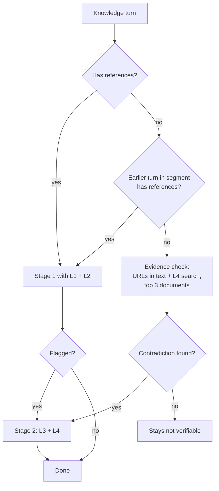

# Data access for the judge: how to set `HIGH` without knowing the truth

| | |
|---|---|
| Problem | `design-doc.md` §6.11, `design.md` Q24 (part of Q12) |
| Status | Adopted for stage 1, 2026-10-23: `design-doc.md` §6.2, §6.7, §6.8, §6.11; `design.md` D23. Stage 2 use of L3/L4 waits for the stage 2 section. Changes on adoption: URLs in the answer text moved from L2 to the evidence check (they give no content without reading the document); a new code `CONTRADICTED_CLAIM` carries `HIGH`; queries use the scrubbed question only until §7 is settled. |
| Builds on | `document-mapping.md` (cited documents → full content), `grounding-metadata.md` (why answers lack references, session-level grounding), `retrieval-linkage.md` (`Search` calls per turn), `cost-quota.md` |

## 1. Summary

1. **The judge does not lack judgement, it lacks data.** Today stage 1 sees only the snippets Bolek chose to cite. It can't check a claim against anything else, and it sees nothing at all for answers without references (~64-72% of web turns).
2. **"True" is defined as "what our indexed documents say".** Bolek's job is to answer from the company's documents. An answer that contradicts them is wrong for Bolek's purpose. If the document itself is wrong, that is a corpus problem (`OUTDATED_SOURCE`, `CONFLICTING_SOURCES`), not an answer error.
3. **Rule: `HIGH` needs a contradicting document.** A turn gets `HIGH` only when an answer span on a knowledge intent is contradicted by an internal document that the assessment actually read. Absence of evidence is never `HIGH`.
4. **Give the judge four levels of evidence, cheapest first:**
   - L1: cited snippets;
   - L2: the references of earlier turns in the same session (URLs in the answer text are read by the evidence check, §5);
   - L3: the full cited documents;
   - L4: the judge's own search of the indexed documents.
5. **L1-L3 need no new data access.** The data is already in the window, or it is already readable (`mcp-document-content`, ~94% of citations). **L4 is the new part.** It is the only way to check answers without references, and claims that Bolek's own retrieval missed.
6. **Blocker to clear first:** the judge's own searches may land in `audit_logs`, where the query text is kept for 30 days. If the query contains words from the answer, answer text would outlive the 4h rule. This must be verified before L4 is adopted (§7).

## 2. The problem in one table

| What the judge has today | What it can conclude |
|---|---|
| A snippet that contradicts an answer span | A confirmed error |
| No snippet that supports an answer span | Only "unsupported". The claim may be wrong, or true but uncited. |
| No references at all | Nothing. The turn is not verifiable. |

The gap is in the last two rows. Better prompting can't close it. Only more evidence can.

## 3. Evidence levels

| Level | Source | Available for | Read by | New access needed |
|---|---|---|---|---|
| **L1** Cited snippets | `references[].content` in the log | ~28% of web turns, most API turns | Stage 1 | No |
| **L2** Session references | References of earlier turns in the same session segment (`grounding-metadata.md` §4). | Lifts verifiable web turns from ~36% to ~61% | Stage 1 | No. Same window, same session key. |
| **L3** Full cited documents | `gs://mcp-document-content/<data_store_id>/<sha256(uri)>.enc`, read with the MCP server's reader | ~94% of citations. Not Google Drive, BQ docs or the people directory. | Stage 2 | No. Already planned for stage 2. |
| **L4** Own search | The judge queries the indexed documents itself, then reads the top results through L3 | Any knowledge turn, with or without references | Stage 2 and the evidence check (§5) | **Yes**: a search identity for the assessor, plus the logging question in §7 |

L4 also covers the case where Bolek cited the wrong document, or none, while the right one exists. That is the case that hurts users most: a confident answer and no warning.

## 4. The `HIGH` rule

> **`HIGH`**: on a knowledge intent, an answer span is contradicted by an internal document that the assessment read (L1-L4). The contradiction must be specific: a different number, name, date, rule or step. "Not mentioned" or "not found" is never `HIGH`.

Who can set it:

| Level used | Who sets `HIGH` | Status |
|---|---|---|
| L1, L2 | Stage 1 | Provisional. It flags the turn for stage 2. |
| L3, L4 | Stage 2 | Final. Stage 2 keeps, drops or adds `HIGH`. |

Metrics use the stage 2 result where it exists (already decided). So a provisional stage-1 `HIGH` counts only on turns that never reach stage 2. By this rule those turns don't exist, because stage-1 `HIGH` always flags the turn. **Every counted `HIGH` is therefore confirmed by stage 2.**

## 5. Which turns get which evidence

- **Verifiable turns** (L1 or L2 exists): stage 1 as designed. Stage 2 for flagged turns now has L4 as well, so it can turn "unsupported" into "contradicted" or "confirmed".
- **Not verifiable knowledge turns:** a new, cheap **evidence check** on `gemini-3.8-flash`. It searches (L4), reads the top 3 documents (capped), and looks only for a specific contradiction. If it finds one, the turn goes to stage 2. Otherwise the turn stays not verifiable, exactly as today. So nothing gets worse, and some real errors become visible.
- Non-knowledge intents (`GENERAL_TASK`, `CHITCHAT`, `OTHER`) and `PEOPLE_LOOKUP` get no L4, the same as they get no groundedness today.

**Volume (rough):** after L2, ~39% of web turns stay without evidence. That is ~350-570 turns per weekday before filtering to knowledge intents, whose share is not measured yet. The evidence check is one flash call with ~3 capped documents. Its size is comparable to stage 1 with full context, so the cost is likely of the order of stage 1 again (~$7-10 per weekday at most). Stage 2 volume grows only by the contradictions found.

## 6. How L4 search works (proposal)

- **Query:** built from the scrubbed question, plus at most the answer's key claims as short phrases. Whether answer phrases may be used depends on §7.
- **Target:** the same engine Bolek uses, with the people directory filtered out (data store `rtb-associates`, `people-connections_*`). Top 10 results. Full content of the top 3 is read through L3, capped per document.
- **Identity:** a dedicated read-only service account for the assessor. It is not a user principal, so `Search` linkage (by user, `retrieval-linkage.md`) never assigns its calls to a real turn. Retrieval statistics must exclude it.
- **Output:** only document IDs or URIs on the allowlist, and codes. The leak guard is unchanged. Documents found by L4 are stored like references, with a source marker (`cited` or `found`).
- **Known limit:** the same engine may miss what it missed for Bolek. L4 helps most where Bolek did not retrieve at all (29% of turns without references had no `Search` call) or answered from context. It helps less on real retrieval misses. Using several query phrasings reduces this, but doesn't remove it.
- **More independent search, if the canary shows too many misses** (2026-10-23): add searches with the answer's key claims (after §7), or a separate keyword search over the decrypted document text. Its ranking differs from the engine's, so its misses are not correlated with Bolek's.
- **BigQuery docs full text (checked 2026-10-23):** the prod engine searches `rtb-bq-documentation-v2`, which has no content. The Cloud Run job `indexer-bq-doc` (`rtbhouse-agentspace`) has a `content_sink` to `rtbhouse-agentspace-mcp-document-content`, but targets `rtb-crj-bq-documentation` and fails every run with 403 on `rtbhouse-core-data-public`, so it has written nothing. Indexers are moving to `rtb-crj-*` data stores, a new bucket and new secrets; the evidence check must read content from wherever the engine's data stores keep it, not from a hard-coded bucket. **Design assumption (user, 2026-10-23): BigQuery docs full text will be readable; the indexer problem is solved separately.**

## 7. Blocker: where the judge's searches are logged

`audit_logs` keeps `userQuery` and the `request` JSON for 30 days. Only `response`, `serviceTextReply` and the principal are cleared at 4h. If the assessor's `Search` calls are exported there:

| Query content | Effect | Acceptable? |
|---|---|---|
| Scrubbed question only | A scrubbed copy of a question that is already kept 30 days. No new kind of data. | Likely yes, to confirm with SECOPS |
| Phrases from the answer | Answer text kept 30 days, which breaks the 4h rule | No |

Ways out, to verify in this order:

1. **Check whether service-account `Search` calls reach `audit_logs` at all.** The export may filter by method or principal. One synthetic call answers it.
2. If they do: **search through a separate engine or serving config** over the same data stores, in a project whose data-access logs are not exported. Verify the cost and the indexing duplication.
3. If neither works: **question-only queries.** L4 still works, but with less precision on multi-claim answers.

## 8. What to verify before adopting

| # | Check | Settles |
|---|---|---|
| V1 | Do the assessor's `Search` calls appear in `audit_logs`, and with which fields? | §7 |
| V2 | On the canary: inject known factual errors into synthetic answers (with and without references). Measure how often L1-L4 finds the contradicting document, and how often a correct answer is wrongly marked `HIGH`. | Whether the rule is precise enough |
| V3 | Share of knowledge intents among turns without references | Evidence-check volume and cost |
| V4 | ~~`gemini-4-argon` price~~ | Accepted (user, 2026-10-23) |
| V5 | SECOPS: assessor service account reading `mcp-document-content` and searching the engine | Access approval |

## 9. Changes to the design if adopted

- `design-doc.md`:
  - §5.3: `HIGH` is reworded per §4 here.
  - §5.2: the judge's inputs gain L2 and L4.
  - §5.7: stage 2 check 2 gains "own search", and a new check row for the evidence check.
  - §5.10: closed, pointing to the new rule.
  - Dictionary: "Evidence check", plus "found" vs "cited" document.
- `design.md`: Q24 answered. Q19 (context-grounded class) is folded into L2. New open items V1-V5.
- `categorizarion.md`, `eli5.md`: the `HIGH` definition and the evidence check, in their own words.
