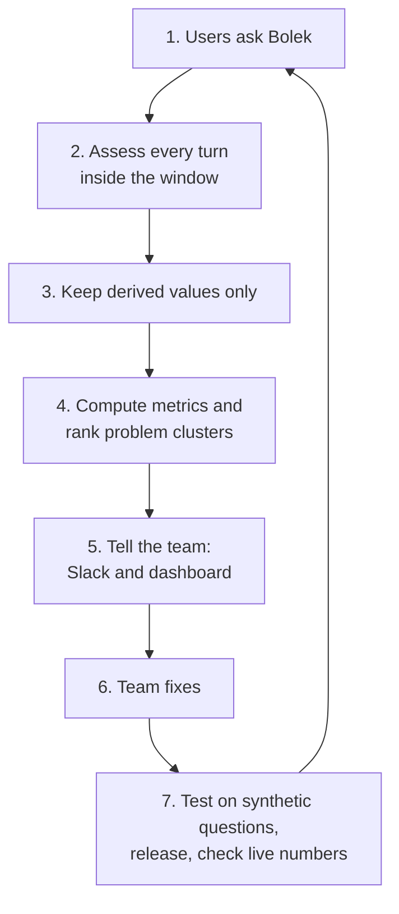
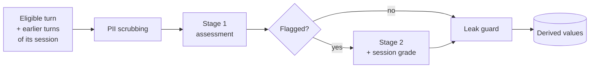
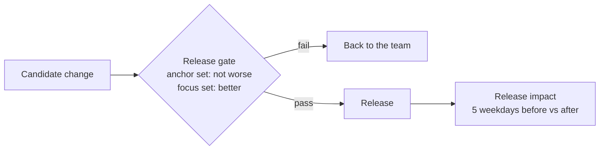
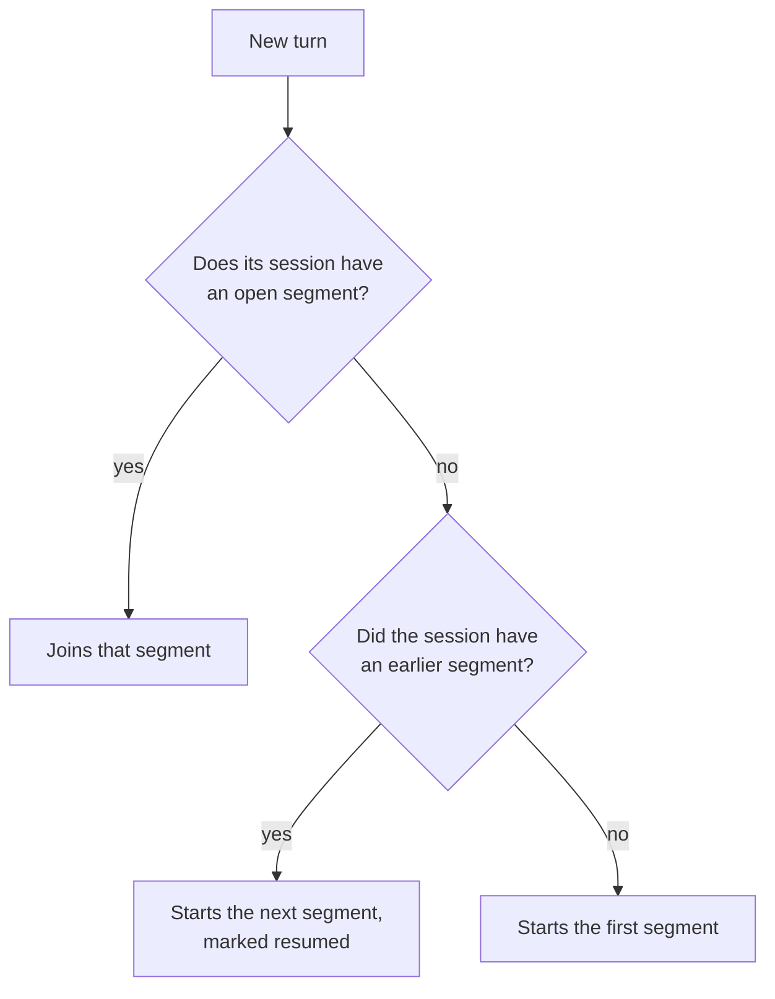
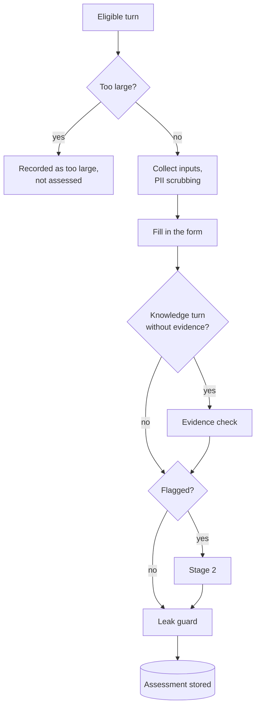
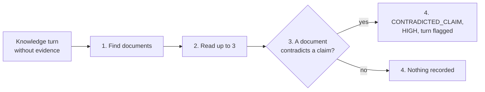
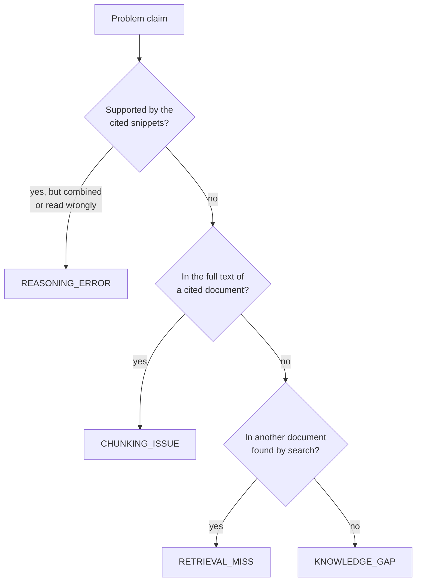
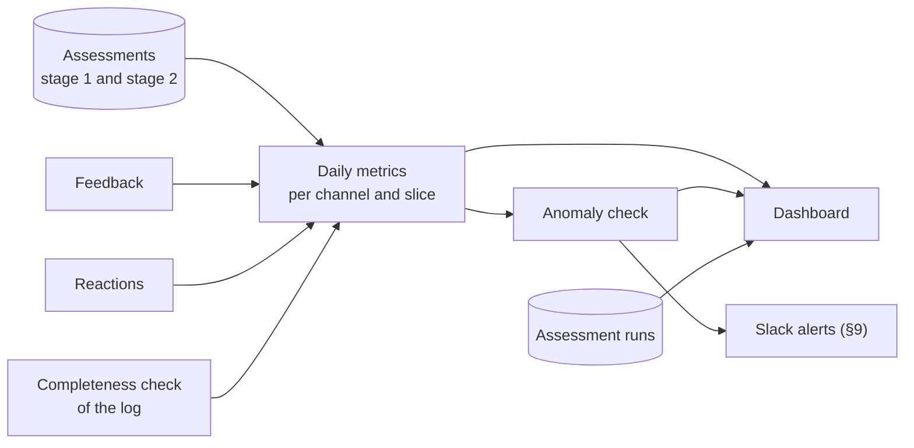
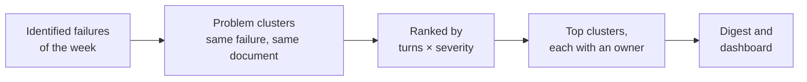

# Conversation Analyzer: Design Document

| | |
|---|---|
| Epic | AIENGLAB-543 (Bolek RAG - Conversation Analyzer), task AIENGLAB-782 |
| Owner | Paweł Borkowski |
| Status | Draft, 2026-10-23. Sections 1-10 written; further sections to follow. |

## 1. Goal

**Raise Bolek's Answer Quality Rate (AQR) on real traffic, and prove every improvement with numbers.**

AQR is the share of verifiable turns whose answer was judged good, standardized to a fixed mix of question types so that a change in what people ask does not look like a change in quality. To raise it, we close Bolek's learning loop: assess every turn, find what to fix, and verify that the fix worked.

### 1.1 Why now

- Bolek answers about 900 to 1,450 questions per weekday on the web UI, and about 115 per day through Slack Bolek and MCP. Nobody knows which answers were good.
- Users give feedback on about 1 answer in 1,000, which is too little to steer by.
- Google erases the answer text, the session ID and the user's identity from the log after about 4 hours. The evidence is gone before anyone could review it.

### 1.2 What we build

An automated assessment of every turn on every channel, done inside the window, that stores **derived values only**: scores, labels from closed lists, and the document IDs of references. From these we compute AQR and the other quality metrics, ranked problem clusters, alerts, a dashboard, and a way to verify releases. Feedback is attached to the assessed turns. When a turn is flagged, its session segment also gets a session grade, shown in alerts as extra context for the team; no metric uses it.

### 1.3 Success criteria

Numeric targets, including the AQR increase, are set after a 4-week baseline period that starts when assessment goes live. No baseline exists today.

| # | Criterion | How we know | Target |
|---|---|---|---|
| 1 | AQR goes up | AQR per day, per channel and for all channels together | Set after the baseline |
| 2 | Every eligible turn is assessed before its answer is erased | Assessed within 3 hours; coverage, the too-large share and the not-verifiable share reported daily | Set after the baseline |
| 3 | No question or answer text is ever stored | Only derived values pass the leak guard; no person reads questions or answers | Always |
| 4 | The team knows what to fix | The weekly digest ranks problem clusters | Weekly |
| 5 | Regressions are noticed quickly | Daily anomaly alerts on the quality metrics | Set after the baseline |
| 6 | A fix can be proven | The release gate before release, then the release impact on the live numbers | Every production change |

### 1.4 Out of scope

- Reading, copying or re-asking real user questions.
- Keeping data longer than the existing 4-hour rule.
- Fixing the problems found. The loop shows the team where to look, and the team owns the fixes.

## 2. Dictionary

Terms used in this document. Each term has exactly one meaning.

- A **turn** is the unit we assess; the **answer** is the text Bolek produced in it.
- An **assessment** grades one turn; a **session grade** grades one session segment.
- A **segment** is always a part of a session; a part of an answer's text is an **answer span**.

### 2.1 Traffic and data

| Term | Definition |
|---|---|
| **Channel** | Where a question comes from: the Gemini Enterprise **web UI**, **Slack Bolek**, or **MCP** (other tools calling Bolek). Evaluator traffic is not a channel. All metrics exist per channel and for all channels together. |
| **Turn** | One user question and Bolek's answer to it: one answer call on the production engine, as recorded in Google's activity log. |
| **Answer** | The text Bolek produced in a turn, with its references. |
| **Session** | A sequence of turns that share the same session ID. The session ID exists only inside the window; we keep only a keyed hash of it, the **session key**, which cannot be turned back into the ID. |
| **Session segment** | A part of a session. A segment closes after **30 minutes without a new turn** (provisional) or is **forced closed** when its oldest turn is 3h30 old. A turn arriving after its session's segment closed starts the next segment, marked **resumed**. For most sessions, one segment is the whole session. |
| **Window** | The roughly **4 hours** after a turn during which its answer text, session ID and the user's identity exist in the log. The question text stays for 30 days. Everything we assess must be read inside the window. |
| **Anonymizer** | The existing job, running every 15 minutes, that erases answer text, session ID and identity from turns older than 4 hours. Because of its schedule, data can last up to about 4h22m. It is not changed by this project. |
| **Feedback** | A user's explicit reaction to an answer. In the web UI: a thumbs up or down, optionally with reason codes from Google's closed list and a free-text comment. In Slack: an emoji reaction. The comment is text, so it is never stored by this system; only the thumbs and the reason codes are. |
| **Reference** | A source snippet Bolek attached to an answer, with the ID and link of its document. |
| **Answer span** | A part of an answer's text that the log links to the references supporting it. Used to count unsupported claims. |
| **Data store** | A collection of documents Bolek searches, such as HR House or the API docs. Each reference belongs to one data store. |
| **People directory** | The data store of employee profiles, used to answer questions about people. Its documents are personal data: they are never stored, never read by the evidence check, and dropped by the leak guard. |
| **Canary** | Synthetic questions from the evaluator that pass through the same log as real traffic. Unlike real turns, engineers may read them, so they are used to test and calibrate the judge. |
| **Derived value** | Anything this system stores: a number, a label from a closed list, a document ID or link, a version. Never question or answer text, summaries, or identity. |

### 2.2 Assessment

| Term | Definition |
|---|---|
| **Assessment** | The form the judge fills in for one turn: closed-list labels and scores only, no free text. Each turn has one stored assessment per rubric version; when the turn is assessed again, the new result replaces it. |
| **Judge** | The language model filling in a form, always on an EU endpoint: `gemini-3.8-flash` for stage 1, `gemini-4-argon` for stage 2 and session grades. |
| **Stage 1** | The assessment every eligible turn gets, within about 5 to 15 minutes, including the evidence check where needed. |
| **Evidence** | The documents an answer is compared with: the turn's own references, the references of earlier turns in the same session segment, or documents found by the evidence check. A claim is wrong only when evidence says something different. |
| **Evidence check** | A step of stage 1 for knowledge turns that have no evidence in the log: the judge searches our documents itself, reads up to 3 of them, and looks for one that contradicts the answer. |
| **Stage 2** | A deeper diagnosis of flagged turns only. The judge also reads the full text of the cited documents and searches our documents itself, and is the only stage that may say *why* something failed, for example that the right document exists but was not found. |
| **Flagged turn** | A turn that goes to stage 2: relevance or groundedness 2 or lower, `HIGH` severity, a dislike, or a late trigger. |
| **Late trigger** | A signal that arrives after the turn was first assessed but while it is still in the window: a dislike, or a next turn that rephrases the question or says the answer was wrong. |
| **Rubric** | The written meaning of each score level plus synthetic example turns, given to the judge. Versioned; results from different versions are only compared through a parallel run. |
| **Intent** | The type of question: `FACT_LOOKUP`, `HOW_TO`, `TROUBLESHOOTING`, `PEOPLE_LOOKUP`, `DATA_QUESTION`, `GENERAL_TASK`, `CHITCHAT`, `OTHER`. `FACT_LOOKUP`, `HOW_TO`, `TROUBLESHOOTING` and `DATA_QUESTION` are **knowledge intents**: question types whose answer may have to come from our documents. Whether a given question really needs internal knowledge is checked per turn (§6.5). Which fields are assessed depends on the intent. |
| **Topic** | The knowledge area of a turn (one per data store, plus `OTHER`). Taken from the data stores of its references; the judge decides it only when there are no references. |
| **Failure type** | A code from a closed list, in five families: retrieval, corpus, generation, question, system. A turn can have several; one is its **primary failure**. Retrieval and corpus codes are assigned only in stage 2. |
| **Identified problem** | A failure that is either deterministic (follows from the data, e.g. no references on a knowledge question) or confirmed against the evidence. Only identified problems are recorded, so failure rates are lower bounds. |
| **Verifiable turn** | A turn whose answer can be checked against sources: any non-knowledge turn, or a knowledge turn with references of its own or of an earlier turn in the same session segment. Other knowledge turns are **not verifiable**: they are reported separately and never counted as good, even after the evidence check. |
| **Severity** | `LOW`, `MEDIUM` or `HIGH`. `HIGH` means a claim on a knowledge question that one of our documents contradicts (`CONTRADICTED_CLAIM`). |
| **Reaction** | How the user's next turn in the same session relates to this one: a follow-up, a rephrase, a correction ("that's wrong"), frustration, or a new topic. A separate metric, never part of the turn's assessment. The last turn of a session has none. |
| **Fingerprint** | A hash of the IDs and versions an assessment depended on (the turn, its context turns, triggers, rubric, model). Never built from text. A turn is assessed again only when its fingerprint changes, so the same input is never assessed twice. |
| **Session facts** | Counts per session segment: number of turns, of rephrases, corrections and frustrations, the duration bucket, whether it was resumed or forced closed. Facts only. |
| **Session grade** | The judge's grade of a whole session segment, made when one of its turns is flagged: outcome (`RESOLVED`, `PARTIALLY_RESOLVED`, `UNRESOLVED`, `UNCLEAR`), the turn where it first went wrong, how often the user had to rephrase, whether the answers recovered after a correction. **Provisional** while the segment is open, **final** after a re-grade at close, **not gradable** when part of the segment's text is already erased. Informational only: no metric or ranking uses it; it is shown in alerts. |
| **PII scrubbing** | Replacing names, emails, phone numbers and similar details with placeholders such as `<PERSON_1>` before any text reaches the judge. The same value gets the same placeholder within a turn and its context. |
| **Leak guard** | The final check before anything is stored or sent: only numbers, closed-list values and allowlisted document links pass. Any free text is rejected. |

### 2.3 Measurement and action

| Term | Definition |
|---|---|
| **Eligible turn** | A turn on any channel, with an answer, between 5 minutes and 3h30 old. |
| **Coverage** | The share of eligible turns that were assessed or skipped as too large. A pipeline health measure, not quality. |
| **Too large** | A turn above the size limit (to be set). It is skipped, not partly assessed, and counted in coverage. |
| **Good answer** | A verifiable turn with relevance 4 or higher, groundedness 4 or higher (knowledge intents only), and no identified `HIGH` severity failure. The user's reaction is not used. |
| **AQR (Answer Quality Rate)** | Good answers divided by assessed verifiable turns, **standardized**: computed per stratum (a slice by intent family × data-store family) and weighted by each stratum's share in the baseline, so a change in what people ask does not look like a change in quality. Also reported raw. |
| **Slice** | A part of the turns that a metric is shown for: a channel, an intent, a topic, a data store, or a stratum of AQR. A slice with fewer turns than the **minimum slice size** (20, a setting) is not shown on its own; it is merged into a bigger slice. |
| **Failure rate** | For one failure type: turns with it as the identified primary failure, divided by assessed turns. A lower bound. |
| **Baseline** | The first 4 weeks after assessment goes live. All numeric targets and the AQR weights are set from it. |
| **Anomaly** | A day on which a metric is unusually far from its recent values, either as a sudden jump or as a slow drift. Found by the daily anomaly check and open until someone acknowledges it. |
| **Problem cluster** | Identified failures grouped by primary failure, data store and document (or by failure and topic when there is no document), ranked weekly by volume and severity. |
| **Alert** | A Slack message sent when something needs attention now: a severe problem cluster after an assessment run, a daily anomaly, or a pipeline health issue. A cluster alert carries the session grades of its turns, and each one can be looked up by the alert's ID. |
| **Digest** | The weekly Slack summary: AQR trend, top problem clusters with owners, best documents and topics, unusual items, release results. |
| **Dashboard** | One Grafana page the team reads every morning: pipeline health, open anomalies, AQR and the other metrics over time, and the problem clusters. It shows daily and weekly aggregates only. |
| **Release gate** | The check every change must pass before release: a paired offline evaluation of the candidate against the current version on synthetic questions. |
| **Anchor set** | About 300 to 500 synthetic questions, fixed per quarter, generated from documents in proportion to how much real traffic uses each data store. Must not get worse at the gate. |
| **Focus set** | 10 to 20 synthetic questions per active problem cluster, generated from its document. Must improve at the gate. |
| **Release impact** | After a release, the live numbers of the 5 weekdays before compared with the 5 weekdays after. It detects only changes of about 2 to 3 percentage points; smaller effects are judged by the gate. |
| **Change event** | A recorded change that can affect quality: a prompt, data store, model, engine or indexer change. Used to annotate alerts and to measure release impact. |

## 3. Principles and constraints

The design follows from a few rules and from what the log lets us see. Everything after this section is built on them.

### 3.1 Rules

| Rule | What it means | Why |
|---|---|---|
| **Derived values only** | The system stores scores, closed-list labels, document IDs, counts and versions. It never stores question text, answer text, summaries, feedback comments or identity. | Questions and answers can contain personal and confidential data. The anonymizer already erases the answers after 4 hours, and we must not rebuild what it removes. |
| **Synthetic questions only** | Tests use questions generated from the documents that real traffic retrieves or cites. Real questions are never re-asked or copied into a test set. | Same reason: real questions stay out of anything we keep. |
| **EU endpoints only** | Text reaches a model only on an EU endpoint (an EU region or the `eu` multi-region, never `global`), and only after PII scrubbing. | Question and answer text must not leave the EU, and personal details must not reach the model. Whether the security team accepts the `eu` multi-region is still open. |
| **Slack for notifications, one dashboard for looking** | Alerts and the digest are sent only to Slack, in messages built from derived values. The dashboard shows only daily and weekly aggregates, with no way down to a single turn. There are no per-session tickets. | One place to be notified and one place to look, and no path for text to leave the system. |
| **Fully automated** | No person reads questions or answers. The judge is tested on canary turns, which may be read. | Requirement of the project. Debugging and calibration use the canary, so there is never a need to look at a real turn. |
| **Only identified problems are reported** | A failure is recorded only when it follows from the data or is confirmed against the sources. When the judge is unsure, the turn is recorded as having no failure. | A false alarm costs the team's trust. The price is that failure rates are lower bounds. |
| **Not verifiable is not good** | A knowledge turn without evidence in the log cannot be checked against sources. It is reported separately, never counted as good and left out of AQR. Errors that the evidence check finds in it still count as identified problems. | Counting it as good would inflate AQR, and counting it as bad would invent failures. |
| **Assessment and reaction stay separate** | The assessment uses only the judge's findings. How the user reacted in the next turn is its own metric. | A rephrase may mean a bad answer or a new thought. Mixing them hides which one it was. |
| **Informational fields drive nothing** | The judge's confidence and the session grade are shown to people but used by no metric, ranking or trigger. | They are hints for the team, not checked results: confidence is the judge's own estimate, and a session grade is often provisional or missing because part of the session is already erased. |
| **All channels, one set of rules** | Web UI, Slack Bolek and MCP are assessed the same way, and every metric exists per channel and combined. | The same Bolek answers all three, so quality has to be comparable between them. |
| **The anonymizer is not touched** | It keeps its 4-hour rule and runs separately from the assessment. We store no list linking turns to sessions. | Changing retention needs a security decision, and such a list would let sessions be rebuilt after the window. |

### 3.2 What the log lets us see

| Fact | Value |
|---|---|
| Window | Answer text, session ID and identity exist for about 4 hours, up to about 4h22m because the anonymizer runs every 15 minutes. |
| Question text | Kept for 30 days. |
| Volume | About 900 to 1,450 web UI turns per weekday, 20 to 140 on a weekend day, and about 115 other API turns per day (810 in one 7-day window), which are Slack Bolek and MCP; the split between the two is not known yet. |
| Feedback | About 0.1 to 0.15% of web UI answers. |
| References | Only about 28 to 36% of web UI answers carry references in the log (three samples of about 390 to 530 turns). Mostly these are answers given without citations, often follow-ups answered from an earlier turn, not a gap in the log. |
| Session ID | Present in the answer, so it is lost with the answer. Each turn has its own token, so tokens cannot group turns into a session. |
| Evaluator traffic | Passes through the same log and is told apart by its prompt prefix. It is used as the canary, never as real traffic. |

### 3.3 What follows from this

| Because | We |
|---|---|
| The evidence disappears after 4 hours | Assess inside the window, with a target of 3 hours and a hard limit of 3h30. |
| Text may not be stored | Keep derived values, and check every write with the leak guard. |
| Feedback is too rare to measure quality | Assess every turn with a judge instead of waiting for feedback. |
| Most web UI answers have no references | Also use the references of earlier turns in the same session, and let the judge search our documents itself for the rest. Knowledge turns with no evidence in the log are not verifiable and are reported separately. |
| The judge does not know what is true at our company | Count a claim as wrong only when one of our documents says something different. |
| Nobody may read real questions or answers | Calibrate the judge on the canary, on injected faults and by comparing it with a second model. |
| Session IDs vanish with the answer | Group turns by a keyed hash of the session ID while it exists, and keep no map. |

## 4. High-level flow

The system is one loop: assess every turn, turn the results into numbers, tell the team, fix, test, release, and check that the numbers moved.

### 4.1 The loop



| # | Step | In one sentence |
|---|---|---|
| 1 | Users ask Bolek | Turns arrive on the web UI, Slack Bolek and MCP; Google logs them, and the window starts. |
| 2 | Assess every turn | Every 10 minutes, new turns are scrubbed of PII and assessed by the judge, before the anonymizer erases the answers. |
| 3 | Keep derived values only | Scores, labels and document IDs are stored; all text is dropped. |
| 4 | Compute metrics and rank problem clusters | Daily metrics (AQR, failure rates, coverage, anomalies) and a weekly ranked list of problem clusters. |
| 5 | Tell the team | Alerts and a weekly digest on Slack, and a dashboard for the daily look, all built only from derived values. |
| 6 | Team fixes | The team changes a prompt, a data store, the indexer, a document or the model. |
| 7 | Test, release, check | The release gate tests the change on synthetic questions; after release, release impact compares the live numbers before and after. |

### 4.2 Step 2 in detail: assessment



Feedback joins the same turn. A dislike that arrives while the turn is still in the window is a late trigger and flags it.

### 4.3 Step 7 in detail: verification



### 4.4 The life of one turn

Everything about a turn must be read before the anonymizer erases its answer.

| Time after the turn | What happens |
|---|---|
| 5 minutes | The turn becomes eligible for assessment. |
| 5 to 15 minutes | Stage 1 assessment, normally. |
| up to 3 hours | Assessment target. |
| up to 3h30 | Hard limit. Late triggers can still start stage 2 and a session grade. A turn not assessed by then is recorded as missed and cannot be recovered. |
| 4 hours (up to 4h22m) | The anonymizer erases the answer, the session ID and the user's identity. |
| 30 days | The question text is deleted. |

### 4.5 Where each guarantee is enforced

| Guarantee | Where |
|---|---|
| No text is stored | Leak guard before every write; the output has no free-text fields. |
| Text goes only to EU endpoints | PII scrubbing, then the judge on the `eu` multi-region. |
| No person reads questions or answers | Every step is automatic; the judge is tested on the canary, not on real turns. |
| Real questions are never re-asked | Verification uses synthetic questions generated from documents. |
| Notifications go only to Slack; the dashboard shows aggregates only | Step 5; messages are built from derived values, and the dashboard's account can read only aggregates. |

## 5. Sessions

People often ask several questions in a row, and a later turn often depends on an earlier one: a follow-up, a rephrase, a "that's wrong". So every turn is assessed together with the earlier turns of its session. All of this happens inside the window, because the session ID is erased together with the answer.

### 5.1 How turns are grouped

- Each turn's record in the log carries its session ID until the window ends. We never keep the ID itself, only the session key.
- Turns with the same session key form a session, ordered by time. Feedback reaches its turn through the same key.
- Every assessment run reads again the turns of a session that are still in the window, including turns assessed in earlier runs, so a new turn always sees the turns before it.
- After the window nothing links a turn to its session any more. Sessions cannot be rebuilt later.

| Channel | What a session is |
|---|---|
| Web UI | One chat. Real conversations of several turns. |
| Slack Bolek, MCP | Nearly every turn has its own session ID, so even a Slack thread is not one session. Until a better grouping is found (§5.5), these turns are assessed on their own. |

### 5.2 Segments

A session can go on for longer than the window. Its first turns would then be erased while the user is still asking, and the session could not be assessed or graded as a whole. So a session is cut into **segments**, each of which fits inside the window.



A segment is open until one of two things happens:

- **30 minutes without a new turn.** The conversation is treated as finished.
- **Its oldest turn is 3h30 old.** The segment is forced closed, so it is complete while all of its text still exists. The anonymizer starts erasing it at 4 hours.

Example of one session:

| Time | What happens | Segment |
|---|---|---|
| 10:00 | Turn 1 | Segment 1 opens |
| 10:04 | Turn 2, a follow-up | Segment 1 |
| 10:09 | Turn 3, a rephrase of turn 2 | Segment 1 |
| 10:39 | 30 minutes without a new turn | Segment 1 closes |
| 11:20 | Turn 4, in the same chat | Segment 2 opens, marked resumed |

For most sessions, one segment is the whole session. When a user comes back after a longer pause, the earlier text usually still exists (§5.5).

The 30 minutes are a starting value. Waiting longer would cut fewer conversations, but keeps segments open and delays their final session grade. So the value is tuned on how often a resumed segment finds its earlier text already erased, not on the pauses alone.

### 5.3 What a turn takes from its session

| What | Used for | From where |
|---|---|---|
| Up to 2 earlier turns, as text | Understanding the question, and checking whether the answer contradicts an earlier one | The same segment |
| The references of all earlier turns | Evidence, when the turn has no references of its own (§6.2) | The same segment |
| The labels and scores of the earlier segment | Context for the first turn of a resumed segment, whose earlier text may already be erased | The previous segment |

- When an earlier turn's text is already erased, the turn is assessed without it, and this is recorded with the assessment.
- The form records how each turn relates to the one before it (§6.4). That label becomes the earlier turn's **reaction**. So a turn's reaction is known only once the next turn is assessed, and the last turn of a session has none.
- If an earlier turn arrives in the log late, the context of the turns after it changes, and they are assessed again (§6.1).

### 5.4 What is stored

**For each turn**, besides its assessment:

| Value | Example |
|---|---|
| Session key and segment number | segment 2 |
| Position in the segment | turn 1 of segment 2 |
| Gap to the previous turn, as a bucket | under 1 min, 1-5 min, 5-30 min, 30-60 min, over 60 min |
| Resumed | yes or no |
| Earlier text missing | yes or no |

**For each segment:** the session facts, computed again each time the segment gets a new turn. A segment one of whose turns was flagged also gets a session grade (§7.6).

### 5.5 Open problems

- **Slack and MCP.** Their turns almost never share a session ID. Is there another key that groups the turns of one Slack thread?
- **The 30 minutes.** Too short cuts real conversations in two; too long keeps a segment open and delays its final session grade (§5.2).
- **Resumed segments.** Most users who come back do so while the earlier text still exists. Should the first turn of a resumed segment then get that text, and fall back to labels and scores only when it is gone?
- **How much context.** Up to 2 earlier turns, or the whole segment up to a size cap? The whole segment would catch more contradictions and rephrases in long conversations, at a higher cost.
- **Chats reopened from history.** Does a chat that the user opens again from the history keep its session ID? If yes, its new turns start a resumed segment; if no, a new session.

## 6. Stage 1: assessing every turn

Every eligible turn gets a stage 1 assessment: a fixed form that the judge fills in. The form has no free text, only labels from closed lists, scores and counts. Each turn has one stored assessment. It may be updated while the turn is in the window (§6.1), and the latest result replaces the earlier one; a rubric change is the only exception (§6.10). Flagged turns go on to stage 2 (§7).

### 6.1 One turn, step by step



**Updates.** A turn is assessed again only when something it depends on changes while it is still in the window (before 3h30):

- a late trigger (a dislike, or a next turn marked `REPHRASE` or `CORRECTION`), which flags the turn;
- an earlier turn of its session that arrived late, so the context is now different.

Each update overwrites the stored assessment, so a turn never counts twice. The fingerprint records what the current assessment was based on, so the same input is never assessed twice.

### 6.2 What the answer is compared with

The judge does not know what is true at our company. It can only compare the answer with documents it is given. So in this design:

> **A claim is wrong when one of our documents says something different.**

Bolek's job is to answer from our documents, so this is the right test for it. If a document is itself wrong, that is a problem of the document, not of the answer. If no document says anything about a claim, the claim is not wrong, only unsupported.

The documents an answer is compared with are its **evidence**. Stage 1 has three kinds, used in this order:

| Evidence | Where it comes from | Web UI turns that have it (one sample of 533 turns) |
|---|---|---|
| 1. The turn's own references | The log | 36% |
| 2. The references of earlier turns in the same session segment | The log | 24% more, mostly follow-ups answered from what Bolek found earlier |
| 3. Documents found by the evidence check | The judge searches our documents itself (§6.8) | Knowledge turns with neither of the above |

- A turn with evidence 1 or 2 is **verifiable**. It gets a groundedness score.
- A knowledge turn with neither gets the **evidence check**. It stays **not verifiable** whatever the check finds: the check can find an error, but it can never prove the answer right. An error it finds is still recorded as an identified problem.

### 6.3 What the judge sees

| Input | Form | Evidence check |
|---|---|---|
| The question | yes | yes |
| The answer, split into answer spans where the log has them | yes | yes |
| The turn's own references (snippets) | yes | (there are none) |
| Up to 2 earlier turns of the same session, and the references of all its earlier turns | yes | no |
| The full text of documents linked in the answer text or found by search | no | yes |

- All text is **PII scrubbed** first. The same person, email or phone number gets the same placeholder across all inputs of a turn, so the judge can still compare them. The mapping exists only in memory during the run.
- A turn above the size limit is **too large**: it is not sent to the judge at all, never cut and partly assessed. The limit is not set yet.
- The judge is `gemini-3.8-flash` on the `eu` multi-region, at temperature 0, answering in a fixed structured format.

### 6.4 The form

| Group | Field | Values |
|---|---|---|
| **What was asked** | Intent | `FACT_LOOKUP`, `HOW_TO`, `TROUBLESHOOTING`, `PEOPLE_LOOKUP`, `DATA_QUESTION`, `GENERAL_TASK`, `CHITCHAT`, `OTHER` |
| | Topic | One per data store, plus `OTHER`. Taken from the references; set by the judge only when there are none. The form records which. |
| | Relation to the previous turn | `FIRST`, `FOLLOW_UP`, `REPHRASE`, `CORRECTION`, `FRUSTRATION`, `NEW_TOPIC`. This becomes the previous turn's reaction. |
| **How good the answer is** | Relevance | 1 to 5: does it answer this question? |
| | Completeness | 1 to 5: does it cover every part of the question? |
| | Clarity | 1 to 5: is it easy to read and use? |
| | Groundedness | 1 to 5: is it supported by its evidence? Verifiable turns only. Where the log splits the answer into answer spans, each span is checked against the references it points to. |
| **Answer span counts** | Unsupported answer spans, total answer spans | Numbers. Only when the log splits the answer into answer spans. |
| **Yes / no checks** | Answer language matches the question; refusal or empty answer; contradicts an earlier answer in the session; needs internal knowledge (knowledge intents only, §6.5) | true or false |
| **What went wrong** | Failure types, primary failure | Codes from §6.6 |
| | Severity | `LOW`, `MEDIUM`, `HIGH`. `HIGH` only for a contradicted claim (§6.7). |
| **Hint** | Confidence | 0 to 1. Informational only. |

What each score level means is set by the rubric: a written meaning of at least levels 1, 3 and 5, in Polish and English, plus synthetic example turns. A first draft of the rubric text exists; it is not yet tuned on the canary.

### 6.5 Which fields apply to which intent

Fields that do not apply to an intent are left empty and are not asked of the judge.

| Intent | Scores | Groundedness | Failure types |
|---|---|---|---|
| Knowledge intents | Relevance, completeness, clarity | Yes, when the turn has evidence 1 or 2. Otherwise the evidence check runs, and the turn is not verifiable. | All stage 1 codes. Not verifiable: deterministic ones, and `CONTRADICTED_CLAIM` from the evidence check. |
| `PEOPLE_LOOKUP` | Relevance only | No | `AGENT_OR_TOOL_ERROR` only |
| `GENERAL_TASK`, `CHITCHAT` | Relevance, completeness, clarity | No | Generation, except the four that need sources (`CONTRADICTED_CLAIM`, `UNSUPPORTED_CLAIM`, `REASONING_ERROR`, `UNGROUNDED_INTERNAL_ANSWER`); question; system |
| `OTHER` | Relevance, completeness, clarity | No | Question and system |

**Knowledge intents and "needs internal knowledge".** The knowledge intents are `FACT_LOOKUP`, `HOW_TO`, `TROUBLESHOOTING` and `DATA_QUESTION`: question types whose answer may have to come from our documents. Not every such question does. "How do I book a business trip?" needs internal knowledge; "How do I write a SQL join?" is also `HOW_TO`, but does not. The judge decides this per turn with the "needs internal knowledge" check, which is asked for knowledge intents only. When it is true and the answer has no references, the turn gets `UNGROUNDED_INTERNAL_ANSWER` (§6.6).

**Why `PEOPLE_LOOKUP` is not a knowledge intent.** Questions about people, such as who owns a project or which team someone is in, are answered from the people directory. Its documents are personal data, so they are never stored or read as evidence. With nothing to check the answer against, only relevance and tool errors are assessed.

This table is the starting point and will be finalized together with the rubric.

### 6.6 Failure types

Stage 1 assigns the generation, question and system codes. The retrieval and corpus codes need the full cited documents, so only stage 2 assigns them.

| Code | Meaning | Assigned in | Usually fixed by |
|---|---|---|---|
| **Retrieval** | | | |
| `RETRIEVAL_MISS` | The right document is indexed but was not found or cited. | Stage 2 | Team: search configuration, indexer |
| `CHUNKING_ISSUE` | The right document was used, but its snippet lost needed context. | Stage 2 | Team: indexer chunking |
| **Corpus** | | | |
| `KNOWLEDGE_GAP` | The information is in no source. | Stage 2 | Corpus owner: add a source |
| `OUTDATED_SOURCE` | The source is stale. | Stage 2 | Document owner |
| `CONFLICTING_SOURCES` | The cited sources contradict each other. | Stage 2 | Document owners |
| **Generation** | | | |
| `CONTRADICTED_CLAIM` | A claim contradicts one of our documents that the assessment read: a different number, name, date, rule or step. | Stage 1 (form or evidence check), stage 2 | Team: prompt, model, search configuration |
| `UNSUPPORTED_CLAIM` | A claim is not supported by its evidence, and no document read contradicts it. | Stage 1 (verifiable turns), stage 2 | Team: prompt, model |
| `REASONING_ERROR` | The sources are fine, but were combined or interpreted wrongly. | Stage 2 | Team: prompt, model |
| `INCOMPLETE_ANSWER` | Parts of the question are not answered. | Stage 1 | Team: prompt |
| `MISUNDERSTOOD_QUERY` | A different question was answered. | Stage 1 | Team: prompt |
| `PRESENTATION_ISSUE` | Wrong language or broken formatting. | Stage 1 | Team: prompt |
| `UNGROUNDED_INTERNAL_ANSWER` | A question that needs internal knowledge was answered with no references at all. | Stage 1, deterministic | Team: prompt, grounding configuration |
| **Question** | | | |
| `AMBIGUOUS_QUESTION` | Too vague to answer well; Bolek should have asked back. | Stage 1 | Team: prompt |
| `OUT_OF_SCOPE` | Not something Bolek should or can answer. | Stage 1 | Communication to users |
| **System** | | | |
| `AGENT_OR_TOOL_ERROR` | A tool or agent failed, or the answer is empty. | Stage 1, deterministic | Team |
| `NONE` | No identified problem. | Both | |

### 6.7 Rules for recording a failure

- **Only identified problems.** A code is recorded only when it is deterministic (follows from the data, like the two marked above) or confirmed against the evidence. If the judge is unsure, the turn gets `NONE`. Failure rates are therefore lower bounds. How strong the confirmation must be for the other stage 1 codes is not decided yet.
- **`HIGH` means contradicted.** `HIGH` severity is set only together with `CONTRADICTED_CLAIM`, on a knowledge intent. A claim that is only unsupported, or about which nothing was found, is at most `MEDIUM`. A `HIGH` always flags the turn.
- **Stage 1 never guesses causes.** It says *what* went wrong, not *why*: retrieval and corpus codes are left to stage 2.
- **Not verifiable turns** get no groundedness score. They can only get deterministic codes and `CONTRADICTED_CLAIM` from the evidence check.
- **Confidence changes nothing.** No rule, threshold or weight uses it.

### 6.8 The evidence check

**What it is for.** About 4 in 10 web UI turns have no evidence in the log (39% in the sample of §6.2). Without the check, a wrong answer on such a turn could never be caught. The check lets the judge look for evidence itself: it finds our documents on the question and reads them. It can find an error, but never prove an answer right, so the turn stays not verifiable either way.

**When it runs.** On knowledge turns with no evidence 1 or 2, right after the form is filled in.



| Step | What happens |
|---|---|
| 1. Find documents | Take the documents linked in the answer text, then search our documents with the scrubbed question. The search leaves out the people directory and returns the top 10. |
| 2. Read | Read the full text of up to 3 of them, each capped in length. |
| 3. Judge | The judge compares the answer with these documents and looks only for a specific contradiction: a different number, name, date, rule or step. It gives no scores. |
| 4. Record | Contradiction found: `CONTRADICTED_CLAIM`, severity `HIGH`, and the turn is flagged. Nothing found: nothing is recorded. Either way, the IDs of the documents read are stored, marked *found*. |

**Boundaries**

- **It checks the answer against our documents, never against Bolek's answers.** The only part it shares with Bolek is the search, to find documents.
- **Shared search, shared blind spots.** If the search can't find the right document for a question, the check usually can't either. Then the error is missed, but nothing false is recorded. The check helps most where Bolek did not search at all, which was the case for 29% of the web UI answers without references in one sample.
- **Not every document can be read.** Full text is kept for every data store except Google Drive, and the people directory is never read.
- **Safe by design.** The search runs under its own read-only account, which is not a user, so its searches never count in any metric. Only document IDs and codes are stored, through the leak guard.
- **Cost.** One judge call with up to 3 documents per checked turn. Not measured yet; at most about the cost of stage 1 again.

### 6.9 Leak guard

Nothing leaves the assessment without passing these checks:

- The output format has **no free-text field**. Every value is a number, a closed-list value, or a document ID or link that matches an allowlist of data stores. Documents found by the evidence check pass the same allowlist.
- People-directory documents are dropped.
- An output that fails the check is retried once, then recorded as failed with an error class. The judge's raw output is never logged.
- Errors reach logs and Slack without any text from the turn.
- An automated test feeds in text with planted personal data and fails if any piece of the input longer than 20 characters appears in the stored result, other than an allowed document link.

### 6.10 Versions stored with every assessment

Each assessment records the rubric version, the failure-list version, the judge model, the prompt version and the assessment code version.

**Rubric or judge model change.** Turns already assessed keep their assessment; they are never re-assessed under the new version. For the first 5 weekdays after the change, every new turn is assessed under both the old and the new version, and both assessments are stored. The difference between them links the metrics across the change, so results from different versions are only ever compared through this parallel run. After it, only the new version is used.

### 6.11 Open problems

| Problem | Why it matters | Next step |
|---|---|---|
| **Are the evidence check's searches written to the log, with their query?** | The log keeps question text for 30 days. A query that held words from the answer would keep answer text past the window. That is why the query is the scrubbed question only. | One synthetic search shows whether these searches reach the log. If they don't, or if a separate search setup keeps them out, the query may also use short phrases from the answer, which finds better documents. |
| **Does the evidence check catch enough errors, without false `HIGH`s?** | A false `HIGH` costs the team's trust; a missed one hides the worst answers. The check uses Bolek's search, so it can share Bolek's blind spots. | On the canary: plant known factual errors in synthetic answers, with and without references, and measure how many are caught and how many correct answers are wrongly marked `HIGH`. If too many are missed, search in a way that does not share Bolek's blind spots: with the answer's key claims, or with a separate keyword search over the document text. |
| **How many turns need the evidence check?** | It sets the cost. | Measure the share of knowledge intents among turns without evidence in the first week. |
| **Access approval** | The judge's account reads the full text of documents and searches them. | Approval by the security team. |

## 7. Stage 2: finding out why

Stage 1 says **what** went wrong with an answer. That is not enough to fix it: an unsupported claim may come from a search that missed the right document, from a document that is out of date, or from a source that does not exist at all, and each has a different owner. Stage 2 finds out **why**. It runs only on flagged turns, reads much more than stage 1, and uses the stronger judge, `gemini-4-argon` on the `eu` multi-region.

When a turn is flagged, stage 2 also grades its whole session segment (§7.6).

### 7.1 When a turn is flagged

| Signal | From | Why it flags |
|---|---|---|
| Relevance 2 or lower | Stage 1 | The answer missed the question. |
| Groundedness 2 or lower | Stage 1 | Most key claims are unsupported, or one is contradicted. |
| `HIGH` severity | Stage 1 or the evidence check | A document contradicts the answer. |
| Dislike | Feedback | The user said the answer was bad. |
| Next turn is `REPHRASE` or `CORRECTION` | The next turn's stage 1 | The user had to ask again or said it was wrong. |

The last two are late triggers: they can arrive after stage 1 is done, up to 3h30 after the turn. A turn is flagged at most once; a second signal adds to the reasons but does not start stage 2 again. Expected share: under 20% of turns, to be measured in the first weeks.

### 7.2 What stage 2 sees

Everything stage 1 saw, plus the documents behind the answer:

| Input | Why |
|---|---|
| The question, the answer, its references, up to 2 earlier turns | As in stage 1 |
| The stage 1 result and the reasons for the flag | So stage 2 knows what to confirm or correct |
| The full text of the cited documents | To see whether the snippet left out what was needed |
| Documents found by its own search of our documents, plus those the evidence check already found | To see whether the right document exists elsewhere |

All of it is PII scrubbed first, and each document is capped in length. The search works as in the evidence check (§6.8): the people directory is left out, and only document IDs are kept.

### 7.3 How the cause is found

Stage 2 follows one path per problem claim. Each question is answered from what it reads, so every code it assigns points at a specific document or a specific absence.



- A turn with no references starts at the third question: there is nothing cited to check.
- Two more checks run on the documents themselves:

| Check | Code |
|---|---|
| A cited document is contradicted by a newer one, or marks itself as replaced | `OUTDATED_SOURCE` |
| Two cited documents say different things on the same point | `CONFLICTING_SOURCES` |

**What and why are both kept.** The stage 1 code (for example `CONTRADICTED_CLAIM`) stays, and stage 2 adds the cause (for example `RETRIEVAL_MISS`). The cause becomes the **primary failure**, because it names who should fix it (§6.6).

**Stage 2 may also correct stage 1.** With the full documents in front of it, it can find that an "unsupported" claim is in fact supported, or that a `HIGH` is not a real contradiction. It then drops the finding.

### 7.4 The stage 2 form

Like stage 1, stage 2 fills in a fixed form with no free text. It has two parts: one entry per problem claim, and a summary for the turn.

**Per problem claim** (at most 3 per turn, the most important first):

| Field | Values |
|---|---|
| Answer span | Its position in the answer, when the log splits the answer into answer spans |
| What | `CONTRADICTED_CLAIM`, `UNSUPPORTED_CLAIM` or `REASONING_ERROR` |
| Why | The cause from §7.3: `CHUNKING_ISSUE`, `RETRIEVAL_MISS`, `KNOWLEDGE_GAP`, or none when the cause is the answer itself |
| Documents | The IDs of the documents behind the finding, each with its role: *cited*, *holds the right answer*, *contradicts the claim*, *outdated* or *conflicting* |

**For the turn:**

| Field | Values |
|---|---|
| Groundedness | 1 to 5, scored again with the full documents |
| Failure types, primary failure | As in stage 1, with the causes added. The primary failure is the cause of the most important claim. |
| Severity | `LOW`, `MEDIUM`, `HIGH`, by the same rule as stage 1 (§6.7) |
| Stage 1 findings | For each stage 1 code: *confirmed* or *dropped* |
| Document to fix | The document a fix should start from: the cited one for `CHUNKING_ISSUE`, the one that holds the right answer for `RETRIEVAL_MISS`, the outdated or conflicting one for those codes. Empty for `KNOWLEDGE_GAP`, which has no document. |
| Confidence | 0 to 1, informational only |

Relevance, completeness and clarity are not scored again: the full documents do not change them. Their stage 1 scores stay in use.

The "document to fix" groups problem clusters by document, so the team sees, for example, "Document X caused 12 retrieval misses this week".

### 7.5 Results

- **Both results are kept.** The stage 1 result is not overwritten; a turn that was never flagged simply has no stage 2 result.
- **Metrics use the stage 2 result where it exists.** A turn whose findings stage 2 dropped can count as a good answer again.
- **Keeping both shows how often stage 2 changes stage 1.** A high rate means the stage 1 rubric needs work.
- The same leak guard (§6.9) and versions (§6.10) apply.

### 7.6 Session grade

When a turn is flagged, the judge also grades its whole session segment: did the user get what they needed, and if not, where did it go wrong. It reads the text of all turns of the segment, together with their stage 1 and stage 2 results.

| Field | Values | How it is set |
|---|---|---|
| Outcome | `RESOLVED`, `PARTIALLY_RESOLVED`, `UNRESOLVED`, `UNCLEAR` | Judged, by the meanings below |
| First bad turn | The position of the first turn where it went wrong | Judged: the first turn with an identified problem of `MEDIUM` or `HIGH` severity, or the first one the user corrected. Empty when nothing went wrong. |
| Rephrases | 0, 1, 2 or more | Counted, not judged: turns whose relation to the previous turn is `REPHRASE` or `CORRECTION` |
| Recovered after correction | `YES`, `NO`, `NO_CORRECTION` | Judged: after the user's first correction, did a later answer give what was asked, without an identified problem? |
| Confidence | 0 to 1 | Informational only |

**What each outcome means.** The user's need is what they were trying to get from the segment as a whole, not from one turn.

| Outcome | Meaning |
|---|---|
| `RESOLVED` | By the end of the segment the user got what they needed: the last answer on their need is relevant and has no `MEDIUM` or `HIGH` problem, and the user did not correct it or show frustration afterwards. Earlier bad answers are allowed if a later one fixed them. |
| `PARTIALLY_RESOLVED` | The user had several needs, or a need with several parts, and only some were met by the end. |
| `UNRESOLVED` | The need was not met by the end: the last answer on it has a `MEDIUM` or `HIGH` problem, or the user's last turn is a correction or shows frustration. |
| `UNCLEAR` | The judge cannot tell what the user needed, or whether it was met, for example when the segment ends right after an answer that cannot be checked. |

The level meanings and example segments are written in Polish and English, like the stage 1 rubric, and tuned on synthetic multi-turn sessions in the canary.

**Why a grade can change.** A turn is often flagged while the user is still chatting, and alerts go out soon after a flag, before anyone knows how the chat ended. So the first grade covers only the turns so far, and the segment is graded again once it closes.

| State | When | Example |
|---|---|---|
| **Provisional** | Graded when a turn is flagged, on the turns so far. It stays provisional if the re-grade at close does not happen, for example when the job is down. | 10:02, turn 2 is flagged: `UNRESOLVED` so far |
| **Final** | Graded again on all its turns when the segment closes. This normally always happens: a segment closes after 30 minutes without a new turn, or at the latest when its oldest turn is 3h30 old, before the text is erased at 4 hours. If the segment has already closed when the turn is flagged (for example a dislike that comes an hour later), the first grade is final at once. | 10:35, after the user rephrased at 10:05 and got a good answer: `RESOLVED`, recovered after correction |
| **Not gradable** | Part of the segment's text was already erased when the turn was flagged, so no grade is made. | A dislike arrives 3 hours after a turn late in a long segment, whose first turns are already more than 4 hours old |

An alert shows the grade it had when it was sent and says whether it was provisional. Looking a grade up later by the alert's ID shows the latest one.

**Informational only.** No metric, ranking or trigger uses the session grade. It is shown in Slack cluster alerts as context: for example "5 turns, unresolved (provisional), went wrong at turn 2, rephrased 2 or more times". Each grade behind an alert can be looked up by the alert's ID.

### 7.7 Open problems

| Problem | Why it matters | Next step |
|---|---|---|
| **`KNOWLEDGE_GAP` rests on not finding something** | Search can miss a document that exists, so this is the least certain code. | Measure on the canary with questions whose answer is known to be in a document; report the code with that miss rate. |
| **Share of flagged turns** | Sets the cost; expected under 20%. | Measure in the first weeks. |
| **The canary has no multi-turn sessions** | The session grade can't be tuned on single synthetic questions. | Add 20 to 50 synthetic conversations of 3 to 5 turns, sent in one session. |

## 8. Metrics

Assessments are made per turn. Metrics turn them into a few numbers per day that say whether Bolek is getting better or worse, and where. The numbers are shown on one dashboard (§8.8), and they drive the alerts and the digest (§9).

### 8.1 From assessments to numbers



- **Once a day, for the day before.** A turn's assessment can still change until 3h30 after the turn: a late trigger can flag it, and stage 2 can change its result. So a day's numbers are computed only once its last turns are past that point, early the next morning.
- **Pipeline health is the exception.** It comes from the assessment runs themselves and is shown as soon as a run ends.
- **Numbers are recomputed, never added up.** Each day is computed again from the stored assessments, so a re-run gives the same result.

### 8.2 Which turns count

- **Every turn of the production engine, on every channel.** Canary turns never count.
- **One result per turn.** The stage 2 result where it exists, otherwise the stage 1 result (§7.5).
- **One rubric version at a time.** During the parallel run after a rubric or judge model change (§6.10), metrics use the old version, and switch to the new one when the run ends. The switch is marked on the dashboard.
- **Users whose pace is not human are left out.** A user with more than 10 turns in 10 minutes is most likely a script. Their turns are left out of the metrics for that day and only counted, so the exclusion itself can be watched.
- **Days with a gap in the log are marked incomplete.** Every hour, the number of log records is compared with the usual number for that hour and weekday, per channel. A day with a gap is still shown, but marked, and it is left out of every baseline. This is how a broken log export is told apart from a real drop in quality.
- **Weekdays and weekends are compared only with their own kind.** Weekend traffic is about a tenth of weekday traffic, and it is different.

### 8.3 The metrics

| Metric | Question it answers | How it is computed |
|---|---|---|
| **Quality** | | |
| **AQR, standardized** | Are answers getting better? | Good answers divided by assessed verifiable turns, weighted to the baseline question mix (§8.4). The main number. |
| AQR, raw | Did the question mix change? | The same without weighting. When raw and standardized AQR move apart, people ask different things; quality did not change. |
| Not verifiable share | How much of the traffic can we not check? | Not verifiable knowledge turns divided by knowledge turns. Shown with the evidence mix: own references, earlier turns' references, none. If it grows, AQR covers less of the traffic. |
| **What goes wrong** | | |
| Failure rate, per failure type | Which kind of problem grows? | Turns with that type as their primary failure, divided by assessed turns. A lower bound, because only identified problems count. |
| Contradicted claims | How often do we say something our documents contradict? | Turns with `HIGH` severity, as a count and as a share of assessed knowledge turns. The most serious error. |
| Unsupported claims | How often do answers say more than their evidence? | Verifiable knowledge turns with at least one unsupported answer span, divided by verifiable knowledge turns. |
| **User reactions** (never part of AQR) | | |
| Negative reaction rate | Do users push back? | Turns whose next turn is a rephrase, a correction or frustration, divided by turns that have a next turn. |
| Dislike rate | Do users complain? | Dislikes divided by turns. About 1 in 1,000, so it is shown as a count, for information only. |
| **Usage** (must not drop while AQR rises) | | |
| Volume | How much is Bolek used? | Turns per day and channel. |
| Active users, 7-day retention | Do people keep coming back? | As Google reports them for the engine, about 3 days late. |
| **Pipeline health** | | |
| Coverage | Did we assess everything? | Assessed and too-large turns divided by eligible turns. Target 98%. |
| Too-large share | How much do we skip? | Too-large turns divided by eligible turns. |
| Missed turns | Did we lose any? | Turns not assessed by 3h30. They can never be assessed. |
| Oldest waiting turn | Are we falling behind? | The age of the oldest eligible turn not yet assessed, per run. |
| Log completeness | Is the input whole? | Hours with a gap in the log, per channel (§8.2). |

### 8.4 Standardized AQR

**Why.** Some kinds of questions are answered better than others. If people ask more of the easy kind in one week, AQR rises although no answer got better. Standardizing removes that effect.

**Example.** HR fact questions are answered well, API how-to questions less well. In week 2 there are many more HR questions, for example during payroll season:

| Stratum | Share in the baseline | Week 1: share, AQR | Week 2: share, AQR |
|---|---|---|---|
| HR, fact lookup | 50% | 50%, 90% | 80%, 90% |
| API docs, how-to | 50% | 50%, 60% | 20%, 60% |
| **Raw AQR** | | **75%** | **84%** |
| **Standardized AQR** | | **75%** | **75%** |

Raw AQR rose by 9 points, but no answer got better. Standardized AQR shows that correctly.

**How.**

1. Turns are split into **strata**: intent family × data-store family, about 10 to 20 strata.
2. AQR is computed per stratum and day.
3. The stratum AQRs are added up, each weighted by the stratum's share of turns in the baseline.
4. A stratum below the minimum slice size on a day is merged into its family (§8.5).

The weights stay fixed. They change only by a deliberate rebase, for example when a new data store is added, and the rebase is recorded as a change event.

### 8.5 Slices and the minimum size

Every metric exists per channel and for all channels together, and can be split further by intent, topic and data store. Each such part is a **slice**.

A small slice jumps around by chance. With 20 turns, one bad answer moves its rate by 5 points. So a slice with fewer turns than the **minimum slice size** in the period shown is not shown on its own: it is merged into a bigger slice (its family, or "other"), and can be looked at per week instead of per day.

The minimum slice size is **20 turns**. It is a setting, kept in one place, so it can be changed without changing the metrics.

In practice, Slack Bolek and MCP have about 115 turns a day together. Their daily lines are rough, and they are best read per week.

### 8.6 Baseline and targets

The baseline is the first 4 weeks after assessment goes live. From it we set:

- the numeric targets of §1.3, including the AQR increase;
- the stratum weights of standardized AQR (§8.4);
- the first reference values for the anomaly check (§8.7).

Pipeline health is alerted on from the first day. Quality anomalies are alerted on once 14 complete days of the same kind exist, so weekend checks start weeks later than weekday checks.

### 8.7 Spotting anomalies

An anomaly check runs every day on standardized AQR, each failure rate, the negative reaction rate and coverage, per channel and for all channels together. It compares the day with the same kind of days before it (weekdays with weekdays, weekends with weekends).

| Check | What it catches | Rule |
|---|---|---|
| **Sudden jump** | A release or a data store that broke something overnight | The day's value is more than 3 noise levels away from the reference value. |
| **Slow drift** | Documents slowly going stale, a gradual model change | Small daily differences in the same direction add up; an alert is raised when the sum passes a limit (a CUSUM check, with 0.5 and 4 noise levels). |

- **Reference value:** the rate over the last 28 complete days of the same kind (14 while there are fewer), without days that belong to an open anomaly.
- **Noise level:** the larger of two: what pure chance gives for that day's number of turns, and how much the days in the reference period really varied. The second is usually larger, because one person asking many questions makes days less alike than chance alone.
- **Skipped:** days with fewer than 100 turns, and incomplete days.
- **An anomaly stays open until someone acknowledges it.** The reference period then restarts from that day, so a lasting change raises one alert, not one every day.
- **Each anomaly lists the change events of the 48 hours before it**, marked "likely caused by". An anomaly without one is marked "unexplained".

**What it can see.** On all web UI turns, a daily check notices a change of about 3 percentage points, and a weekly view about 1 to 1.5 points. For Slack Bolek and MCP, only changes of more than about 10 points show on a single day. Smaller effects of a release are judged by the release gate (§10). With about 20 checks a day, expect roughly one false alarm a month.

### 8.8 The dashboard

**What it is for.** Slack tells the team when something needs attention now (§9). The dashboard is where the team looks every morning: is the pipeline healthy, is anything unusual, and is quality moving after the last fixes. It is built in **Grafana** and reads the daily and weekly aggregates from BigQuery.

**Layout.** One page, read from top to bottom. The first rows answer "can I trust today's numbers?", the last ones "what should we work on?". Values below are made up.

```text
┌─ Filters: channel ▾  period ▾  weekdays / weekends ▾     Markers: change events, rubric switches ─┐
│ 1. IS THE PIPELINE HEALTHY?                                                                       │
│  [Coverage 99.2%]  [Missed 0]  [Oldest waiting 42 min]  [Too large 0.3%]  [Log complete: yes]     │
├───────────────────────────────────────────────────────────────────────────────────────────────────┤
│ 2. ANYTHING UNUSUAL?                                                                              │
│  Open anomalies: metric · value vs reference · since · change events before it · acknowledged     │
├───────────────────────────────────────────────────────────────────────────────────────────────────┤
│ 3. IS QUALITY MOVING?                                                     [AQR 78%, +1.2 vs ref.] │
│  AQR standardized and raw, per day, with 7-day average and the reference band                     │
│  Not verifiable share and evidence mix                                    [Contradicted today: 3] │
├───────────────────────────────────────────────────────────────────────────────────────────────────┤
│ 4. WHAT GOES WRONG?                                                                               │
│  Failure rates by type, stacked per day          │  Contradicted and unsupported claims per day   │
├───────────────────────────────────────────────────────────────────────────────────────────────────┤
│ 5. WHERE?                                                                                         │
│  AQR by topic × week (heat map)                  │  Question mix by intent over time              │
├───────────────────────────────────────────────────────────────────────────────────────────────────┤
│ 6. HOW DO USERS REACT?                                                                            │
│  Negative reaction rate (rephrase / correction / frustration) · dislikes · volume · active users  │
├───────────────────────────────────────────────────────────────────────────────────────────────────┤
│ 7. WHAT TO FIX, AND DID IT HELP?                                                                  │
│  Top problem clusters this week (§9)             │  Change events with their release impact (§10) │
└───────────────────────────────────────────────────────────────────────────────────────────────────┘
```

| Row | Panels | Use it to |
|---|---|---|
| 1. Pipeline health | Coverage, missed turns, oldest waiting turn, too-large share, log completeness | Decide whether today's numbers can be trusted. If this row is red, fix the pipeline before reading the rest. |
| 2. Anomalies | Open anomalies with their change events and acknowledgement | See what the anomaly check found, and acknowledge it or start work on it. |
| 3. Quality | Standardized and raw AQR with the reference band; not verifiable share; evidence mix; contradicted claims today | See the trend. If raw and standardized AQR move apart, the question mix changed, not quality. |
| 4. Failures | Failure rates per type; contradicted and unsupported claims | Find which kind of problem moved. |
| 5. Where | AQR per topic and week; question mix per intent | Find where it moved: which topic or data store. |
| 6. Users | Negative reaction rate, dislikes, volume, active users | Check that users see the same as the judge, and that usage does not drop. |
| 7. Fix and verify | Top problem clusters; change events with release impact; weekly turns still in the top clusters of the baseline | Pick the next fix, and see whether the last one helped. |

**Reading it each morning (about 5 minutes).**

1. Row 1: is everything green? If not, the other numbers for that day are not reliable.
2. Row 2: any open anomaly? Read the change events before it, then acknowledge it or start work on it.
3. Row 3: is AQR inside its reference band, and going the right way since the last change?
4. Rows 4 and 5, only when something moved: which failure type, which topic.
5. Once a week, with the digest: row 7.

**Rules.**

- **Aggregates only.** The dashboard reads only daily and weekly aggregates, through a read-only account that cannot see per-turn assessments. There is no drill-down to a single turn.
- **Days, not hours.** Quality numbers are per day or week. Only pipeline health is per run.
- **Small slices are merged** (§8.5), so no panel shows a number based on fewer turns than the minimum slice size.
- **Incomplete days and weekends are marked**, so a gap in the log or a quiet Sunday does not look like a drop in quality.
- **Session grades are not shown.** They are informational and appear only in alerts (§7.6).

### 8.9 Open problems

| Problem | Why it matters | Next step |
|---|---|---|
| **The strata are not defined** | Standardized AQR needs the intent families and data-store families before the baseline starts. | Define 10 to 20 strata from the first days of data, then freeze them with the baseline. |
| **The too-large size limit is not set** | Coverage and the too-large share depend on it. | Set it from the sizes of turns in the first days. |
| **Slack feedback** | Where Slack emoji reactions are logged, and how they join a turn, is not known yet. Until then the dislike rate covers the web UI only. | Find the source and the join key with the Slack Bolek owner. |
| **Which Grafana, and who sees it** | The aggregates hold no text, but who may see quality per topic and data store must still be agreed. | Choose the Grafana instance and the viewer group, and agree it with the security team. |

## 9. From numbers to action

Metrics say whether quality moves. This section says how the team learns **what to fix and who fixes it**: identified failures become a short weekly list of concrete problems, each with an owner, and urgent problems reach the team the same day.

### 9.1 The weekly fix list



- **A problem cluster** holds the failures with the same primary failure and the same document: the document to fix where stage 2 named one (§7.4), otherwise the cited document. When there is no document, as for a knowledge gap, the topic is used instead.
- **Ranking:** each cluster's turns of the week, weighted by their severity, and compared with the 4 weeks before. The starting weights are 3 for `HIGH`, 2 for `MEDIUM` and 1 for `LOW`; they are tuned after the baseline.
- **Owner:** follows from the failure type (§6.6): the team for prompt, model, search and indexer problems, a document owner for outdated or conflicting documents, a corpus owner for missing knowledge.

Example entry: *"HR House, document X: 12 contradicted claims this week, up from 3. Owner: the document owner."*

### 9.2 How the team hears about it

| Where | When | What |
|---|---|---|
| Alert on Slack | Right away | A cluster of `HIGH` failures after an assessment run, an anomaly (§8.7), or a pipeline health problem. Cluster alerts carry the session grades of their turns as context (§7.6). |
| Digest on Slack | Weekly | AQR trend, the top clusters with owners and trends, the best documents and topics, release results. |
| Dashboard | Every morning | Everything above, over time (§8.8). |

All of it is built from derived values only.

### 9.3 When a fix counts as done

1. The fix is recorded as a change event and linked to the clusters it should fix.
2. Before release, it must pass the release gate: better on synthetic questions about the cluster's document, and not worse on everything else (§10).
3. After release, the cluster is **closed** when its weekly turns stay below a quarter of their level before the fix for 2 weeks in a row. Until then it stays on the list.

Over time, the number of turns still in the baseline's top clusters shows whether the loop is working at all.

## 10. Verification

Every change has to be proven twice: before release on synthetic questions, and after release on the live numbers (§4.3). Real questions are never used for this.

### 10.1 Synthetic questions

The evaluator generates questions from our documents, each with the document it should be answered from.

| Set | Size | Built from | Purpose |
|---|---|---|---|
| **Anchor set** | 300 to 500 questions | Documents of every data store, in proportion to how often real traffic cites or retrieves them (at least 20 per data store). Fixed for a quarter. | Must not get worse. |
| **Focus set** | 10 to 20 questions per active problem cluster | The cluster's document. A knowledge gap gets one once the missing document is added. | Must get better. |

Before a question is used, it is checked automatically: it can be answered from its document, it is not a duplicate, and it contains nothing from the people directory. When the anchor set is replaced each quarter, the old and new sets run side by side for 2 weeks so the results stay comparable.

### 10.2 Release gate

1. The candidate runs on a test engine, and the current version answers the same questions. Every run is repeated twice.
2. **Pass:** not worse on the anchor set, and better on the focus sets of the clusters the change targets.
3. A difference counts only if it is larger than the spread between two runs of the same version.

A change that fails goes back to the team.

### 10.3 Release impact

After release, standardized AQR and the failure rates of the 5 complete weekdays before the change are compared with the 5 after it.

- **Verdict:** improved, regressed, no detectable change, or *confounded* when another change falls in the same days.
- **What it can see:** about 3 percentage points on all web UI turns, about 6 points for a data store with 15% of the traffic. Smaller effects are left to the release gate.
- **Same rubric on both sides.** If the rubric or the judge model changed in between, the comparison waits for the parallel run (§6.10).
- **A regression** is investigated or rolled back. Every verdict goes into the digest and onto the dashboard.
