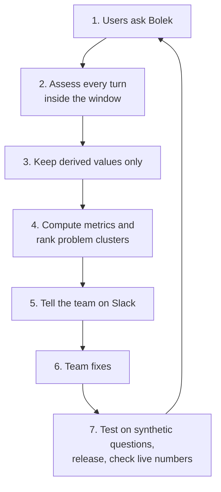
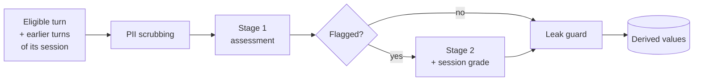
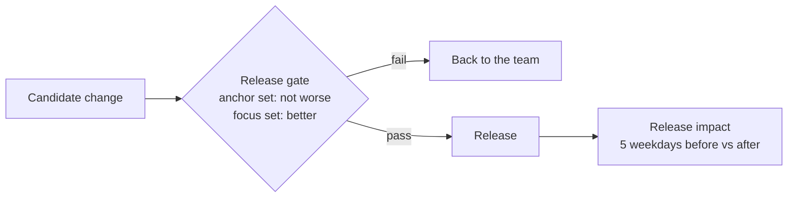
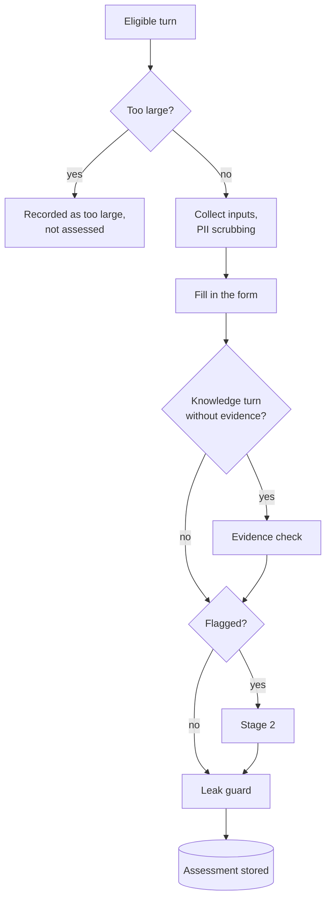
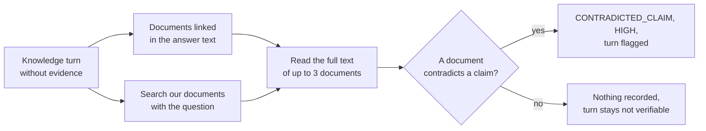

# Bolek Quality Loop: Design Document

| | |
|---|---|
| Epic | AIENGLAB-543 (Bolek RAG - Conversation Analyzer), task AIENGLAB-782 |
| Owner | Paweł Borkowski |
| Status | Draft, 2026-10-23. Sections 1-5 written (§5 covers stage 1); stage 2 and further sections to follow. |

## 1. Goal

**Raise Bolek's Answer Quality Rate (AQR) on real traffic, and prove every improvement with numbers.**

AQR is the share of verifiable turns whose answer was judged good, standardized to a fixed mix of question types so that a change in what people ask does not look like a change in quality. To raise it, we close Bolek's learning loop: assess every turn, find what to fix, and verify that the fix worked.

### 1.1 Why now

- Bolek answers about 900 to 1,450 questions per weekday on the web UI, and about 115 per day through Slack Bolek and MCP. Nobody knows which answers were good.
- Users give feedback on about 1 answer in 1,000, which is too little to steer by.
- Google erases the answer text, the session ID and the user's identity from the log after about 4 hours. The evidence is gone before anyone could review it.

### 1.2 What we build

An automated assessment of every turn on every channel, done inside the window, that stores **derived values only**: scores, labels from closed lists, and the document IDs of references. From these we compute AQR and the other quality metrics, ranked problem clusters, alerts, and a way to verify releases. Feedback is attached to the assessed turns. When a turn is flagged, its session segment also gets a session grade, shown in alerts as extra context for the team; no metric uses it.

### 1.3 Success criteria

Numeric targets, including the AQR increase, are set after a 4-week baseline period that starts when assessment goes live. No baseline exists today.

| # | Criterion | How we know | Target |
|---|---|---|---|
| 1 | AQR goes up | AQR per day, per channel and for all channels together | Set after the baseline |
| 2 | Every eligible turn is assessed before its answer is erased | Assessed within 3 hours; coverage, the too-large share and the not-verifiable share reported daily | Set after the baseline |
| 3 | No question or answer text is ever stored | Only derived values pass the leak guard; no person reads questions or answers | Always |
| 4 | The team knows what to fix | The weekly digest ranks problem clusters | Weekly |
| 5 | Regressions are noticed quickly | Daily anomaly alerts on the quality metrics | Set after the baseline |
| 6 | A fix can be proven | The release gate before release, then the release impact on the live numbers | Every production change |

### 1.4 Out of scope

- Reading, copying or re-asking real user questions.
- Keeping data longer than the existing 4-hour rule.
- Fixing the problems found. The loop shows the team where to look, and the team owns the fixes.

## 2. Dictionary

Terms used in this document. Each term has exactly one meaning.

- A **turn** is the unit we assess; the **answer** is the text Bolek produced in it.
- An **assessment** grades one turn; a **session grade** grades one session segment.
- A **segment** is always a part of a session; a part of an answer's text is an **answer span**.

### 2.1 Traffic and data

| Term | Definition |
|---|---|
| **Channel** | Where a question comes from: the Gemini Enterprise **web UI**, **Slack Bolek**, or **MCP** (other tools calling Bolek). Evaluator traffic is not a channel. All metrics exist per channel and for all channels together. |
| **Turn** | One user question and Bolek's answer to it: one answer call on the production engine, as recorded in Google's activity log. |
| **Answer** | The text Bolek produced in a turn, with its references. |
| **Session** | A sequence of turns that share the same session ID. The session ID exists only inside the window; we keep only a keyed hash of it, the **session key**, which cannot be turned back into the ID. |
| **Session segment** | A part of a session. A segment closes after **30 minutes without a new turn** (provisional) or is **forced closed** when its oldest turn is 3h30 old. A turn arriving after its session's segment closed starts the next segment, marked **resumed**. For most sessions, one segment is the whole session. |
| **Window** | The roughly **4 hours** after a turn during which its answer text, session ID and the user's identity exist in the log. The question text stays for 30 days. Everything we assess must be read inside the window. |
| **Anonymizer** | The existing job, running every 15 minutes, that erases answer text, session ID and identity from turns older than 4 hours. Because of its schedule, data can last up to about 4h22m. It is not changed by this project. |
| **Feedback** | A user's explicit reaction to an answer. In the web UI: a thumbs up or down, optionally with reason codes from Google's closed list and a free-text comment. In Slack: an emoji reaction. The comment is text, so it is never stored by this system; only the thumbs and the reason codes are. |
| **Reference** | A source snippet Bolek attached to an answer, with the ID and link of its document. |
| **Answer span** | A part of an answer's text that the log links to the references supporting it. Used to count unsupported claims. |
| **Data store** | A collection of documents Bolek searches, such as HR House or the API docs. Each reference belongs to one data store. |
| **People directory** | The data store of employee profiles, used to answer questions about people. Its documents are personal data: they are never stored, never read by the evidence check, and dropped by the leak guard. |
| **Canary** | Synthetic questions from the evaluator that pass through the same log as real traffic. Unlike real turns, engineers may read them, so they are used to test and calibrate the judge. |
| **Derived value** | Anything this system stores: a number, a label from a closed list, a document ID or link, a version. Never question or answer text, summaries, or identity. |

### 2.2 Assessment

| Term | Definition |
|---|---|
| **Assessment** | The form the judge fills in for one turn: closed-list labels and scores only, no free text. Each turn has one stored assessment per rubric version; when the turn is assessed again, the new result replaces it. |
| **Judge** | The language model filling in a form, always on an EU endpoint: `gemini-3.8-flash` for stage 1, `gemini-4-argon` for stage 2 and session grades. |
| **Stage 1** | The assessment every eligible turn gets, within about 5 to 15 minutes, including the evidence check where needed. |
| **Evidence** | The documents an answer is compared with: the turn's own references, the references of earlier turns in the same session segment, or documents found by the evidence check. A claim is wrong only when evidence says something different. |
| **Evidence check** | A step of stage 1 for knowledge turns that have no evidence in the log: the judge searches our documents itself, reads up to 3 of them, and looks for one that contradicts the answer. |
| **Stage 2** | A deeper diagnosis of flagged turns only. The judge also reads the full source documents and is the only stage that may say *why* something failed, for example that the right document exists but was not found. |
| **Flagged turn** | A turn that goes to stage 2: relevance or groundedness 2 or lower, `HIGH` severity, a dislike, or a late trigger. |
| **Late trigger** | A signal that arrives after the turn was first assessed but while it is still in the window: a dislike, or a next turn that rephrases the question or says the answer was wrong. |
| **Rubric** | The written meaning of each score level plus synthetic example turns, given to the judge. Versioned; results from different versions are only compared through a parallel run. |
| **Intent** | The type of question: `FACT_LOOKUP`, `HOW_TO`, `TROUBLESHOOTING`, `PEOPLE_LOOKUP`, `DATA_QUESTION`, `GENERAL_TASK`, `CHITCHAT`, `OTHER`. `FACT_LOOKUP`, `HOW_TO`, `TROUBLESHOOTING` and `DATA_QUESTION` are **knowledge intents**: question types whose answer may have to come from our documents. Whether a given question really needs internal knowledge is checked per turn (§5.5). Which fields are assessed depends on the intent. |
| **Topic** | The knowledge area of a turn (one per data store, plus `OTHER`). Taken from the data stores of its references; the judge decides it only when there are no references. |
| **Failure type** | A code from a closed list, in five families: retrieval, corpus, generation, question, system. A turn can have several; one is its **primary failure**. Retrieval and corpus codes are assigned only in stage 2. |
| **Identified problem** | A failure that is either deterministic (follows from the data, e.g. no references on a knowledge question) or confirmed against the evidence. Only identified problems are recorded, so failure rates are lower bounds. |
| **Verifiable turn** | A turn whose answer can be checked against sources: any non-knowledge turn, or a knowledge turn with references of its own or of an earlier turn in the same session segment. Other knowledge turns are **not verifiable**: they are reported separately and never counted as good, even after the evidence check. |
| **Severity** | `LOW`, `MEDIUM` or `HIGH`. `HIGH` means a claim on a knowledge question that one of our documents contradicts (`CONTRADICTED_CLAIM`). |
| **Reaction** | How the user's next turn in the same session relates to this one: a follow-up, a rephrase, a correction ("that's wrong"), frustration, or a new topic. A separate metric, never part of the turn's assessment. The last turn of a session has none. |
| **Fingerprint** | A hash of the IDs and versions an assessment depended on (the turn, its context turns, triggers, rubric, model). Never built from text. A turn is assessed again only when its fingerprint changes, so the same input is never assessed twice. |
| **Session facts** | Counts per session segment: number of turns, of rephrases, corrections and frustrations, the duration bucket, whether it was resumed or forced closed. Facts only. |
| **Session grade** | The judge's grade of a whole session segment, made when one of its turns is flagged: outcome (`RESOLVED`, `PARTIALLY_RESOLVED`, `UNRESOLVED`, `UNCLEAR`), the turn where it first went wrong, how often the user had to rephrase, whether the answers recovered after a correction. **Provisional** while the segment is open, **final** after a re-grade at close, **not gradable** when part of the segment's text is already erased. Informational only: no metric or ranking uses it; it is shown in alerts. |
| **PII scrubbing** | Replacing names, emails, phone numbers and similar details with placeholders such as `<PERSON_1>` before any text reaches the judge. The same value gets the same placeholder within a turn and its context. |
| **Leak guard** | The final check before anything is stored or sent: only numbers, closed-list values and allowlisted document links pass. Any free text is rejected. |

### 2.3 Measurement and action

| Term | Definition |
|---|---|
| **Eligible turn** | A turn on any channel, with an answer, between 5 minutes and 3h30 old. |
| **Coverage** | The share of eligible turns that were assessed or skipped as too large. A pipeline health measure, not quality. |
| **Too large** | A turn above the size limit (to be set). It is skipped, not partly assessed, and counted in coverage. |
| **Good answer** | A verifiable turn with relevance 4 or higher, groundedness 4 or higher (knowledge intents only), and no identified `HIGH` severity failure. The user's reaction is not used. |
| **AQR (Answer Quality Rate)** | Good answers divided by assessed verifiable turns, **standardized**: computed per stratum (intent family × data-store family) and weighted by each stratum's share in the baseline, so a change in what people ask does not look like a change in quality. Also reported raw. |
| **Failure rate** | For one failure type: turns with it as the identified primary failure, divided by assessed turns. A lower bound. |
| **Baseline** | The first 4 weeks after assessment goes live. All numeric targets and the AQR weights are set from it. |
| **Problem cluster** | Identified failures grouped by primary failure, data store and document (or by failure and topic when there is no document), ranked weekly by volume and severity. |
| **Alert** | A Slack message sent when something needs attention now: a severe problem cluster after an assessment run, a daily anomaly, or a pipeline health issue. A cluster alert carries the session grades of its turns, and each one can be looked up by the alert's ID. |
| **Digest** | The weekly Slack summary: AQR trend, top problem clusters with owners, best documents and topics, unusual items, release results. |
| **Release gate** | The check every change must pass before release: a paired offline evaluation of the candidate against the current version on synthetic questions. |
| **Anchor set** | About 300 to 500 synthetic questions, fixed per quarter, generated from documents in proportion to how much real traffic uses each data store. Must not get worse at the gate. |
| **Focus set** | 10 to 20 synthetic questions per active problem cluster, generated from its document. Must improve at the gate. |
| **Release impact** | After a release, the live numbers of the 5 weekdays before compared with the 5 weekdays after. It detects only changes of about 2 to 3 percentage points; smaller effects are judged by the gate. |
| **Change event** | A recorded change that can affect quality: a prompt, data store, model, engine or indexer change. Used to annotate alerts and to measure release impact. |

## 3. Principles and constraints

The design follows from a few rules and from what the log lets us see. Everything after this section is built on them.

### 3.1 Rules

| Rule | What it means | Why |
|---|---|---|
| **Derived values only** | The system stores scores, closed-list labels, document IDs, counts and versions. It never stores question text, answer text, summaries, feedback comments or identity. | Questions and answers can contain personal and confidential data. The anonymizer already erases the answers after 4 hours, and we must not rebuild what it removes. |
| **Synthetic questions only** | Tests use questions generated from the documents that real traffic retrieves or cites. Real questions are never re-asked or copied into a test set. | Same reason: real questions stay out of anything we keep. |
| **EU endpoints only** | Text reaches a model only on an EU endpoint (an EU region or the `eu` multi-region, never `global`), and only after PII scrubbing. | Question and answer text must not leave the EU, and personal details must not reach the model. Whether the security team accepts the `eu` multi-region is still open. |
| **Notifications only on Slack** | Alerts and the digest are sent only to Slack, in messages built from derived values. There are no per-session tickets. A dashboard may be added later; it is not part of this design yet. | One place for the team to be notified, and no path for text to leave the system. |
| **Fully automated** | No person reads questions or answers. The judge is tested on canary turns, which may be read. | Requirement of the project. Debugging and calibration use the canary, so there is never a need to look at a real turn. |
| **Only identified problems are reported** | A failure is recorded only when it follows from the data or is confirmed against the sources. When the judge is unsure, the turn is recorded as having no failure. | A false alarm costs the team's trust. The price is that failure rates are lower bounds. |
| **Not verifiable is not good** | A knowledge turn without evidence in the log cannot be checked against sources. It is reported separately, never counted as good and left out of AQR. Errors that the evidence check finds in it still count as identified problems. | Counting it as good would inflate AQR, and counting it as bad would invent failures. |
| **Assessment and reaction stay separate** | The assessment uses only the judge's findings. How the user reacted in the next turn is its own metric. | A rephrase may mean a bad answer or a new thought. Mixing them hides which one it was. |
| **Informational fields drive nothing** | The judge's confidence and the session grade are shown to people but used by no metric, ranking or trigger. | They are hints for the team, not checked results: confidence is the judge's own estimate, and a session grade is often provisional or missing because part of the session is already erased. |
| **All channels, one set of rules** | Web UI, Slack Bolek and MCP are assessed the same way, and every metric exists per channel and combined. | The same Bolek answers all three, so quality has to be comparable between them. |
| **The anonymizer is not touched** | It keeps its 4-hour rule and runs separately from the assessment. We store no list linking turns to sessions. | Changing retention needs a security decision, and such a list would let sessions be rebuilt after the window. |

### 3.2 What the log lets us see

| Fact | Value |
|---|---|
| Window | Answer text, session ID and identity exist for about 4 hours, up to about 4h22m because the anonymizer runs every 15 minutes. |
| Question text | Kept for 30 days. |
| Volume | About 900 to 1,450 web UI turns per weekday, 20 to 140 on a weekend day, and about 115 other API turns per day (810 in one 7-day window), which are Slack Bolek and MCP; the split between the two is not known yet. |
| Feedback | About 0.1 to 0.15% of web UI answers. |
| References | Only about 28 to 36% of web UI answers carry references in the log (three samples of about 390 to 530 turns). Mostly these are answers given without citations, often follow-ups answered from an earlier turn, not a gap in the log. |
| Session ID | Present in the answer, so it is lost with the answer. Each turn has its own token, so tokens cannot group turns into a session. |
| Evaluator traffic | Passes through the same log and is told apart by its prompt prefix. It is used as the canary, never as real traffic. |

### 3.3 What follows from this

| Because | We |
|---|---|
| The evidence disappears after 4 hours | Assess inside the window, with a target of 3 hours and a hard limit of 3h30. |
| Text may not be stored | Keep derived values, and check every write with the leak guard. |
| Feedback is too rare to measure quality | Assess every turn with a judge instead of waiting for feedback. |
| Most web UI answers have no references | Also use the references of earlier turns in the same session, and let the judge search our documents itself for the rest. Knowledge turns with no evidence in the log are not verifiable and are reported separately. |
| The judge does not know what is true at our company | Count a claim as wrong only when one of our documents says something different. |
| Nobody may read real questions or answers | Calibrate the judge on the canary, on injected faults and by comparing it with a second model. |
| Session IDs vanish with the answer | Group turns by a keyed hash of the session ID while it exists, and keep no map. |

## 4. High-level flow

The system is one loop: assess every turn, turn the results into numbers, tell the team, fix, test, release, and check that the numbers moved.

### 4.1 The loop

| # | Step | In one sentence |
|---|---|---|
| 1 | Users ask Bolek | Turns arrive on the web UI, Slack Bolek and MCP; Google logs them, and the window starts. |
| 2 | Assess every turn | Every 10 minutes, new turns are scrubbed of PII and assessed by the judge, before the anonymizer erases the answers. |
| 3 | Keep derived values only | Scores, labels and document IDs are stored; all text is dropped. |
| 4 | Compute metrics and rank problem clusters | Daily metrics (AQR, failure rates, coverage, anomalies) and a weekly ranked list of problem clusters. |
| 5 | Tell the team on Slack | Alerts and a weekly digest, built only from derived values. |
| 6 | Team fixes | The team changes a prompt, a data store, the indexer, a document or the model. |
| 7 | Test, release, check | The release gate tests the change on synthetic questions; after release, release impact compares the live numbers before and after. |

### 4.2 Step 2 in detail: assessment

Feedback joins the same turn. A dislike that arrives while the turn is still in the window is a late trigger and flags it.

### 4.3 Step 7 in detail: verification

### 4.4 The life of one turn

Everything about a turn must be read before the anonymizer erases its answer.

| Time after the turn | What happens |
|---|---|
| 5 minutes | The turn becomes eligible for assessment. |
| 5 to 15 minutes | Stage 1 assessment, normally. |
| up to 3 hours | Assessment target. |
| up to 3h30 | Hard limit. Late triggers can still start stage 2 and a session grade. A turn not assessed by then is recorded as missed and cannot be recovered. |
| 4 hours (up to 4h22m) | The anonymizer erases the answer, the session ID and the user's identity. |
| 30 days | The question text is deleted. |

### 4.5 Where each guarantee is enforced

| Guarantee | Where |
|---|---|
| No text is stored | Leak guard before every write; the output has no free-text fields. |
| Text goes only to EU endpoints | PII scrubbing, then the judge on the `eu` multi-region. |
| No person reads questions or answers | Every step is automatic; the judge is tested on the canary, not on real turns. |
| Real questions are never re-asked | Verification uses synthetic questions generated from documents. |
| Notifications go only to Slack | Step 5; messages are built from derived values. |

## 5. Stage 1: assessing every turn

Every eligible turn gets a stage 1 assessment: a fixed form that the judge fills in. The form has no free text, only labels from closed lists, scores and counts. Each turn has one stored assessment. It may be updated while the turn is in the window (§5.1), and the latest result replaces the earlier one; a rubric change is the only exception (§5.10). Flagged turns go on to stage 2, which is described in a later section.

### 5.1 One turn, step by step

**Updates.** A turn is assessed again only when something it depends on changes while it is still in the window (before 3h30):

- a late trigger (a dislike, or a next turn marked `REPHRASE` or `CORRECTION`), which flags the turn;
- an earlier turn of its session that arrived late, so the context is now different.

Each update overwrites the stored assessment, so a turn never counts twice. The fingerprint records what the current assessment was based on, so the same input is never assessed twice.

### 5.2 What the answer is compared with

The judge does not know what is true at our company. It can only compare the answer with documents it is given. So in this design:

> **A claim is wrong when one of our documents says something different.**

Bolek's job is to answer from our documents, so this is the right test for it. If a document is itself wrong, that is a problem of the document, not of the answer. If no document says anything about a claim, the claim is not wrong, only unsupported.

The documents an answer is compared with are its **evidence**. Stage 1 has three kinds, used in this order:

| Evidence | Where it comes from | Web UI turns that have it (one sample of 533 turns) |
|---|---|---|
| 1. The turn's own references | The log | 36% |
| 2. The references of earlier turns in the same session segment | The log | 24% more, mostly follow-ups answered from what Bolek found earlier |
| 3. Documents found by the evidence check | The judge searches our documents itself (§5.8) | Knowledge turns with neither of the above |

- A turn with evidence 1 or 2 is **verifiable**. It gets a groundedness score.
- A knowledge turn with neither gets the **evidence check**. It stays **not verifiable** whatever the check finds: the check can find an error, but it can never prove the answer right. An error it finds is still recorded as an identified problem.

### 5.3 What the judge sees

| Input | Form | Evidence check |
|---|---|---|
| The question | yes | yes |
| The answer, split into answer spans where the log has them | yes | yes |
| The turn's own references (snippets) | yes | (there are none) |
| Up to 2 earlier turns of the same session, and the references of all its earlier turns | yes | no |
| The full text of documents linked in the answer text or found by search | no | yes |

- All text is **PII scrubbed** first. The same person, email or phone number gets the same placeholder across all inputs of a turn, so the judge can still compare them. The mapping exists only in memory during the run.
- A turn above the size limit is **too large**: it is not sent to the judge at all, never cut and partly assessed. The limit is not set yet.
- The judge is `gemini-3.8-flash` on the `eu` multi-region, at temperature 0, answering in a fixed structured format.

### 5.4 The form

| Group | Field | Values |
|---|---|---|
| **What was asked** | Intent | `FACT_LOOKUP`, `HOW_TO`, `TROUBLESHOOTING`, `PEOPLE_LOOKUP`, `DATA_QUESTION`, `GENERAL_TASK`, `CHITCHAT`, `OTHER` |
| | Topic | One per data store, plus `OTHER`. Taken from the references; set by the judge only when there are none. The form records which. |
| | Relation to the previous turn | `FIRST`, `FOLLOW_UP`, `REPHRASE`, `CORRECTION`, `FRUSTRATION`, `NEW_TOPIC`. This becomes the previous turn's reaction. |
| **How good the answer is** | Relevance | 1 to 5: does it answer this question? |
| | Completeness | 1 to 5: does it cover every part of the question? |
| | Clarity | 1 to 5: is it easy to read and use? |
| | Groundedness | 1 to 5: is it supported by its evidence? Verifiable turns only. Where the log splits the answer into answer spans, each span is checked against the references it points to. |
| **Answer span counts** | Unsupported answer spans, total answer spans | Numbers. Only when the log splits the answer into answer spans. |
| **Yes / no checks** | Answer language matches the question; refusal or empty answer; contradicts an earlier answer in the session; needs internal knowledge (knowledge intents only, §5.5) | true or false |
| **What went wrong** | Failure types, primary failure | Codes from §5.6 |
| | Severity | `LOW`, `MEDIUM`, `HIGH`. `HIGH` only for a contradicted claim (§5.7). |
| **Hint** | Confidence | 0 to 1. Informational only. |

What each score level means is set by the rubric: a written meaning of at least levels 1, 3 and 5, in Polish and English, plus synthetic example turns. A first draft of the rubric text exists; it is not yet tuned on the canary.

### 5.5 Which fields apply to which intent

Fields that do not apply to an intent are left empty and are not asked of the judge.

| Intent | Scores | Groundedness | Failure types |
|---|---|---|---|
| Knowledge intents | Relevance, completeness, clarity | Yes, when the turn has evidence 1 or 2. Otherwise the evidence check runs, and the turn is not verifiable. | All stage 1 codes. Not verifiable: deterministic ones, and `CONTRADICTED_CLAIM` from the evidence check. |
| `PEOPLE_LOOKUP` | Relevance only | No | `AGENT_OR_TOOL_ERROR` only |
| `GENERAL_TASK`, `CHITCHAT` | Relevance, completeness, clarity | No | Generation, except the four that need sources (`CONTRADICTED_CLAIM`, `UNSUPPORTED_CLAIM`, `REASONING_ERROR`, `UNGROUNDED_INTERNAL_ANSWER`); question; system |
| `OTHER` | Relevance, completeness, clarity | No | Question and system |

**Knowledge intents and "needs internal knowledge".** The knowledge intents are `FACT_LOOKUP`, `HOW_TO`, `TROUBLESHOOTING` and `DATA_QUESTION`: question types whose answer may have to come from our documents. Not every such question does. "How do I book a business trip?" needs internal knowledge; "How do I write a SQL join?" is also `HOW_TO`, but does not. The judge decides this per turn with the "needs internal knowledge" check, which is asked for knowledge intents only. When it is true and the answer has no references, the turn gets `UNGROUNDED_INTERNAL_ANSWER` (§5.6).

**Why `PEOPLE_LOOKUP` is not a knowledge intent.** Questions about people, such as who owns a project or which team someone is in, are answered from the people directory. Its documents are personal data, so they are never stored or read as evidence. With nothing to check the answer against, only relevance and tool errors are assessed.

This table is the starting point and will be finalized together with the rubric.

### 5.6 Failure types

Stage 1 assigns the generation, question and system codes. The retrieval and corpus codes need the full cited documents, so only stage 2 assigns them.

| Code | Meaning | Assigned in | Usually fixed by |
|---|---|---|---|
| **Retrieval** | | | |
| `RETRIEVAL_MISS` | The right document is indexed but was not found or cited. | Stage 2 | Team: search configuration, indexer |
| `CHUNKING_ISSUE` | The right document was used, but its snippet lost needed context. | Stage 2 | Team: indexer chunking |
| **Corpus** | | | |
| `KNOWLEDGE_GAP` | The information is in no source. | Stage 2 | Corpus owner: add a source |
| `OUTDATED_SOURCE` | The source is stale. | Stage 2 | Document owner |
| `CONFLICTING_SOURCES` | The cited sources contradict each other. | Stage 2 | Document owners |
| **Generation** | | | |
| `CONTRADICTED_CLAIM` | A claim contradicts one of our documents that the assessment read: a different number, name, date, rule or step. | Stage 1 (form or evidence check), stage 2 | Team: prompt, model, search configuration |
| `UNSUPPORTED_CLAIM` | A claim is not supported by its evidence, and no document read contradicts it. | Stage 1 (verifiable turns), stage 2 | Team: prompt, model |
| `REASONING_ERROR` | The sources are fine, but were combined or interpreted wrongly. | Stage 2 | Team: prompt, model |
| `INCOMPLETE_ANSWER` | Parts of the question are not answered. | Stage 1 | Team: prompt |
| `MISUNDERSTOOD_QUERY` | A different question was answered. | Stage 1 | Team: prompt |
| `PRESENTATION_ISSUE` | Wrong language or broken formatting. | Stage 1 | Team: prompt |
| `UNGROUNDED_INTERNAL_ANSWER` | A question that needs internal knowledge was answered with no references at all. | Stage 1, deterministic | Team: prompt, grounding configuration |
| **Question** | | | |
| `AMBIGUOUS_QUESTION` | Too vague to answer well; Bolek should have asked back. | Stage 1 | Team: prompt |
| `OUT_OF_SCOPE` | Not something Bolek should or can answer. | Stage 1 | Communication to users |
| **System** | | | |
| `AGENT_OR_TOOL_ERROR` | A tool or agent failed, or the answer is empty. | Stage 1, deterministic | Team |
| `NONE` | No identified problem. | Both | |

### 5.7 Rules for recording a failure

- **Only identified problems.** A code is recorded only when it is deterministic (follows from the data, like the two marked above) or confirmed against the evidence. If the judge is unsure, the turn gets `NONE`. Failure rates are therefore lower bounds. How strong the confirmation must be for the other stage 1 codes is not decided yet.
- **`HIGH` means contradicted.** `HIGH` severity is set only together with `CONTRADICTED_CLAIM`, on a knowledge intent. A claim that is only unsupported, or about which nothing was found, is at most `MEDIUM`. A `HIGH` always flags the turn.
- **Stage 1 never guesses causes.** It says *what* went wrong, not *why*: retrieval and corpus codes are left to stage 2.
- **Not verifiable turns** get no groundedness score. They can only get deterministic codes and `CONTRADICTED_CLAIM` from the evidence check.
- **Confidence changes nothing.** No rule, threshold or weight uses it.

### 5.8 The evidence check

The evidence check lets the judge look for evidence itself when the log has none. It runs on knowledge turns without evidence 1 or 2: about 4 in 10 web UI turns before filtering by intent (39% in the sample of §5.2).

- **Search.** The query is the scrubbed question. It runs on the same documents Bolek searches, with the people directory left out, and takes the top 10 results.
- **Reading.** The full text of up to 3 documents is read, each capped in length. Full text is kept for about 94% of the documents Bolek cites; Google Drive, the BigQuery documentation and the people directory have none.
- **Judging.** The judge looks only for a specific contradiction. It does not score the answer.
- **Identity.** The search runs under its own read-only account, which is not a user. Its searches are never mistaken for a user's searches or counted in any metric.
- **Stored.** The document IDs of the documents read, each marked as *found* (by this check) or *cited* (by Bolek), and the result.
- **Limit.** The check searches the same documents with the same search that Bolek uses, so it can miss what Bolek missed. It helps most where Bolek did not search at all, which was the case for 29% of the web UI answers without references in one sample.
- **Cost.** One judge call with up to 3 documents per checked turn. Not measured yet; at most about the cost of stage 1 again.

### 5.9 Leak guard

Nothing leaves the assessment without passing these checks:

- The output format has **no free-text field**. Every value is a number, a closed-list value, or a document ID or link that matches an allowlist of data stores. Documents found by the evidence check pass the same allowlist.
- People-directory documents are dropped.
- An output that fails the check is retried once, then recorded as failed with an error class. The judge's raw output is never logged.
- Errors reach logs and Slack without any text from the turn.
- An automated test feeds in text with planted personal data and fails if any piece of the input longer than 20 characters appears in the stored result, other than an allowed document link.

### 5.10 Versions stored with every assessment

Each assessment records the rubric version, the failure-list version, the judge model, the prompt version and the assessment code version.

**Rubric or judge model change.** Turns already assessed keep their assessment; they are never re-assessed under the new version. For the first 5 weekdays after the change, every new turn is assessed under both the old and the new version, and both assessments are stored. The difference between them links the metrics across the change, so results from different versions are only ever compared through this parallel run. After it, only the new version is used.

### 5.11 Open problems

| Problem | Why it matters | Next step |
|---|---|---|
| **Are the evidence check's searches written to the log, with their query?** | The log keeps question text for 30 days. A query that held words from the answer would keep answer text past the window. That is why the query is the scrubbed question only. | One synthetic search shows whether these searches reach the log. If they don't, or if a separate search setup keeps them out, the query may also use short phrases from the answer, which finds better documents. |
| **Is the `HIGH` rule precise enough?** | A false `HIGH` costs the team's trust; a missed one hides the worst answers. | On the canary: plant known factual errors in synthetic answers, with and without references, and measure how many are found and how many correct answers are wrongly marked `HIGH`. |
| **How many turns need the evidence check?** | It sets the cost. | Measure the share of knowledge intents among turns without evidence in the first week. |
| **Access approval** | The judge's account reads the full text of documents and searches them. | Approval by the security team. |
