# Conversation Analyzer: Design Document

| | |
|---|---|
| Epic | AIENGLAB-543 (Bolek RAG - Conversation Analyzer), task AIENGLAB-782 |
| Owner | Paweł Borkowski |
| Status | Draft, 2026-10-27. Revised 2026-11-02: no document index or search of our own; the user's department in the strata; stage and prod environments; no PII scrubbing. Deployment: `deployment-plan.md`. |

## 1. Goal

**Raise Bolek's Answer Quality Rate (AQR) on real traffic, and prove every improvement with numbers.**

AQR is the share of verifiable turns whose answer was judged good, standardized to a fixed mix of question types, data stores and departments so that a change in what people ask does not look like a change in quality. To raise it, we close Bolek's learning loop: assess every turn, find what to fix, and verify that the fix worked.

### 1.1 Why now

- Bolek answers about 900 to 1,450 questions per weekday on the web UI, and about 115 per day through Slack Bolek and MCP. Nobody knows which answers were good.
- Users give feedback on about 1 answer in 1,000, which is too little to steer by.
- After about 4 hours, our existing anonymizer job erases the answer text, the session ID and the user's identity from the log. The answers are gone before anyone can review them.

### 1.2 What we build

We build an automated assessment of every turn on every channel. It runs while the answer still exists, and it stores **derived values only**: scores, labels from closed lists, and the document IDs of references. From these values come AQR and the other quality metrics, a ranked list of problem clusters, Slack alerts and a weekly digest, a dashboard, and the checks that verify a release. Feedback is attached to the assessed turns. When a turn is flagged, its session segment also gets a session grade, shown in alerts as extra context for the team; no metric uses it.

### 1.3 Success criteria

Coverage has a fixed target of 98%. All other numeric targets, including the AQR increase, are set after a 4-week baseline period that starts when assessment goes live. No baseline exists today.

| # | Criterion | How we know | Target |
|---|---|---|---|
| 1 | AQR goes up | AQR per day, per channel and for all channels together, with the not-verifiable share next to it | Set after the baseline |
| 2 | Every eligible turn is assessed before its answer is erased | Coverage and the too-large share, reported daily; the target time is 3 hours after the turn | 98% coverage |
| 3 | No question or answer text is stored, and no person reads it | Only derived values pass the leak guard; every step is automatic | Always |
| 4 | The team knows what to fix | The weekly digest ranks problem clusters | Weekly |
| 5 | Regressions are noticed quickly | Daily anomaly alerts on the quality metrics | Set after the baseline |
| 6 | A fix can be proven | The release gate before release, then the release impact on the live numbers | Every production change |

### 1.4 Out of scope

- Reading, copying or re-asking real user questions.
- Changing how long the log keeps data. The 4-hour rule for answers, session IDs and identity stays as it is.
- Measuring response time: the log records no latency.
- Fixing the problems found. The loop shows where to look; the team, document owners and corpus owners make the fixes (§9.1).

## 2. Dictionary

Terms used in this document. Each term has exactly one meaning.

- A **turn** is the unit we assess; the **answer** is the text Bolek produced in it.
- An **assessment** grades one turn; a **session grade** grades one session segment.
- A **segment** is always a part of a session; a part of an answer's text is an **answer span**.
- **Feedback** is a rating the user gives an answer; a **reaction** is what the user's next turn shows about it.

### 2.1 Traffic and data

| Term | Definition |
|---|---|
| **Bolek** | Our company assistant, built on Google Gemini Enterprise. It answers employees' questions from our documents. |
| **Channel** | Where a question comes from: the Gemini Enterprise **web UI**, **Slack Bolek** (Bolek's Slack bot), or **MCP** (other tools that call Bolek through the Model Context Protocol). Evaluator traffic is not a channel. All metrics exist per channel and for all channels together. Until the log can tell Slack Bolek and MCP apart, they are reported together as one channel (§8.9). A **Slack channel**, where Slack messages are posted, is a different thing. |
| **Engine** | A Gemini Enterprise setup of Bolek: its prompt, model and data stores. Real traffic and the canary use the production engine; test engines are used for the release gate. |
| **Log** | Google's activity log of Bolek, exported to our BigQuery: one record per answer, search call and feedback event. It is the only record of what users asked and what Bolek answered. |
| **Turn** | One user question and Bolek's answer to it: one answer call on the production engine, as recorded in the log. |
| **Answer** | The text Bolek produced in a turn, with its references. |
| **Session** | A sequence of turns that share the same session ID. The session ID exists only inside the window; we keep only a keyed hash of it, the **session key**, which cannot be turned back into the ID. |
| **Session segment** | A part of a session. A segment closes after **30 minutes without a new turn** (a starting value, §5.2) or is **forced closed** when its oldest turn is 3h30 old. A turn arriving after its session's segment closed starts the next segment, marked **resumed**. For most sessions, one segment is the whole session. |
| **Window** | The roughly **4 hours** after a turn during which its answer text, session ID and the user's identity exist in the log. The question text stays for 30 days. Everything we assess must be read inside the window. |
| **Anonymizer** | Our existing job that erases answer text, session ID and identity from log records older than 4 hours. It runs every 15 minutes, but runs can be up to 22 minutes apart, so data can last up to about 4h22m. It is not changed by this project. |
| **Feedback** | A user's explicit rating of an answer. In the web UI: a thumbs up or down, optionally with reason codes from Google's closed list and a free-text comment. In Slack: an emoji on the answer, collected only if a way to gather them is found (§8.9). A thumbs down, or an emoji that means the same, is a **dislike**. Feedback stays in the log for 30 days. The comment is text, so it is never stored by this system; only the thumbs and the reason codes are. |
| **Reference** | A source snippet Bolek attached to an answer, with the ID and link of its document, the **cited document**. |
| **Answer span** | A part of an answer's text that the log links to the references it cites. Used to count unsupported claims. |
| **Data store** | A collection of documents Bolek searches, such as HR House or the API docs. Each reference belongs to one data store. All data stores together are the **corpus**; a **corpus owner** decides what a data store should contain. Our **indexers** load documents into the data stores and cut them into the snippets that search returns. |
| **People directory** | The data store of employee profiles, used to answer questions about people. Its documents are personal data: they are never stored, never read by the evidence check, and dropped by the leak guard. |
| **Department** | The company department the user works in, such as IT or Sales: the `base_function` of the user in HR's table of active associates. It is known only while the user's identity is in the log, and is stored only as a **department family**, a code from a closed list (§8.4). |
| **Evaluator** | Our existing offline test tool. It holds sets of synthetic questions, each with an expected answer and its source document, sends them to an engine, and scores the answers. |
| **Canary** | Evaluator questions answered by the production engine, so they pass through the same log as real turns. They are synthetic, so engineers may read them, and they are used to test the judge on the real path. They are assessed like real turns but kept apart, and never count in any metric. |
| **Derived value** | Anything this system stores: a number, a label from a closed list, a document ID or link, a hash (such as the session key), a version. Never question or answer text, summaries, or identity. |

### 2.2 Assessment

| Term | Definition |
|---|---|
| **Assessment** | The judge's result for one turn: the stage 1 form, plus the stage 2 form if the turn was flagged. Closed-list labels, scores and counts only, no free text. Each turn has one stored assessment; when the turn is assessed again, the new result replaces the old one. The only exception is the parallel run. |
| **Judge** | The language model filling in a form, always on an EU endpoint: `gemini-3.8-flash` for stage 1 (including the evidence check), `gemini-4-argon` for stage 2 and session grades. |
| **Assessment run** | One pass of the assessment job, every 10 minutes: it picks up eligible turns and assesses them. |
| **Stage 1** | The assessment every eligible turn gets unless it is too large, normally 5 to 15 minutes after the turn, including the evidence check where needed. |
| **Evidence** | The documents an answer is compared with: the turn's own references, the references of earlier turns in the same session segment, or documents linked in the answer text and read by the evidence check. A claim is wrong only when evidence says something different. |
| **Evidence check** | A step of stage 1 for knowledge turns that have no evidence in the log: the judge reads up to 3 of the documents linked in the answer text and looks for one that contradicts the answer. The documents it reads are marked **found**, as opposed to cited. There is no search: an answer that links no readable document gets no check (§6.9). |
| **Stage 2** | A deeper diagnosis of flagged turns only. The judge also reads the full text of the cited documents and of the documents linked in the answer, and is the only stage that may say *why* something failed, for example that a snippet lost content its document holds. It does not search for other documents. |
| **Flagged turn** | A turn that goes to stage 2: relevance or groundedness 2 or lower, `HIGH` severity, a dislike, or a next turn labelled `REPHRASE` or `CORRECTION`. |
| **Late trigger** | A signal that flags a turn after its stage 1 assessment, up to 3h30 after the turn: a dislike, or a next turn labelled `REPHRASE` or `CORRECTION`. |
| **Rubric** | The written meaning of every value of the form, with synthetic example turns, given to the judge with every call. Versioned; results from different versions are compared only through a parallel run. |
| **Parallel run** | The first 5 weekdays after a change to the judge (its rubric, prompt, model or form), during which every new turn is assessed under both the old and the new version (§6.11). |
| **Judge test suite** | A few hundred fixed synthetic cases, each with the form a perfect judge would fill in. A change to the judge is kept only if it brings the judge's distance from those forms down (§11). |
| **Intent** | The type of question: `FACT_LOOKUP`, `HOW_TO`, `TROUBLESHOOTING`, `PEOPLE_LOOKUP`, `DATA_QUESTION`, `GENERAL_TASK`, `CHITCHAT`, `OTHER`. `FACT_LOOKUP`, `HOW_TO`, `TROUBLESHOOTING` and `DATA_QUESTION` are **knowledge intents**: question types whose answer may have to come from our documents. A turn with a knowledge intent is a **knowledge turn**. Whether a given question really needs internal knowledge is checked per turn (§6.6). Which fields are assessed depends on the intent. |
| **Key claim** | A claim in an answer that the user would act on: a number, name, date, rule, step, place or link. |
| **Topic** | The knowledge area of a turn (one per data store, plus `OTHER`). Taken from the data store of its references; when they come from several data stores, the judge picks one of those. The judge decides it freely only when there are no references. |
| **Failure type** | A code from a closed list, in five families: retrieval, corpus, generation, question, system. A turn can have several; one is its **primary failure**, the one that says who should fix it. Retrieval and corpus codes are assigned only in stage 2. |
| **Identified problem** | A failure that is either deterministic (it follows from the data and the form's yes / no checks, for example a question that needs internal knowledge answered with no evidence in the log) or backed by something concrete the judge can point to, such as a passage that contradicts a claim (§6.5). Only identified problems are recorded, so failure rates are lower bounds. |
| **Verifiable turn** | A turn whose answer can be fully assessed: any turn that is not a knowledge turn, or a knowledge turn with evidence in the log (references of its own or of an earlier turn in the same session segment). Other knowledge turns are **not verifiable**: they are reported separately and never counted as good, even after the evidence check. |
| **Severity** | `LOW`, `MEDIUM` or `HIGH`. `HIGH` means a key claim on a knowledge turn that one of our documents contradicts (`CONTRADICTED_CLAIM`). |
| **Reaction** | How the user's next turn in the same session relates to this one: a follow-up, a rephrase, a correction ("that's wrong"), frustration, or an unrelated question. The next turn may be in a later segment. A separate metric, never part of the turn's assessment. A turn has no reaction if it is the last of its session, or if its text was already erased when the next turn came. |
| **Fingerprint** | A hash of the IDs and versions an assessment depended on (the turn, its context turns, triggers, the judge's version). Never built from text. A turn is assessed again only when its fingerprint changes, so the same input is never assessed twice. |
| **Session facts** | Counts per session segment: number of turns, of rephrases, corrections and frustrations, the duration bucket, whether it was resumed or forced closed. Facts only. |
| **Session grade** | The judge's grade of a whole session segment, made when one of its turns is flagged: outcome (`RESOLVED`, `PARTIALLY_RESOLVED`, `UNRESOLVED`, `UNCLEAR`), the turn where it first went wrong, how often the user had to rephrase or correct, whether the answers recovered after a correction. **Provisional** while the segment is open, **final** once graded on the closed segment, **not gradable** when part of the segment's text is already erased. Informational only: no metric or ranking uses it; it is shown in alerts. |
| **Leak guard** | The final check before anything is stored or sent: only numbers, closed-list values, hashes and allowlisted document IDs and links pass. Any free text is rejected. |

### 2.3 Measurement and action

| Term | Definition |
|---|---|
| **Eligible turn** | A turn on any channel that is between 5 minutes and 3h30 old. |
| **Missed turn** | An eligible turn that was neither assessed nor recorded as too large by 3h30. It can never be assessed. |
| **Coverage** | The share of eligible turns that were assessed or skipped as too large. A pipeline health measure, not quality. |
| **Too large** | A turn whose question, answer and references together are longer than 50,000 characters. It is skipped, not partly assessed, and counted in coverage. |
| **Good answer** | A verifiable turn with relevance 4 or higher, groundedness 4 or higher (knowledge turns only), and no identified `HIGH` severity failure. Completeness, clarity and failures below `HIGH` do not decide it; such failures are counted in the failure rates. The user's reaction is not used. |
| **AQR (Answer Quality Rate)** | Good answers divided by assessed verifiable turns, **standardized**: computed per stratum (a slice by intent family × data-store family × department family, §8.4) and weighted by each stratum's share in the baseline, so a change in what people ask does not look like a change in quality. Also reported raw. |
| **Slice** | A part of the turns that a metric is shown for: a channel, an intent, a topic, a data store, a department family, or a stratum of AQR. A slice with fewer turns than the **minimum slice size** (20, a setting) is not shown on its own; it is merged into a bigger slice. |
| **Failure rate** | For one failure type: turns with it as the identified primary failure, divided by assessed turns. A lower bound. |
| **Baseline** | The first 4 weeks after assessment goes live. All numeric targets except coverage, and the AQR weights, are set from it. |
| **Anomaly** | A day on which a metric is unusually far from its recent values, either as a sudden jump or as a slow drift. Found by the daily anomaly check and open until someone acknowledges it. |
| **Reference value** | What the anomaly check compares a day with: the metric's rate over recent complete days of the same kind (§8.7). Those days are the **reference period**, and the reference value plus or minus 3 noise levels is the **reference band**. |
| **Problem cluster** | Identified failures grouped by primary failure, data store and document (or by failure and topic when there is no single document), ranked weekly by volume and severity. |
| **Alert** | A Slack message sent when something needs attention now: a cluster of `HIGH` severity failures after an assessment run, a daily anomaly, or a pipeline health problem (§9.2). A cluster alert carries the session grades of its turns, and each one can be looked up later by the alert's ID. |
| **Digest** | The weekly Slack summary, every Monday: AQR trend, top problem clusters with owners, best documents and topics, unusual items, release results. |
| **Dashboard** | One Grafana page the team reads every morning: pipeline health, open anomalies, AQR and the other metrics over time, and the problem clusters. It shows aggregates only: daily and weekly, and per assessment run for pipeline health. |
| **Release gate** | The check every change must pass before release: the candidate and the current version answer the same synthetic questions, and their scores are compared question by question. |
| **Anchor set** | About 300 to 500 synthetic questions, fixed per quarter, generated from documents in proportion to how much real traffic uses each data store. Must not get worse at the gate. |
| **Focus set** | 10 to 20 synthetic questions per active problem cluster, generated from its document. Must improve at the gate. |
| **Release impact** | After a release, the live numbers of the 5 weekdays before compared with the 5 weekdays after. On all web UI turns it can detect only changes of about 3 percentage points or more; smaller effects are judged by the gate. |
| **Change event** | A recorded change that can affect the numbers: a prompt, data store, document, model, engine or indexer change, a change to the judge, or a rebase of the AQR weights. Most are collected automatically from the log, from the repository that holds Bolek's prompts and data store settings, and from indexer runs; a fix is recorded when it is made (§9.3). Used to annotate alerts and to measure release impact. |
| **Team** | The AI Engineering Lab team, which builds Bolek and runs this system. It reads the alerts, the digest and the dashboard, and fixes what they show, together with document owners and corpus owners. |

## 3. Principles and constraints

The design follows from a few rules and from what the log lets us see. Everything after this section is built on them.

### 3.1 Rules

| Rule | What it means | Why |
|---|---|---|
| **Derived values only** | The system stores scores, closed-list labels, counts, versions, document IDs and links, and the session ID only as a keyed hash. It never stores question text, answer text, summaries, feedback comments or identity. The user's department is kept only as a department family; a family with fewer than 30 active associates is merged into `OTHER`, so it never narrows a turn down to a few people. A turn's time is kept only as its day, and alerts give no time finer than the hour. | Questions and answers can contain personal and confidential data. The anonymizer already erases the answers after 4 hours, and we must not rebuild what it removes. An exact time could match a turn to a person through other records of when people used Bolek. |
| **Synthetic questions only** | Tests use questions generated from the documents that real traffic retrieves or cites. Real questions are never re-asked or copied into a test set. | Same reason: real questions stay out of anything we keep. |
| **EU endpoints only** | Text reaches a model only on an EU endpoint (an EU region or the `eu` multi-region, never `global`). Conversations and our documents reach the judge as they are, with no PII scrubbing; nothing the judge reads is stored. | Question and answer text must not leave the EU. Our documents are already processed by Google in the EU, in Bolek's data stores. Whether the security team accepts the `eu` multi-region is still open. |
| **Slack for notifications, one dashboard for looking** | Alerts and the digest are sent only to Slack, in messages built from derived values. The dashboard shows only aggregates (daily and weekly, and per run for pipeline health), with no way down to a single turn. There are no per-session tickets. | One place to be notified and one place to look, and no path for text to leave the system. |
| **Fully automated** | No person reads questions or answers. The judge is tested on the judge test suite and on canary turns, which may be read. | Requirement of the project. Debugging and calibration use synthetic material, so there is never a need to look at a real turn. |
| **Only identified problems are reported** | A failure is recorded only when it follows from the data or the judge can point to what confirms it. When the judge is unsure, the turn is recorded as having no failure. | A false alarm costs the team's trust. The price is that failure rates are lower bounds. |
| **Not verifiable is not good** | A knowledge turn without evidence in the log cannot be shown to be right. It is reported separately, never counted as good and left out of AQR. Errors that the evidence check finds in it still count as identified problems. | Counting it as good would inflate AQR, and counting it as bad would invent failures. |
| **Assessment and reaction stay separate** | The assessment uses only the judge's findings. How the user reacted in the next turn is its own metric. A reaction can still send a turn to stage 2 for a closer look, but the result depends only on what the judge finds. | A rephrase may mean a bad answer or a new thought. Mixing them hides which one it was. |
| **Informational fields drive nothing** | The judge's confidence and the session grade are shown to people but used by no metric, ranking or trigger. | They are hints for the team, not checked results: confidence is the judge's own estimate, and a session grade is often provisional or missing because part of the session is already erased. |
| **All channels, one set of rules** | Web UI, Slack Bolek and MCP are assessed the same way, and every metric exists per channel and combined. | The same Bolek answers all three, so quality has to be comparable between them. |
| **The anonymizer is not touched** | It keeps its 4-hour rule and runs separately from the assessment. We store nothing that links the log's records to sessions; the stored assessments carry only the session key. | Changing retention needs a security decision. A link from the log's records to sessions would let the questions of a session, which stay in the log for 30 days, be put back together after the window. |

### 3.2 What the log lets us see

| Fact | Value |
|---|---|
| Window | Answer text, session ID and identity exist for about 4 hours, up to about 4h22m because the anonymizer's runs can be up to 22 minutes apart. |
| Delay | A turn reaches the log about 4 minutes after the answer. |
| Question text | Kept for 30 days. |
| Volume | About 900 to 1,450 web UI turns per weekday and 20 to 140 on a weekend day. About 115 turns per day come from Slack Bolek and MCP together (810 in one 7-day period); the log does not yet tell the two apart. |
| Feedback | About 0.1 to 0.15% of web UI answers get feedback. Feedback records stay in the log for 30 days. |
| References | Only about 28 to 36% of web UI answers carry references in the log (three samples of about 390 to 530 turns). The others are mostly answers given without citations, often follow-ups answered from an earlier turn. This is how Bolek answers, not a gap in the log. |
| Session ID | In a turn's record, the session ID sits in the answer, so it is erased with the answer. The turn's other IDs stay for 30 days, but they are unique per turn and cannot group turns into a session. |
| Evaluator traffic | Passes through the same log and is told apart by its prompt prefix. It is used as the canary, never as real traffic. |

### 3.3 What follows from this

| Because | We |
|---|---|
| The answers disappear after 4 hours | Assess inside the window, with a target of 3 hours and a hard limit of 3h30. |
| Text may not be stored | Keep derived values, and check every write with the leak guard. |
| Feedback is too rare to measure quality | Assess every turn with a judge instead of waiting for feedback. |
| Most web UI answers have no references | Also use the references of earlier turns in the same session segment, and let the judge read the documents linked in the answer for the rest. Knowledge turns with no evidence in the log are not verifiable and are reported separately. |
| The judge does not know what is true at our company | Count a claim as wrong only when one of our documents says something different. |
| Nobody may read real questions or answers | Tune the judge on a suite of synthetic test cases with known right answers, and check it on the canary and by comparing it with a second model. |
| Session IDs vanish with the answer | Group turns by a keyed hash of the session ID while it exists, and keep nothing that links the log's records to sessions. |

## 4. High-level flow

The system is one loop: assess every turn, turn the results into numbers, tell the team, fix, test, release, and check that the numbers moved.

### 4.1 The loop

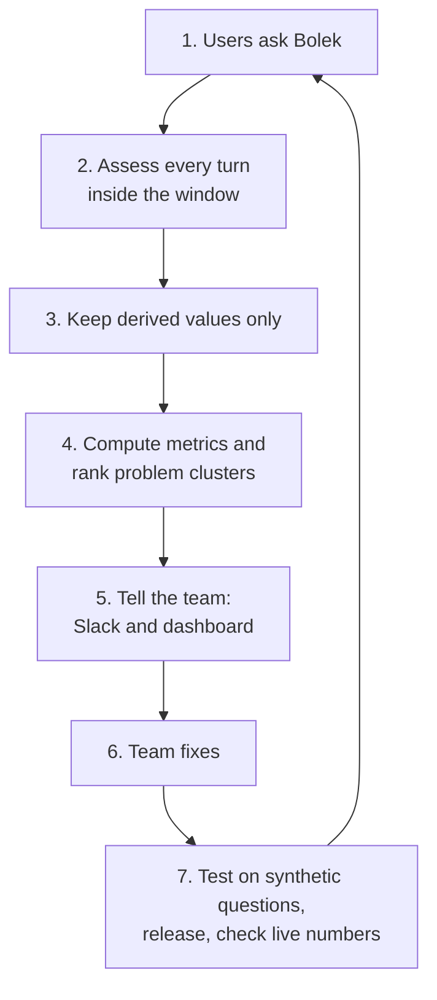

| # | Step | In one sentence |
|---|---|---|
| 1 | Users ask Bolek | Turns arrive on the web UI, Slack Bolek and MCP; Google records them in the log, and the window starts. |
| 2 | Assess every turn | Every 10 minutes, new turns are assessed by the judge, before the anonymizer erases the answers. |
| 3 | Keep derived values only | Scores, labels and document IDs are stored in BigQuery; all text is dropped. |
| 4 | Compute metrics and rank problem clusters | Daily metrics (AQR, failure rates, coverage) with an anomaly check, and a weekly ranked list of problem clusters. |
| 5 | Tell the team | Alerts and a weekly digest on Slack, and a dashboard for the daily look, all built only from derived values. |
| 6 | Team fixes | The team changes a prompt, a data store, the indexer, a document or the model. |
| 7 | Test, release, check | The release gate tests the change on synthetic questions; after release, release impact compares the live numbers before and after. |

### 4.2 Step 2 in detail: assessment

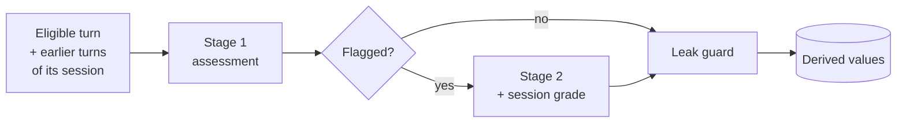

Feedback is attached to its turn. A dislike that arrives within 3h30 of the turn flags it; if stage 1 is already done, the dislike is a late trigger.

### 4.3 Step 7 in detail: verification

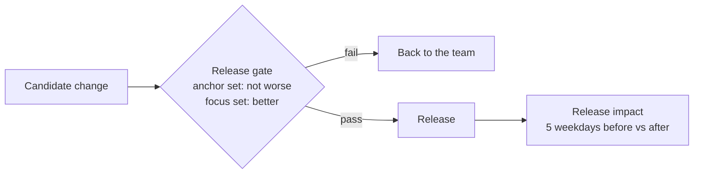

### 4.4 The life of one turn

Everything about a turn must be read before the anonymizer erases its answer.

| Time after the turn | What happens |
|---|---|
| 5 minutes | The turn has reached the log, about 4 minutes after the answer, and becomes eligible for assessment. |
| 5 to 15 minutes | Stage 1 assessment, normally. |
| up to 3 hours | Assessment target. |
| up to 3h30 | Hard limit. Late triggers can still start stage 2 and a session grade. A turn neither assessed nor recorded as too large by then is recorded as missed and cannot be recovered. |
| 4 hours (up to 4h22m) | The anonymizer erases the answer, the session ID and the user's identity. |
| 30 days | The question text is deleted. |

### 4.5 Where each guarantee is enforced

| Guarantee | Where |
|---|---|
| No text is stored | Leak guard before every write; the output has no free-text fields. |
| Text goes only to EU endpoints | The judge on the `eu` multi-region. |
| No person reads questions or answers | Every step is automatic; the judge is tested on the judge test suite and the canary, not on real turns. |
| Real questions are never re-asked | Verification uses synthetic questions generated from documents. |
| Notifications go only to Slack; the dashboard shows aggregates only | Step 5; messages are built from derived values, and the dashboard's account can read only aggregates. |

## 5. Sessions

People often ask several questions in a row, and a later turn often depends on an earlier one: a follow-up, a rephrase, a "that's wrong". So every turn is assessed together with the earlier turns of its session. All of this happens inside the window, because the session ID is erased together with the answer.

### 5.1 How turns are grouped

- Each turn's record in the log carries its session ID until the window ends. We never keep the ID itself, only the session key.
- Turns with the same session key form a session, ordered by time.
- Feedback records carry the IDs of the turn and the session they belong to, so feedback is attached to its turn.
- Every assessment run reads again the turns of a session that are still in the window, including turns assessed in earlier runs, so a new turn always sees the turns before it.
- After the window, the log's turn records no longer carry their session ID, and we store nothing that links them to it. So the questions of a session cannot be put back together later.

| Channel | What a session is |
|---|---|
| Web UI | One chat. Real conversations of several turns. |
| Slack Bolek, MCP | Nearly every turn has its own session ID, so even a Slack thread is not one session. The same rules apply; in practice these are sessions of one turn. |

### 5.2 Segments

A session can go on for longer than the window. Its first turns would then be erased while the user is still asking, and the session could not be assessed or graded as a whole. So a session is cut into **segments**, each of which fits inside the window.

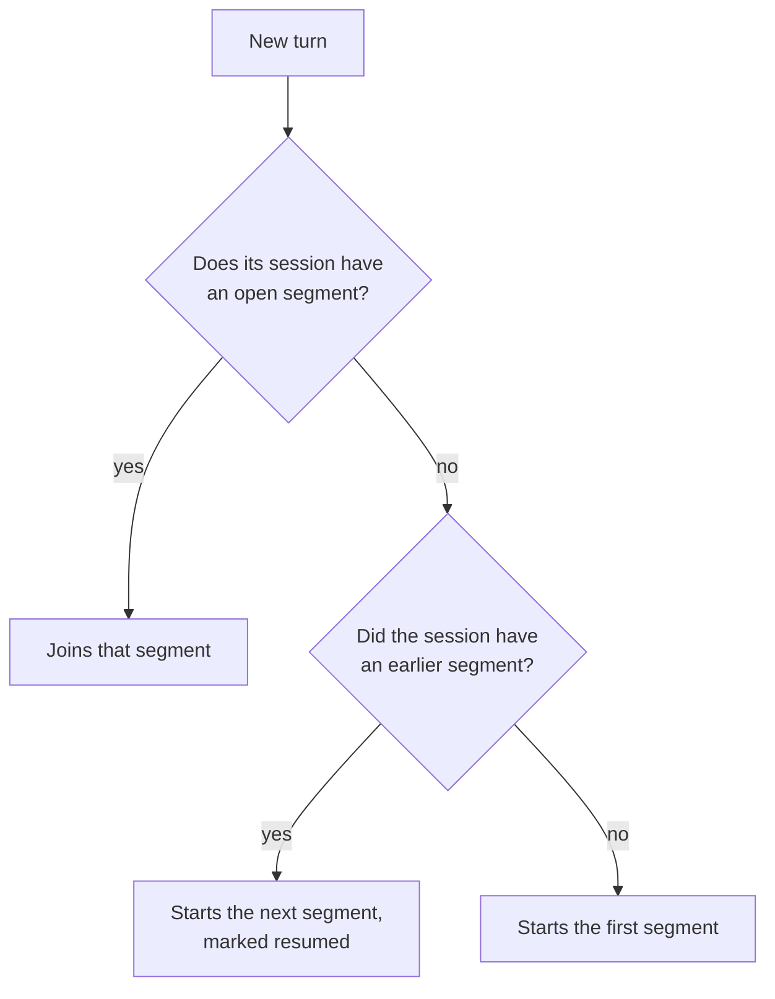

A segment is open until one of two things happens:

- **30 minutes without a new turn.** The conversation is treated as finished for now.
- **Its oldest turn is 3h30 old.** The segment is forced closed, so it is complete while all of its text still exists. The anonymizer starts erasing it at 4 hours.

Example of one session:

| Time | What happens | Segment |
|---|---|---|
| 10:00 | Turn 1 | Segment 1 opens |
| 10:04 | Turn 2, a follow-up | Segment 1 |
| 10:09 | Turn 3, a rephrase of turn 2 | Segment 1 |
| 10:39 | 30 minutes without a new turn | Segment 1 closes |
| 11:20 | Turn 4, in the same chat | Segment 2 opens, marked resumed |

Turn 4 still sees the text of segment 1, and its relation to turn 3 is judged as usual (§5.3).

For most sessions, one segment is the whole session. When a user comes back after a longer pause, the earlier text usually still exists, and the resumed segment uses it.

The 30 minutes are a starting value. A longer wait cuts fewer conversations, but keeps segments open and delays their final session grade. A cut costs little while the earlier text exists: the resumed segment still sees it, and its first turn is still related to the turn before the pause. What is lost is one session grade for the whole conversation, and the earlier segment's references as evidence (§6.2). So the value is tuned on how often a segment resumed after a 30-minute close continues the earlier conversation, that is, how often its first turn is a follow-up, a rephrase, a correction or frustration rather than an unrelated question. This share is a metric on the dashboard (§8.3); if it is high, segments should stay open longer.

### 5.3 What a turn takes from its session

| What | Used for | From where |
|---|---|---|
| All earlier turns of the segment, as text, up to 60,000 characters (when cut, the most recent are kept) | Understanding the question, and checking whether the answer contradicts an earlier one or the user had to ask again | The same segment |
| The references of all earlier turns | Evidence, when the turn has no references of its own (§6.2) | The same segment |
| The text of the previous segment while it exists, within the same 60,000 characters; once it is erased, its labels and scores | Context for the turns of a resumed segment, and the relation of its first turn to the turn before the pause | The previous segment |

- When an earlier turn's text is already erased, the turn is assessed without it, and this is recorded with the assessment.
- The form records how each turn relates to the turn before it in the session, even across a pause that started a new segment (§6.4). That label becomes the earlier turn's **reaction**. So a turn's reaction is known only once the next turn is assessed. A turn has none if it is the last of its session, or if its text was already erased when the next turn came.
- If an earlier turn arrives in the log late, the context of the turns after it changes, and they are assessed again (§6.1).

### 5.4 What is stored

**For each turn**, besides its assessment:

| Value | Example |
|---|---|
| Session key and segment number | segment 2 |
| Position in the segment | turn 1 of segment 2 |
| Gap to the previous turn, as a bucket | under 1 min, 1-5 min, 5-30 min, 30-60 min, over 60 min |
| Resumed | yes or no |
| Earlier text missing | yes or no |
| Department family of the user | `ENGINEERING` |

**For each segment:** the session facts, computed again each time the segment gets a new turn. A segment with a flagged turn also gets a session grade (§7.7).

## 6. Stage 1: assessing every turn

Every eligible turn that is not too large gets a stage 1 assessment: a fixed form that the judge fills in. The form has no free text, only labels from closed lists, scores and counts. Each turn has one stored assessment. It may be updated up to 3h30 after the turn (§6.1), and the latest result replaces the earlier one; a change to the judge is the only exception (§6.11). Flagged turns go on to stage 2 (§7).

### 6.1 One turn, step by step


**Updates.** A turn is assessed again only when something it depends on changes, up to 3h30 after the turn:

- a late trigger (a dislike, or a next turn marked `REPHRASE` or `CORRECTION`), which flags the turn and sends it to stage 2, unless it was already flagged;
- an earlier turn of its session that arrived in the log late, so the context is now different.

An update replaces the earlier result of the same stage, so a turn never counts twice. The fingerprint records what the current assessment was based on, so the same input is never assessed twice.

### 6.2 What the answer is compared with

The judge does not know what is true at our company. It can only compare the answer with documents it is given. So in this design:

> **A claim is wrong when one of our documents says something different.**

Bolek's job is to answer from our documents, so this is the right test for it. If a document is itself wrong, that is a problem of the document, not of the answer. If no document says anything about a claim, the claim is not wrong, only unsupported.

The documents an answer is compared with are its **evidence**. Stage 1 has three kinds, used in this order:

| Evidence | Where it comes from | Share of web UI turns (one sample of 533 turns; rounded) |
|---|---|---|
| 1. The turn's own references | The log | 36% |
| 2. The references of earlier turns in the same session segment | The log | 24% more, mostly follow-ups answered from what Bolek found earlier |
| 3. Documents linked in the answer text, read by the evidence check | The links in the answer; the text from the content bucket (§6.9) | Part of the remaining 39%: knowledge turns whose answer links a document we can read |

- A knowledge turn with evidence 1 or 2 is **verifiable** and gets a groundedness score.
- A knowledge turn with neither gets the **evidence check**, if its answer links one of our documents. It stays **not verifiable** whatever the check finds: the check can find an error, but it can never prove the answer right. An error it finds is still recorded as an identified problem.
- References to the people directory never count as evidence. They are left out of the judge's inputs in both stages (§6.6).

### 6.3 What the judge sees

| Input | Form | Evidence check |
|---|---|---|
| The question | yes | yes |
| The answer, split into answer spans where the log has them | yes | yes |
| The turn's own references (snippets) | yes | (there are none) |
| The earlier turns of the session as text (up to 60,000 characters, §5.3), and the references of all earlier turns of the segment | yes | no |
| The full text of documents linked in the answer text | no | yes |

- The question, the answer, the earlier turns, the references and the documents reach the judge as they are: there is no PII scrubbing. The judge runs only on an EU endpoint, and nothing it reads is stored (§6.10).
- A turn whose question, answer and references are longer than 50,000 characters together is **too large**. It is not sent to the judge at all; it is never cut down and partly assessed. In a sample of 526 web UI turns, 99% were under about 21,000 characters, and only the largest, about 50,500 characters with a long pasted question, was over the limit. The earlier turns are capped separately, so they never make a turn too large.
- The judge is `gemini-3.8-flash` on the `eu` multi-region, at temperature 0, answering in a fixed structured format.

### 6.4 The form

| Group | Field | Values |
|---|---|---|
| **What was asked** | Intent | `FACT_LOOKUP`, `HOW_TO`, `TROUBLESHOOTING`, `PEOPLE_LOOKUP`, `DATA_QUESTION`, `GENERAL_TASK`, `CHITCHAT`, `OTHER` |
| | Topic | One per data store, plus `OTHER`. Taken from the data store of the references; when they come from several, the judge picks one of those. Set by the judge freely only when there are no references. The form records whether the topic came from the references or from the judge alone. |
| | Relation to the previous turn | `FIRST`, `FOLLOW_UP`, `REPHRASE`, `CORRECTION`, `FRUSTRATION`, `NEW_TOPIC`. This becomes the previous turn's reaction. |
| **How good the answer is** | Relevance | 1 to 5: does it answer this question? |
| | Completeness | 1 to 5: does it cover every part of the question? |
| | Clarity | 1 to 5: is it easy to read and use? |
| | Groundedness | 1 to 5: is it supported by its evidence? Verifiable knowledge turns only. Where the log splits the answer into answer spans, each span is checked against the references it points to. |
| **Answer span counts** | Unsupported answer spans, total answer spans | Numbers. Only for verifiable knowledge turns whose answer the log splits into answer spans. |
| **Yes / no checks** | Answer language matches the question; refusal or empty answer; contradicts an earlier answer in the session; needs internal knowledge (knowledge intents only, §6.6) | true or false |
| **What went wrong** | Failure types, primary failure | Codes from §6.7 |
| | Severity | `LOW`, `MEDIUM`, `HIGH`. `HIGH` only for a contradicted claim (§6.8). |
| **Hint** | Confidence | 0 to 1. Informational only. |

What each value means is set by the rubric (§6.5).

### 6.5 The stage 1 rubric

The rubric is the text the judge gets with every call: what each value of the form means. The judge gets it in English and Polish, with example turns. The English text is below. It is a first draft, tuned on the judge test suite before launch (§11).

**General rules.**

1. Judge only against what you are given: the question, the answer, the earlier turns and the evidence. You do not know what is true at the company.
2. A claim is wrong only when the evidence says something different. If the evidence says nothing about it, the claim is unsupported, not wrong.
3. Between two levels, choose the lower one only if you can name the concrete defect that rules out the higher one. Otherwise choose the higher one.
4. Score each field on its own. A clear answer can be wrong, and a correct one can be hard to read.
5. Leave out fields that do not apply to the intent (§6.6). Do not guess them.
6. Judge the content, not the language, unless the answer's language differs from the question's.

A **key claim** is one the user would act on: a number, name, date, rule, step, place or link.

**Score levels.** Two lines turn relevance and groundedness into decisions: 2 or lower flags the turn, and 4 or higher is needed for a good answer. So the rubric is sharpest at levels 2 and 4, and 3 means "neither".

| Level | Relevance: does it answer this question? | Completeness: does it cover every part? | Clarity: is it easy to read and use? | Groundedness: is it supported by its evidence? |
|---|---|---|---|---|
| **5** | Answers exactly the question asked, directly, at the start. | Covers every part, with what the user needs to act: steps, conditions, exceptions. | Easy to read and use at once. The answer comes first; structure and formatting fit the content. | Every claim is supported. |
| **4** | Answers the question, with a detour or material the user did not need. Also: a justified refusal of an out-of-scope question, or asking back when the question really is ambiguous. | Covers every part. A minor detail is missing that the user can do without. | Clear, but longer or less ordered than needed. | Every key claim is supported. Only side remarks or general knowledge lack support. |
| **3** | Partly on target: answers a broader or related question, and the user has to dig for the answer. | One part of a multi-part question is missing, or the main part lacks a condition or step the user needs. | Usable with effort: wordy, poorly ordered, or with unexplained jargon. | Most key claims are supported, at least one is not. Nothing is contradicted. |
| **2** | Mostly off target: about the topic, not the question. | Only a small part of the question is answered. | Hard to follow: confusing, mixing languages, or formatting that hides content. | Most key claims are unsupported, **or** one key claim is contradicted. |
| **1** | Does not answer: answers a different question, refuses without a reason, or is empty. | Nothing of substance is answered. | Unusable: unreadable, in the wrong language throughout, or broken. | Not backed by its evidence as a whole, or its main point is contradicted. |

- Completeness is about the question, not about the documents. Leaving out document content the user did not ask for is not a defect.
- For groundedness, the answer span counts guide the score, but there is no formula: one unsupported key claim weighs more than several unsupported side remarks.
- A contradicted key claim always means groundedness 2 or lower, `CONTRADICTED_CLAIM` and `HIGH`.

**Relation to the previous turn.** The previous turn is the turn before it in the same session, also when a pause started a new segment. If two values fit, the first one in this order wins: `CORRECTION`, `FRUSTRATION`, `REPHRASE`, `FOLLOW_UP`, `NEW_TOPIC`.

| Value | The user's turn |
|---|---|
| `FIRST` | Has no previous turn, or the previous turn's text is already erased. |
| `CORRECTION` | Says or shows that the previous answer was wrong: "that's not true", "it's 4 days, not 6". |
| `FRUSTRATION` | Shows annoyance or gives up: "useless", "forget it". |
| `REPHRASE` | Asks the same thing again in other words, without saying the answer was wrong. |
| `FOLLOW_UP` | Builds on the previous answer: a next step, a detail, a related question. |
| `NEW_TOPIC` | Has nothing to do with the previous turn. |

**Yes / no checks.**

| Check | True when |
|---|---|
| Needs internal knowledge | A correct answer depends on something specific to our company: a rule, process, system, number, name or document. "How do I book a business trip?" is true; "How do I write a SQL join?" is false; "How do I query our campaign table?" is true. |
| Answer language matches | The answer is mainly in the language of the question. Code, names and quoted document text do not count. |
| Refusal or empty | The answer declines to answer, or has no content of substance. |
| Contradicts an earlier answer | A key claim differs from a key claim of an earlier answer in the same session. |

**When a judged failure counts as identified.** Deterministic codes follow from the data and the yes / no checks. For every other code, the judge records it only if it can point to the concrete thing below. If it can't, the code is not recorded; a turn with no recorded code gets `NONE`.

| Code | The judge must be able to point to |
|---|---|
| `CONTRADICTED_CLAIM` | A key claim and a passage of the evidence that says something specific and different on the same point |
| `UNSUPPORTED_CLAIM` | A key claim that no evidence supports |
| `INCOMPLETE_ANSWER` | A part of the question the answer does not address |
| `MISUNDERSTOOD_QUERY` | The different question that was answered instead |
| `PRESENTATION_ISSUE` | The wrong language, or the formatting that hides content |
| `AMBIGUOUS_QUESTION` | Two meanings of the question that need different answers, where Bolek picked one without asking |
| `OUT_OF_SCOPE` | Why Bolek should not or cannot answer it, for example a request to do something Bolek cannot do, such as booking a trip |

**Severity.** Set only when there is an identified failure; with `NONE` it is left empty.

| Level | Meaning |
|---|---|
| `HIGH` | A key claim on a knowledge intent is contradicted by the evidence (`CONTRADICTED_CLAIM`). Nothing else is `HIGH`. |
| `MEDIUM` | The answer fails its purpose without a contradiction: an unsupported key claim, a missing main part, a misunderstood question, a tool error, or an internal question answered with no evidence in the log. |
| `LOW` | The user still gets what they need: a formatting or language problem, a minor gap. |

**Examples.** The documents and numbers are made up.

| Turn | Intent | Relevance | Completeness | Clarity | Groundedness | Failure, severity |
|---|---|---|---|---|---|---|
| "How many days of on-demand leave do I have?" The reference says up to 4; the answer says 6. | `FACT_LOOKUP` | 5 | 5 | 5 | 1 | `CONTRADICTED_CLAIM`, `HIGH` |
| "How do I book a business trip, and who approves it?" The answer explains only the booking, which the reference supports. | `HOW_TO` | 5 | 3 | 5 | 5 | `INCOMPLETE_ANSWER`, `MEDIUM` |
| "What's the limit?", with no earlier turns. The answer explains meal expense limits at length. | `OTHER` | 2 | 2 | 4 | (not asked) | `AMBIGUOUS_QUESTION`, `MEDIUM` |

In the first example relevance stays 5: the answer is on target, just wrong. In the second, the missing part lowers completeness, not relevance. That is why every field is scored on its own. In the third, Bolek should have asked which limit was meant; the guess missed the question, so the user did not get what they needed.

### 6.6 Which fields apply to which intent

Fields that do not apply to an intent are left empty and are not asked of the judge.

| Intent | Scores | Groundedness | Failure types |
|---|---|---|---|
| Knowledge intents | Relevance, completeness, clarity | Yes, when the turn has evidence 1 or 2. Otherwise the evidence check runs, and the turn is not verifiable. | All stage 1 codes. Not verifiable: deterministic ones, and `CONTRADICTED_CLAIM` from the evidence check. |
| `PEOPLE_LOOKUP` | Relevance only | No | `AGENT_OR_TOOL_ERROR` only |
| `GENERAL_TASK`, `CHITCHAT` | Relevance, completeness, clarity | No | Generation, except the four that need sources (`CONTRADICTED_CLAIM`, `UNSUPPORTED_CLAIM`, `REASONING_ERROR`, `UNGROUNDED_INTERNAL_ANSWER`); question; system |
| `OTHER` | Relevance, completeness, clarity | No | Question and system |

**Knowledge intents and "needs internal knowledge".** The knowledge intents are `FACT_LOOKUP`, `HOW_TO`, `TROUBLESHOOTING` and `DATA_QUESTION`: question types whose answer may have to come from our documents. Not every such question does. "How do I book a business trip?" needs internal knowledge; "How do I write a SQL join?" is also `HOW_TO`, but does not. The judge decides this per turn with the "needs internal knowledge" check, which is asked for knowledge intents only. When it is true and the turn has no evidence in the log, that is, no references of its own or of an earlier turn in the segment, the turn gets `UNGROUNDED_INTERNAL_ANSWER` (§6.7).

**Why `PEOPLE_LOOKUP` is not a knowledge intent.** Questions about people, such as who owns a project or which team someone is in, are answered from the people directory. Its documents are personal data, so they are never stored or read as evidence. With nothing to check the answer against, only relevance and tool errors are assessed.

This table is the starting point and will be finalized together with the rubric.

### 6.7 Failure types

Stage 1 assigns the generation codes except `REASONING_ERROR`, and the question and system codes. The retrieval and corpus codes need the full cited documents, so only stage 2 assigns them, together with `REASONING_ERROR`.

| Code | Meaning | Assigned in | Usually fixed by |
|---|---|---|---|
| **Retrieval** | | | |
| `NOT_IN_CITED_SOURCES` | The right content is in none of the documents the answer cited or linked. Either Bolek's search missed the document that holds it, or no document does; without a search of our own, the two can't be told apart (§7.3). | Stage 2 | Team first: search configuration, or a corpus owner to add a source |
| `CHUNKING_ISSUE` | The right document was used, but its snippet lost needed context. | Stage 2 | Team: indexer chunking |
| **Corpus** | | | |
| `OUTDATED_SOURCE` | A cited document is out of date: a newer document says something different, or it says itself that it is replaced. | Stage 2 | Document owner |
| `CONFLICTING_SOURCES` | Two cited documents say different things on the same point. | Stage 2 | Document owners |
| **Generation** | | | |
| `CONTRADICTED_CLAIM` | A key claim contradicts one of our documents that the assessment read: a different number, name, date, rule or step. | Stage 1 (form or evidence check), stage 2 | Team: prompt, model, search configuration |
| `UNSUPPORTED_CLAIM` | A key claim is not supported by its evidence, and no document read contradicts it. | Stage 1 (verifiable turns), stage 2 | Team: prompt, model |
| `REASONING_ERROR` | The sources are fine, but were combined or interpreted wrongly. | Stage 2 | Team: prompt, model |
| `INCOMPLETE_ANSWER` | Parts of the question are not answered. | Stage 1 | Team: prompt |
| `MISUNDERSTOOD_QUERY` | A different question was answered. | Stage 1 | Team: prompt |
| `PRESENTATION_ISSUE` | Wrong language or broken formatting. | Stage 1 | Team: prompt |
| `UNGROUNDED_INTERNAL_ANSWER` | A question that needs internal knowledge was answered with no evidence in the log: no references of its own or of an earlier turn in the segment. | Stage 1, deterministic | Team: prompt, the engine's search and citation settings |
| **Question** | | | |
| `AMBIGUOUS_QUESTION` | Too vague to answer well; Bolek should have asked back. | Stage 1 | Team: prompt |
| `OUT_OF_SCOPE` | Not something Bolek should or can answer. | Stage 1 | Team: communication to users |
| **System** | | | |
| `AGENT_OR_TOOL_ERROR` | A tool or agent failed, or the answer is empty. | Stage 1, deterministic | Team |
| `NONE` | No identified problem. | Both | |

### 6.8 Rules for recording a failure

- **Only identified problems.** A code is recorded only when it is deterministic (follows from the data and the yes / no checks, like the two marked above) or the judge can point to what confirms it (§6.5). If the judge is unsure, the code is not recorded, and a turn with no recorded code gets `NONE`. Failure rates are therefore lower bounds.
- **`HIGH` means contradicted.** `HIGH` severity is set only together with `CONTRADICTED_CLAIM`, on a knowledge intent. A claim that is only unsupported, or about which nothing was found, is at most `MEDIUM`. A `HIGH` always flags the turn.
- **Stage 1 never guesses causes.** It says *what* went wrong, not *why*: retrieval and corpus codes are left to stage 2.
- **One primary failure, by a fixed order.** When stage 1 records several codes, the primary failure is the first of them in this order: `AGENT_OR_TOOL_ERROR`, `CONTRADICTED_CLAIM`, `UNSUPPORTED_CLAIM`, `UNGROUNDED_INTERNAL_ANSWER`, `MISUNDERSTOOD_QUERY`, `INCOMPLETE_ANSWER`, `AMBIGUOUS_QUESTION`, `OUT_OF_SCOPE`, `PRESENTATION_ISSUE`. A turn with a stage 2 result takes its primary failure from stage 2 instead (§7.5).
- **Turns that are not verifiable** can be assessed only in part: they get no groundedness score, only deterministic codes and `CONTRADICTED_CLAIM` from the evidence check.
- **Confidence changes nothing.** No rule, threshold or weight uses it.

### 6.9 The evidence check

**What it is for.** About 4 in 10 web UI turns have no evidence in the log (39% in the sample of §6.2). Without the check, a wrong answer on such a turn could never be caught. The check lets the judge look for evidence in the documents the answer links to: answers often carry links in their text without references attached. It can find an error, but never prove an answer right, so the turn stays not verifiable either way.

**When it runs.** On knowledge turns with no evidence 1 or 2 whose answer text links at least one of our documents that we can read, right after the form is filled in. Other such turns are counted as not checked, so the check's reach is measured.

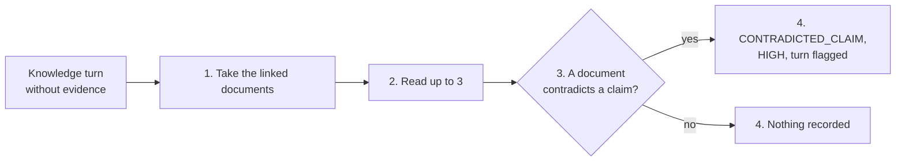

| Step | What happens |
|---|---|
| 1. Take the linked documents | The documents linked in the answer text that belong to an allowlisted data store, without the people directory. There is no search. |
| 2. Read | Read the full text of up to 3 of them, each capped in length. |
| 3. Judge | The judge compares the answer with these documents and looks only for a specific contradiction: a different number, name, date, rule or step. It gives no scores. |
| 4. Record | Contradiction found: `CONTRADICTED_CLAIM`, severity `HIGH`, and the turn is flagged. Nothing found: nothing is recorded. Either way, the IDs of the documents read are stored, marked *found*. |

**Boundaries**

- **It checks the answer against our documents, never against Bolek's answers.** It reads their full text from the content bucket, which our indexers already write (§12.7).
- **Only what the answer links.** An answer that links no document, or only documents we can't read, is not checked; a wrong claim in it is missed, but nothing false is recorded.
- **No search of our own, on purpose.** An earlier version of this design searched a vector index of our documents, written by the indexers. It was dropped: it needs a change to every indexer, an embedding model and a second search to keep healthy, for a check that can never prove an answer right. It can be added back later as its own step.
- **Not every document can be read.** Our indexers keep the full text of the documents of every data store except Google Drive (about 6% of citations), and the people directory is never read.
- **Safe by design.** The documents are read inside this system, not through Gemini Enterprise, so the reads never appear in the log or count in any metric. Only document IDs and codes are stored, through the leak guard.
- **Cost.** One judge call with up to 3 documents per checked turn. Not measured yet; at most about the cost of stage 1 again.

### 6.10 Leak guard

Nothing leaves the assessment without passing these checks:

- The output format has **no free-text field**. Every value is a number, a closed-list value, a hash made by the system (such as the session key), or a document ID or link that matches an allowlist of data stores. Documents found by the evidence check pass the same allowlist.
- People-directory documents are dropped.
- An output that fails the check is retried once, then recorded as failed with an error class. The judge's raw output is never stored or written anywhere.
- Error reports, to the team's error tracking and to Slack, never contain text from the turn.
- An automated test feeds in text with planted personal data and fails if any piece of the input longer than 20 characters appears in the stored result, other than an allowed document link.

### 6.11 Versions stored with every assessment

Each assessment records the rubric version, the version of the closed lists (failure types and topics), the judge model, the prompt version and the assessment code version.

**A change to the judge** (its rubric, prompt, model or form). Turns already assessed keep their assessment; they are never re-assessed under the new version. For the first 5 weekdays after the change, the parallel run, every new turn is assessed under both the old and the new version, and both assessments are stored. The difference between them links the metrics across the change, so results from different versions are only ever compared through this parallel run. After it, only the new version is used.

### 6.12 Open problems

| Problem | Why it matters | Next step |
|---|---|---|
| **Does the evidence check catch enough errors, without false `HIGH`s?** | A false `HIGH` costs the team's trust; a missed one hides the worst answers. The check reads only what the answer links. | On the canary: plant known factual errors in synthetic answers, with and without references, and measure how many are caught and how many correct answers are wrongly marked `HIGH`. If too many are missed, reconsider a search of our own (§6.9). |
| **How many turns does the evidence check reach?** | It sets the cost, and how many turns without evidence stay unchecked. | Measure in the first week the share of knowledge turns without evidence, and how many of them link a document we can read. |

## 7. Stage 2: finding out why

Stage 1 says **what** went wrong with an answer. That is not enough to fix it: an unsupported claim may come from a search that missed the right document, from a document that is out of date, or from a source that does not exist at all, and each has a different owner. Stage 2 finds out **why**. It runs only on flagged turns, reads much more than stage 1, and uses the stronger judge, `gemini-4-argon` on the `eu` multi-region.

When a turn is flagged, stage 2 also grades its whole session segment (§7.7).

### 7.1 When a turn is flagged

| Signal | From | Why it flags |
|---|---|---|
| Relevance 2 or lower | Stage 1 | The answer missed the question. |
| Groundedness 2 or lower | Stage 1 | Most key claims are unsupported, or one is contradicted. |
| `HIGH` severity | Stage 1 or the evidence check | A document contradicts the answer. |
| Dislike | Feedback | The user said the answer was bad. |
| Next turn is `REPHRASE` or `CORRECTION` | The next turn's stage 1 | The user had to ask again or said it was wrong. |

The last two are late triggers when they arrive after stage 1 is done, up to 3h30 after the turn. A turn is flagged at most once; a second signal adds to the reasons but does not start stage 2 again. Expected share: under 20% of turns, to be measured in the first weeks.

### 7.2 What stage 2 sees

Everything stage 1 saw, plus the documents behind the answer:

| Input | Why |
|---|---|
| The question, the answer, its references, the earlier turns (§5.3) | As in stage 1 |
| The stage 1 result and the reasons for the flag | So stage 2 knows what to confirm or correct |
| The full text of the cited documents | To see whether the snippet left out what was needed |
| The full text of the documents linked in the answer text, including those the evidence check read | Bolek may have used a document it did not attach as a reference |

As in stage 1, nothing is PII scrubbed (§6.3). Each document is capped in length, the people directory is left out, and only document IDs are kept. Stage 2 runs no search of its own, so it never sees a document that the answer neither cited nor linked.

### 7.3 How the cause is found

First, two checks run on the cited documents themselves:

| Check | Code |
|---|---|
| A cited document is contradicted by a newer one, or marks itself as replaced | `OUTDATED_SOURCE` |
| Two cited documents say different things on the same point | `CONFLICTING_SOURCES` |

Then stage 2 follows one path per problem claim. Each question is answered from what it reads, so every cause it assigns points at a specific document or a specific absence.

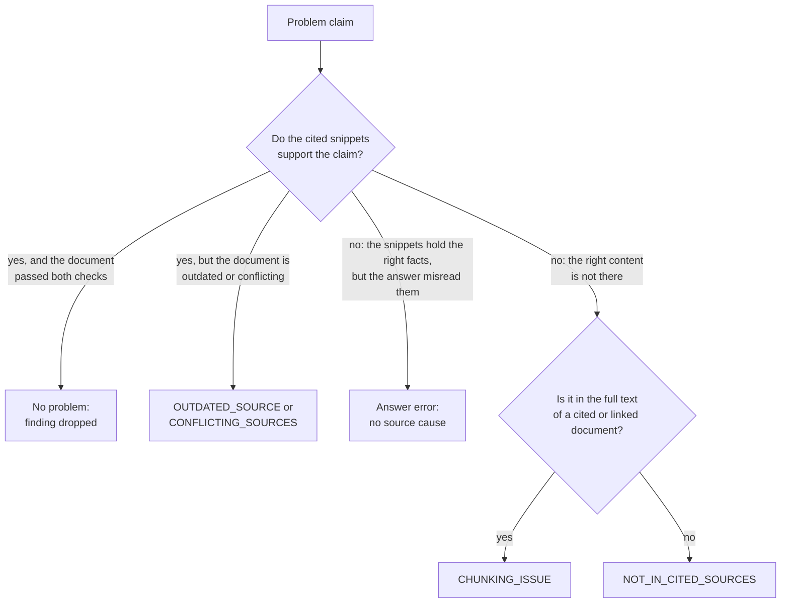

- A turn with no references starts at the second question, on the documents linked in its answer. With none of those either, the cause is `NOT_IN_CITED_SOURCES`.
- Without a search of our own, stage 2 can't tell whether missing content is in a document Bolek's search failed to find, or in no document at all. Both end as `NOT_IN_CITED_SOURCES`, which has no document to fix.
- The path decides the cause, the *why*. What is wrong with the claim, the *what*, is decided separately: contradicted, unsupported or a reasoning error (§7.5).

**What and why are both kept.** The stage 1 code (for example `CONTRADICTED_CLAIM`) stays, and stage 2 adds the cause (for example `CHUNKING_ISSUE`). The cause becomes the **primary failure**, because it names who should fix it (§6.7).

**Stage 2 may also correct stage 1.** With the full documents in front of it, it can find that an "unsupported" claim is in fact supported, or that a `HIGH` is not a real contradiction. It then drops the finding.

### 7.4 The stage 2 form

Like stage 1, stage 2 fills in a fixed form with no free text. It has two parts: one entry per problem claim, and a summary for the turn.

**Per problem claim** (at most 3 per turn, the most important first):

| Field | Values |
|---|---|
| Answer span | Its position in the answer, when the log splits the answer into answer spans |
| What | `CONTRADICTED_CLAIM`, `UNSUPPORTED_CLAIM` or `REASONING_ERROR` |
| Why | The cause from §7.3: `OUTDATED_SOURCE`, `CONFLICTING_SOURCES`, `CHUNKING_ISSUE`, `NOT_IN_CITED_SOURCES`, or none when the snippets hold the right facts and the answer misread them (the What is then `REASONING_ERROR`, or `CONTRADICTED_CLAIM` when a snippet says the opposite) |
| Documents | The IDs of the documents behind the finding, each with its role: *cited*, *holds the right answer*, *contradicts the claim*, *outdated* or *conflicting* |

**For the turn:**

| Field | Values |
|---|---|
| Groundedness | 1 to 5, scored again with the full documents. Verifiable knowledge turns only, as in stage 1. |
| Failure types, primary failure | As in stage 1, with the causes added. The primary failure is the cause of the most important claim. |
| Severity | `LOW`, `MEDIUM`, `HIGH`, by the same rule as stage 1 (§6.8) |
| Stage 1 findings | For each stage 1 code: *confirmed* or *dropped* |
| Document to fix | The document a fix should start from: the cited or linked one for `CHUNKING_ISSUE`, and for `OUTDATED_SOURCE` or `CONFLICTING_SOURCES` the outdated or conflicting document the claim follows. Empty for `NOT_IN_CITED_SOURCES`, which has no document. |
| Confidence | 0 to 1, informational only |

Relevance, completeness and clarity are not scored again: the full documents do not change them. Their stage 1 scores stay in use.

Problem clusters are grouped by the document to fix, so the team sees, for example, "Document X lost needed content in its snippets 12 times this week".

### 7.5 The stage 2 rubric

Stage 2 uses the stage 1 rubric for groundedness and severity (§6.5). On top of it, these rules decide each field of the stage 2 form.

**What is wrong with a claim.** When a claim fits more than one row, `CONTRADICTED_CLAIM` wins over the others, and `REASONING_ERROR` wins over `UNSUPPORTED_CLAIM`.

| Code | When |
|---|---|
| `CONTRADICTED_CLAIM` | A document that stage 2 read says something specific and different on the same point: a different number, name, date, rule or step. |
| `UNSUPPORTED_CLAIM` | No document read states the claim, and none says something different. |
| `REASONING_ERROR` | The cited snippets hold the right facts, but the answer combined them wrongly, drew a conclusion they don't support, or applied a rule to the wrong case. |

**Checks on the documents.** They run before the cause path, on the cited documents.

| Code | When |
|---|---|
| `OUTDATED_SOURCE` | A cited document is contradicted on the same point by a document with a later date, or says itself that it is replaced or out of date. |
| `CONFLICTING_SOURCES` | Two cited documents give different specific values on the same point, and neither is clearly newer. |

**Why: the cause path (§7.3), question by question.**

| Question | Rule | Result |
|---|---|---|
| 1. Do the cited snippets support the claim? | "Support" means the snippet states it, or it follows directly without extra assumptions. | Supported, and the document checks found nothing: there is no problem, and the finding is dropped. Supported, but the document is outdated or conflicting: the claim is kept, and the cause is `OUTDATED_SOURCE` or `CONFLICTING_SOURCES`. Not supported, although the snippets hold the right content: the cause is the answer itself, with no "why". |
| 2. Is it in the full text of a cited or linked document? | The right content is in a document the answer cited or linked, but not in the snippet Bolek got. | `CHUNKING_ISSUE`. The document to fix is that document. |
| 3. None of the above | The right content is in none of the documents stage 2 read. | `NOT_IN_CITED_SOURCES`. No document to fix; the cluster is by topic. |

**Confirming or dropping stage 1 findings.** A finding is **dropped** only if stage 2 can point to a passage that supports the claim in a document that passed both document checks, or to a passage that shows the contradiction is about a different case (another country, year or product). Otherwise it is **confirmed**. A dropped `HIGH` gets its severity set again by the stage 1 rules.

**Choosing claims.** At most 3 per turn, most important first: contradicted before unsupported before reasoning errors, key claims before side remarks. The primary failure is the cause of the first claim. When the cause is the answer itself (no "why"), it is the "what".

**Examples.** The documents and numbers are made up.

| Situation | What | Why | Document to fix |
|---|---|---|---|
| The answer says 6 days of on-demand leave. The cited snippet is about sick leave; the full text of the same document says 4. | `CONTRADICTED_CLAIM` | `CHUNKING_ISSUE` | The cited leave policy |
| Same answer, no references and no links. No document stage 2 reads says anything about it. | `UNSUPPORTED_CLAIM` | `NOT_IN_CITED_SOURCES` | (none) |
| The answer says 6 days, as the cited 2024 leave policy does. The 2026 policy, also cited, says 4. | `CONTRADICTED_CLAIM` | `OUTDATED_SOURCE` | The 2024 leave policy |
| The snippet says trips outside Europe need finance approval; the answer says all trips do. | `REASONING_ERROR` | (none) | (none) |

The session grade has its own rubric: the outcome meanings in §7.7.

### 7.6 Results

- **Both results are kept.** The stage 1 result is not overwritten; a turn that was never flagged simply has no stage 2 result.
- **Metrics use the stage 2 result where it exists.** A turn whose findings stage 2 dropped can count as a good answer again.
- **Keeping both shows how often stage 2 changes stage 1.** A high rate means the stage 1 rubric needs work.
- The same leak guard (§6.10) and versions (§6.11) apply.

### 7.7 Session grade

When a turn is flagged, the judge also grades its whole session segment: did the user get what they needed, and if not, where did it go wrong. It reads the text of all turns of the segment, together with their stage 1 and stage 2 results.

| Field | Values | How it is set |
|---|---|---|
| Outcome | `RESOLVED`, `PARTIALLY_RESOLVED`, `UNRESOLVED`, `UNCLEAR` | Judged, by the meanings below |
| First bad turn | The position of the first turn where it went wrong | Judged: the first turn with an identified problem of `MEDIUM` or `HIGH` severity, or the first one the user corrected. Empty when nothing went wrong. |
| Rephrases and corrections | 0, 1, 2 or more | Counted, not judged: turns whose relation to the previous turn is `REPHRASE` or `CORRECTION` |
| Recovered after correction | `YES`, `NO`, `NO_CORRECTION` | Judged: after the user's first correction, did a later answer give what was asked, without an identified problem? |
| Confidence | 0 to 1 | Informational only |

**What each outcome means.** The user's need is what they were trying to get from the segment as a whole, not from one turn.

| Outcome | Meaning |
|---|---|
| `RESOLVED` | By the end of the segment the user got what they needed: the last answer on their need is relevant and has no `MEDIUM` or `HIGH` problem, and the user did not correct it or show frustration afterwards. Earlier bad answers are allowed if a later one fixed them. |
| `PARTIALLY_RESOLVED` | The user had several needs, or a need with several parts, and only some were met by the end. |
| `UNRESOLVED` | The need was not met by the end: the last answer on it has a `MEDIUM` or `HIGH` problem, or the user corrected that answer or showed frustration after it. |
| `UNCLEAR` | The judge cannot tell what the user needed, or whether it was met, for example when the segment ends right after an answer that cannot be checked. |

The outcome meanings and example segments are given to the judge in English and Polish, like the stage 1 rubric, and tuned on the synthetic conversations of the judge test suite (§11.1).

**Why a grade can change.** A turn is often flagged while the user is still chatting, and alerts go out soon after a flag, before anyone knows how the chat ended. So the first grade covers only the turns so far, and the segment is graded again once it closes.

| State | When | Example |
|---|---|---|
| **Provisional** | Graded when a turn is flagged, on the turns so far. It stays provisional if the re-grade at close does not happen, for example when the job is down. | 10:02, turn 2 is flagged: `UNRESOLVED` so far |
| **Final** | Graded again on all its turns when the segment closes. This almost always happens: a segment closes after 30 minutes without a new turn, or at the latest when its oldest turn is 3h30 old, before the text is erased at 4 hours. If the segment has already closed when the turn is flagged (for example a dislike that comes an hour later), the first grade is final at once. | 10:35, after the user corrected the answer at 10:05 and got a good one: `RESOLVED`, recovered after correction |
| **Not gradable** | Part of the segment's text was already erased when the turn was flagged, so no grade is made. | A dislike arrives 3 hours after a turn late in a long segment, whose first turns are already more than 4 hours old |

An alert shows the grade it had when it was sent and says whether it was provisional. Looking a grade up later by the alert's ID shows the latest one. The lookup reads the stored session grades, which only the team can access.

**Informational only.** No metric, ranking or trigger uses the session grade. It is shown in Slack cluster alerts as context: for example "5 turns, unresolved (provisional), went wrong at turn 2, rephrased or corrected 2 or more times".

### 7.8 Open problems

| Problem | Why it matters | Next step |
|---|---|---|
| **`NOT_IN_CITED_SOURCES` mixes two owners** | A retrieval miss (the team) and a missing source (a corpus owner) look the same without a search of our own. | Watch its share per topic. If it is large, reconsider a search of our own (§6.9). |
| **Share of flagged turns** | Sets the cost; expected under 20%. | Measure in the first weeks. |

## 8. Metrics

Assessments are made per turn. Metrics turn them into a few numbers per day that say whether Bolek is getting better or worse, and where. The numbers are shown on one dashboard (§8.8), and they drive the alerts and the digest (§9).

### 8.1 From assessments to numbers

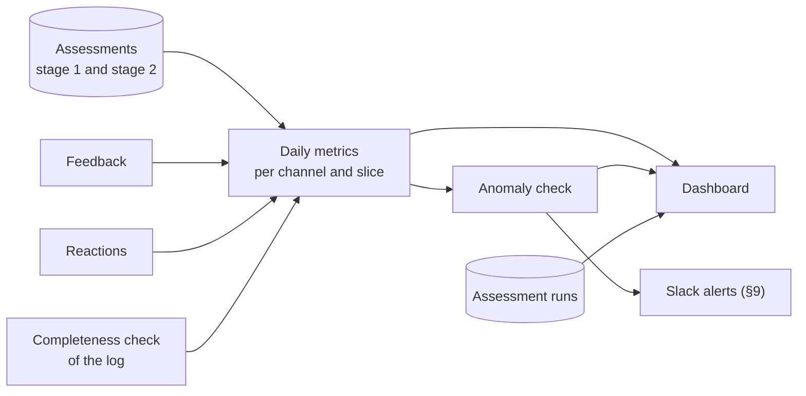

- **Once a day, for the day before.** A turn's numbers can still change for a while: until 3h30 a late trigger can flag it and stage 2 can change its result, and until its text is erased the next turn can still give it a reaction. So a day's numbers are computed only once its last turns are erased, early the next morning.
- **Pipeline health is the exception.** It comes from the assessment runs themselves and is shown as soon as a run ends.
- **Numbers are recomputed, never added up.** Each day is computed again from the stored assessments, so a re-run gives the same result.

### 8.2 Which turns count

- **Every turn of the production engine, on every channel.** Canary turns never count.
- **One result per turn.** The stage 2 result where it exists, otherwise the stage 1 result (§7.6).
- **One judge version at a time.** During the parallel run after a change to the judge (§6.11), metrics use the old version, and switch to the new one when the run ends. The switch is marked on the dashboard.
- **Users whose pace is not human are left out.** A user with more than 10 turns in 10 minutes is most likely a script. The check runs inside the window, while the user's identity is still in the log, and only a mark on each of their turns is stored. Marked turns are left out of the metrics for that day and only counted, so the exclusion itself can be watched.
- **Days with a gap in the log are marked incomplete.** Every hour, the number of log records is compared with the usual number for that hour and weekday, per channel. A day with a gap is still shown, but marked, and it is left out of the baseline and of every reference period. This is how a broken log export is told apart from a real drop in quality.
- **Weekdays and weekends are compared only with their own kind.** Weekend traffic is about a tenth of weekday traffic, and it is different.

### 8.3 The metrics

| Metric | Question it answers | How it is computed |
|---|---|---|
| **Quality** | | |
| **AQR, standardized** | Are answers getting better? | Good answers divided by assessed verifiable turns, weighted to the baseline question mix (§8.4). The main number. |
| AQR, raw | Did the question mix change? | The same without weighting. When raw and standardized AQR move apart, people ask different things; quality did not change. |
| Not verifiable share | How much of the traffic can we not check? | Not verifiable knowledge turns divided by knowledge turns. Shown with the evidence mix: own references, earlier turns' references, none. If it grows, AQR covers less of the traffic. |
| **What goes wrong** | | |
| Failure rate, per failure type | Which kind of problem grows? | Turns with that type as their primary failure, divided by assessed turns. A lower bound, because only identified problems count. |
| Contradicted claims | How often do we say something our documents contradict? | Turns with `HIGH` severity, as a count and as a share of assessed knowledge turns. The most serious error. |
| Unsupported claims | How often do answers say more than their evidence? | Verifiable knowledge turns with answer spans and at least one of them unsupported, divided by verifiable knowledge turns with answer spans. Only turns with references of their own have answer spans. |
| **User reactions and feedback** (never part of AQR) | | |
| Negative reaction rate | Do users push back? | Turns whose next turn is a rephrase, a correction or frustration, divided by turns that have a reaction. |
| Dislike rate | Do users complain? | Dislikes divided by turns. About 1 in 1,000, so it is shown as a count, for information only. |
| **Usage** (must not drop while AQR rises) | | |
| Volume | How much is Bolek used? | Turns per day and channel. |
| Active users, 7-day retention | Do people keep coming back? | As Google reports them for the engine, about 3 days late. |
| **Pipeline health** | | |
| Coverage | Did we assess everything? | Assessed and too-large turns divided by eligible turns. Target 98%. |
| Too-large share | How much do we skip? | Too-large turns divided by eligible turns. |
| Missed turns | Did we lose any? | Turns neither assessed nor recorded as too large by 3h30. They can never be assessed. |
| Oldest waiting turn | Are we falling behind? | The age of the oldest eligible turn not yet assessed, per run. |
| Log completeness | Is the input whole? | Hours with a gap in the log, per channel (§8.2). |
| Resumed without text | How often does a resumed segment lose its earlier text? | Resumed segments whose earlier text was already erased, divided by resumed segments. Their turns see only the earlier labels and scores (§5.3). |
| Resumed and continued | Is the 30-minute segment close right? | Segments resumed after a 30-minute close whose first turn is a follow-up, rephrase, correction or frustration, divided by all such segments whose earlier text still existed. If it is high, segments should stay open longer (§5.2). |

### 8.4 Standardized AQR

**Why.** Some kinds of questions are answered better than others. If people ask more of the easy kind in one week, AQR rises although no answer got better. Standardizing removes that effect.

**Example.** HR fact questions are answered well, API how-to questions less well. In week 2 there are many more HR questions, for example during payroll season:

| Stratum | Share in the baseline | Week 1: share, AQR | Week 2: share, AQR |
|---|---|---|---|
| HR, fact lookup | 50% | 50%, 90% | 80%, 90% |
| API docs, how-to | 50% | 50%, 60% | 20%, 60% |
| **Raw AQR** | | **75%** | **84%** |
| **Standardized AQR** | | **75%** | **75%** |

Raw AQR rose by 9 points, but no answer got better. Standardized AQR shows that correctly.

**How.**

1. Turns are split into **strata**: intent family × data-store family × department family. A family is a group of similar intents, of similar data stores, or of departments. The starting families are 4 intent families, 3 data-store families and 3 to 5 department families, frozen when the baseline starts (§8.9). That allows up to about 60 strata; most are small and merged (step 4), so about 10 to 20 carry weight.
2. AQR is computed per stratum and day.
3. The stratum AQRs are added up, each weighted by the stratum's share of turns in the baseline.
4. A stratum below the minimum slice size on a day is merged into a bigger slice (§8.5).

**Department.** People in different departments ask different things, from different data stores, and the mix changes, for example when a department starts using Bolek. Without the department in the strata, such a change would look like a change in quality.

- The assessor reads `Email` and `base_function` from HR's table of active associates (`rtb-house-hr-reporting-data.IT.bolek_associates_active`, the table the people directory's indexer already reads) once per run, in memory.
- While a turn's user identity is still in the log, it maps the user to a department family through a setting (`base_function` → family). Users not in the table, such as service accounts, get `UNKNOWN`.
- Only the family is stored, never `base_function` or the identity. A family with fewer than 30 active associates is merged into `OTHER`.

The weights stay fixed. They change only by a deliberate rebase, for example when a new data store is added, and the rebase is recorded as a change event.

### 8.5 Slices and the minimum size

Every metric exists per channel and for all channels together, and can be split further by intent, topic, data store and department family. Each such part is a **slice**.

A small slice jumps around by chance. With 20 turns, one bad answer moves its rate by 5 points. So a slice with fewer turns than the **minimum slice size** in the period shown is not shown on its own: it is merged into a bigger slice (its family, or "other"), and can be looked at per week instead of per day.

The minimum slice size is **20 turns**. It is a setting, kept in one place, so it can be changed without changing how the metrics are computed.

In practice, Slack Bolek and MCP have about 115 turns a day together. Their daily lines are rough, and they are best read per week.

### 8.6 Baseline and targets

The baseline is the first 4 weeks after assessment goes live. From it we set:

- the numeric targets of §1.3 other than coverage, including the AQR increase;
- the stratum weights of standardized AQR (§8.4);
- the first reference values for the anomaly check (§8.7).

Pipeline health is alerted on from the first day. Quality anomalies are alerted on only once the baseline has ended, because standardized AQR needs its weights, and once 14 complete days of the same kind exist. So weekday checks start when the baseline ends, and weekend checks a few weeks later.

### 8.7 Spotting anomalies

An anomaly check runs every day on standardized AQR, each failure rate, the negative reaction rate and coverage, per channel and for all channels together. It compares the day with the same kind of days before it (weekdays with weekdays, weekends with weekends).

| Check | What it catches | Rule |
|---|---|---|
| **Sudden jump** | A release or a data store that broke something overnight | The day's value is more than 3 noise levels away from the reference value. |
| **Slow drift** | Documents slowly going stale, a gradual model change | Small daily differences in the same direction add up; an alert is raised when the sum passes a limit. This is a CUSUM check: each day adds how far it is from the reference value beyond 0.5 noise levels, and the limit is 4 noise levels. |

- **Reference value:** the rate over the last 28 complete days of the same kind, without days that belong to an open anomaly. While fewer than 28 such days exist, all of them are used, if there are at least 14.
- **Noise level:** the larger of two: what pure chance gives for that day's number of turns, and how much the days in the reference period really varied. The second is usually larger, because one person asking many questions makes days less alike than chance alone.
- **Reference band:** the reference value plus or minus 3 noise levels. A day outside it is a sudden jump.
- **Skipped:** days with fewer than 100 turns, and incomplete days.
- **An anomaly stays open until someone acknowledges it** by reacting with ✅ to its Slack alert. Who acknowledged it, and when, is recorded. The reference period then restarts from the day of the acknowledgement, so a lasting change raises one alert, not one every day. Until 14 complete days of the same kind exist again, that metric is not checked on that channel.
- **Each anomaly lists the change events of the 48 hours before it**, marked "likely caused by". An anomaly without one is marked "unexplained".

**What it can see.** On all web UI turns, a daily check notices a change in AQR of about 3 to 4 percentage points, and a weekly view about 1.5 to 2 points. For Slack Bolek and MCP, only changes of more than about 10 points show on a single day. Smaller effects of a release are judged by the release gate (§10).

**False alarms.** About 50 series are checked every weekday: 17 metrics (standardized AQR, 14 failure rates, the negative reaction rate and coverage), each for the web UI, for Slack Bolek and MCP, and for all channels together. Even when nothing changes, chance alone raises false alarms: at the starting limits, about 3 a month from the jump check and up to about 7 a month from the drift check (§8.9).

### 8.8 The dashboard

**What it is for.** Slack tells the team when something needs attention now (§9). The dashboard is where the team looks every morning: is the pipeline healthy, is anything unusual, and is quality moving after the last fixes. It is built in the company's **Central Grafana**, as dashboard files in the `infra-grafana-dashboards` repository (folder `AI-Engineering-Lab/Conversation-Analyzer`: the test instance shows stage, the prod instance shows prod). It is visible to the team only and reads the aggregates from BigQuery.

**Layout.** One page, read from top to bottom. The first rows answer "can I trust yesterday's numbers?", the last ones "what should we work on?". Values below are made up.

```text
┌─ Filters: channel ▾  department ▾  period ▾  weekdays / weekends ▾      Markers: changes, judges ─┐
│ 1. IS THE PIPELINE HEALTHY?                                                                       │
│  [Coverage 99.2%]  [Missed 9]  [Oldest waiting 42 min]  [Too large 0.3%]  [Log complete: yes]     │
│  [Resumed without text 4%]  [Resumed and continued 31%]                                           │
├───────────────────────────────────────────────────────────────────────────────────────────────────┤
│ 2. ANYTHING UNUSUAL?                                                                              │
│  Open anomalies: metric · value vs reference · since · change events before it · acknowledged     │
├───────────────────────────────────────────────────────────────────────────────────────────────────┤
│ 3. IS QUALITY MOVING?                                                     [AQR 78%, +1.2 vs ref.] │
│  AQR standardized and raw, per day, with 7-day average and the reference band                     │
│  Not verifiable share and evidence mix                                [Contradicted yesterday: 3] │
├───────────────────────────────────────────────────────────────────────────────────────────────────┤
│ 4. WHAT GOES WRONG?                                                                               │
│  Failure rates by type, stacked per day          │  Contradicted and unsupported claims per day   │
├───────────────────────────────────────────────────────────────────────────────────────────────────┤
│ 5. WHERE?                                                                                         │
│  AQR by topic × week (heat map)                  │  Question mix by intent over time              │
├───────────────────────────────────────────────────────────────────────────────────────────────────┤
│ 6. HOW DO USERS RESPOND?                                                                          │
│  Negative reaction rate (rephrase / correction / frustration) · dislikes · volume · active users  │
├───────────────────────────────────────────────────────────────────────────────────────────────────┤
│ 7. WHAT TO FIX, AND DID IT HELP?                                                                  │
│  Top problem clusters this week (§9)             │  Change events with their release impact (§10) │
└───────────────────────────────────────────────────────────────────────────────────────────────────┘
```

| Row | Panels | Use it to |
|---|---|---|
| 1. Pipeline health | Coverage, missed turns, oldest waiting turn, too-large share, log completeness, resumed without text, resumed and continued | Decide whether the latest numbers can be trusted. If this row is red, fix the pipeline before reading the rest. |
| 2. Anomalies | Open anomalies with their change events and acknowledgement | See what the anomaly check found, and acknowledge it or start work on it. |
| 3. Quality | Standardized and raw AQR with the reference band; not verifiable share; evidence mix; contradicted claims yesterday | See the trend. If raw and standardized AQR move apart, the question mix changed, not quality. |
| 4. Failures | Failure rates per type; contradicted and unsupported claims | Find which kind of problem moved. |
| 5. Where | AQR per topic and week; AQR per department family; question mix per intent | Find where it moved: which topic or data store. |
| 6. Users | Negative reaction rate, dislikes, volume, active users | Check that users see the same as the judge, and that usage does not drop. |
| 7. Fix and verify | Top problem clusters; change events with release impact; weekly turns still in the top clusters of the baseline | Pick the next fix, and see whether the last one helped. |

**Reading it each morning (about 5 minutes).**

1. Row 1: is everything green? If not, yesterday's numbers may not be reliable.
2. Row 2: any open anomaly? Read the change events before it, then acknowledge it or start work on it.
3. Row 3: is AQR inside its reference band, and going the right way since the last change?
4. Rows 4 and 5, only when something moved: which failure type, which topic.
5. Once a week, with the digest: row 7.

**Rules.**

- **Aggregates only.** The dashboard reads only aggregates (daily and weekly, and per run for pipeline health), through a read-only account that cannot see per-turn assessments. There is no drill-down to a single turn.
- **Days, not hours.** Quality numbers are per day or week. Only pipeline health is per run.
- **Small slices are merged** (§8.5), so no panel shows a number based on fewer turns than the minimum slice size.
- **Incomplete days and weekends are marked**, so a gap in the log or a quiet Sunday does not look like a drop in quality.
- **Session grades are not shown.** They are informational and appear only in alerts (§7.7).

### 8.9 Open problems

| Problem | Why it matters | Next step |
|---|---|---|
| **The strata are not final** | Standardized AQR needs the intent, data-store and department families before the baseline starts. | Set the department families from the `base_function` values and their associate counts, check all strata on the first days of data, then freeze them with the baseline. |
| **Slack Bolek and MCP can't be told apart yet** | Both call Bolek the same way, and the log does not yet show which one sent a turn. Until a rule is found, they are reported together as one channel. | Inspect the request fields of these turns to find a rule. |
| **Slack feedback (optional)** | Where Slack emoji are recorded, and how they are matched to a turn, is not known. Until a way is found, the dislike rate covers the web UI only. | Added only if the Slack Bolek owner finds a way to collect them. |
| **False alarms** | At the starting limits, about 50 daily checks give up to about 10 false alarms a month. That many would cost the team's trust in alerts. | Measure the false alarm rate during the baseline, then raise the limits or check fewer series, for example failure rates only for all channels together. |

## 9. From numbers to action

Metrics say whether quality moves. This section says how the team learns **what to fix and who fixes it**: identified failures become a short weekly list of concrete problems, each with an owner, and urgent problems reach the team the same day.

### 9.1 The weekly fix list

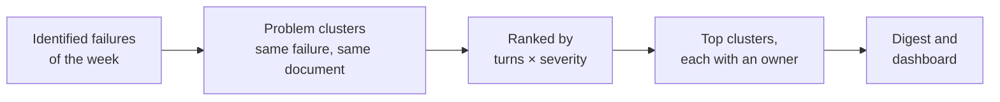

- **A problem cluster** holds the failures with the same primary failure and the same document: for turns that went through stage 2, the document to fix (§7.4); for other turns, the cited document. When there is no single document, because the turn cites none or several, or as for `NOT_IN_CITED_SOURCES`, the topic is used instead.
- **Ranking:** by the cluster's turns of the week, each weighted by its severity. The starting weights are 3 for `HIGH`, 2 for `MEDIUM` and 1 for `LOW`; they are tuned after the baseline. Each cluster also shows its trend against the 4 weeks before.
- **Owner:** follows from the failure type (§6.7): the team for prompt, model, search and indexer problems and for communication to users, a document owner for outdated or conflicting documents, a corpus owner for missing knowledge. `NOT_IN_CITED_SOURCES` goes to the team first, which finds out whether search or the corpus is at fault.

Example entry: *"HR House, document X: outdated source in 12 turns this week, up from 3. Owner: the document owner."*

### 9.2 How the team hears about it

| Where | When | What |
|---|---|---|
| Alert on Slack | After an assessment run; once a day for anomalies | `HIGH` failures found in the run, grouped like problem clusters (§9.1); an anomaly (§8.7); or a pipeline health problem: coverage below 98%, a turn waiting longer than 3 hours, a failed assessment run, or a gap in the log (§8.2); the full list is in §12.8. Cluster alerts carry the session grades of their turns as context (§7.7). |
| Digest on Slack | Weekly, on Monday | AQR trend, the top clusters with owners and trends, the best documents and topics, unusual items (fast-growing topics, growth of the `OTHER` topic, documents suddenly cited much more), release results. |
| Dashboard | Every morning | The metrics, anomalies and problem clusters above, over time, without session grades (§8.8). |

Quality alerts and the digest go to a new Slack channel used only for them, which the team reads. Pipeline health alerts go to the team's existing Slack alerts channel.

All of it is built from derived values only, and alerts give no time finer than the hour.

### 9.3 When a fix counts as done

1. The fix is recorded as a change event and linked to the clusters it should fix.
2. Before release, it must pass the release gate: better on synthetic questions about the cluster's document, and not worse on everything else (§10).
3. After release, the cluster is **closed** when its weekly turns stay below a quarter of their level before the fix for 2 weeks in a row. Until then it stays on the list as an **active** cluster.

Over time, the number of turns still in the baseline's top clusters shows whether the loop is working at all.

### 9.4 Open problems

| Problem | Why it matters | Next step |
|---|---|---|
| **How many `HIGH` failures make an alert** | Too low a bar floods Slack and teaches the team to ignore alerts; too high a bar hides the worst answers. | Set the bar with the first weeks of data. |

## 10. Verification

Every change has to be proven twice: before release on synthetic questions, and after release on the live numbers (§4.3). Real questions are never used for this.

### 10.1 Synthetic questions

The evaluator generates questions from our documents, each with the document it should be answered from.

| Set | Size | Built from | Purpose |
|---|---|---|---|
| **Anchor set** | 300 to 500 questions | Documents of every data store, in proportion to how often real traffic cites or retrieves them (at least 20 per data store). Fixed for a quarter. | Must not get worse. |
| **Focus set** | 10 to 20 questions per active problem cluster | The cluster's document. A `NOT_IN_CITED_SOURCES` cluster gets one once a document that holds the answer is named or added. | Must get better. |

Before a question is used, it is checked automatically: it can be answered from its document, it is not a duplicate, and it contains nothing from the people directory. When the anchor set is replaced each quarter, the old and new sets run side by side for 2 weeks so the results stay comparable.

### 10.2 Release gate

1. The candidate runs on a test engine, and the current version answers the same questions. Each version answers them twice.
2. The evaluator scores every answer against the question's expected answer and source document.
3. **Pass:** not worse on the anchor set, and better on the focus sets of the clusters the change targets, if any.
4. A difference counts only if it is larger than the spread between two runs of the same version.

A change that fails goes back to the team.

### 10.3 Release impact

After release, standardized AQR and the failure rates of the 5 complete weekdays before the change are compared with the 5 after it.

- **Verdict:** improved or regressed when the difference is larger than chance explains, otherwise no detectable change; *confounded* when another change falls in the same days.
- **What it can see:** about 3 percentage points on all web UI turns, about 8 points for a data store with 15% of the traffic. Smaller effects are left to the release gate.
- **Same judge on both sides.** If the judge changed in between, the comparison waits for the parallel run (§6.11).
- **A regression** is investigated or rolled back. Every verdict goes into the digest and onto the dashboard.

## 11. Trusting the judge

Nobody may read real conversations, so nobody can check the judge on them. The judge is checked on synthetic material instead, in three ways:

| Check | What it is | Question it answers |
|---|---|---|
| **Judge test suite** (§11.1-11.3) | A few hundred fixed synthetic cases, each with the form a perfect judge would fill in | How far is the judge from the right answers, and did a change make it better? |
| **Canary** (§11.4) | Evaluator questions that go through Bolek and the log like real ones | Does the whole path work on real log records, and does the evidence check catch planted errors? |
| **Checks on real traffic** (§11.5) | Signals that need no reading | Does the judge drift on real traffic? |

### 11.1 The judge test suite

The suite works like unit tests for the judge. Each **case** has:

- **A fixed input:** a question, an answer, its references, the earlier turns, and the full text of the documents it cites or links. Because the documents are part of the case, the evidence check and stage 2 get the same documents on every run.
- **The expected form:** what a perfect judge fills in. That is the stage 1 form, the evidence check result, the stage 2 form, and, for conversations, the session grade.

Cases are fed straight to the judge. Bolek and the log are not involved, so between two runs only the judge changes. The cases are synthetic, so engineers may read and write them, in Polish and English.

**Scenarios.** The suite is built from a list of scenarios, so that each value below is tested on purpose, not by chance:

| Dimension | Values | At least |
|---|---|---|
| Intent | All 8 | 10 cases each |
| Evidence | Own references, earlier turns' references, none | 20 cases each |
| Failure type | Every code, including `NONE` | 5 cases each |
| Severity | `LOW`, `MEDIUM`, `HIGH` | 20 `HIGH` cases, plus near misses where a claim is only unsupported |
| Relation to the previous turn | All 6 | 5 cases each |
| Stage 2 cause | Every cause on the path (§7.3), and no cause (the answer itself) | 5 cases each |
| Session outcome | All 4 | 10 conversations of 3 to 5 turns each |
| Edge cases | Refusal, wrong language, people lookup, private details, very long context | 5 cases each |

That adds up to a few hundred cases. A language model drafts them from the scenario list, and an engineer checks every expected form against the rubric before the case joins the suite. When the rubric changes what a level means, the affected expected forms are updated, and the suite gets a new version.

**Held-out part.** About 20% of the cases are kept aside and never looked at while the judge is tuned. They show whether a change really works, or only fits the cases it was tuned on. The other 80% are the tuning part.

### 11.2 Scoring: distance from the expected form

Every case gets a **distance**: 0 when the judge filled in exactly the expected form, and more the further it is off. Each field adds its own part:

| Field | Distance | Weight |
|---|---|---|
| Intent | 0 if right, 1 if wrong | 3 |
| Needs internal knowledge, relation to the previous turn, each yes / no check | 0 if right, 1 if wrong | 1 each |
| Each score (relevance, completeness, clarity, groundedness) | The difference divided by 4. For relevance and groundedness, plus 1 if the two scores fall on different sides of a decision line (2 or lower flags the turn, 4 or higher counts as good). | 1 each |
| Answer span counts | The difference in unsupported spans divided by the number of spans, at most 1 | 1 |
| Failure types | The share of codes that are not in both lists | 2 |
| Primary failure | 0 if right, 1 if wrong | 2 |
| Severity | A false `HIGH` is 5, a missed `HIGH` is 3, `LOW` instead of `MEDIUM` or the other way round is 1 | 1 |
| A field filled that should be empty, or the other way round | 1 per field | 1 |
| Stage 2 cause, document to fix | 0 if right, 1 if wrong | 2 and 1 |
| Session outcome, turn where it went wrong, recovered after correction | 0 or 1; the difference in turns, at most 1; 0 or 1 | 2, 1, 1 |

**Why these weights.**
- A mistake that changes a decision costs more than one that doesn't. Relevance 3 instead of 4 costs 1.25, because the turn stops counting as good. Relevance 4 instead of 5 costs only 0.25.
- A false `HIGH` costs the most, because it is the error that costs the team's trust.
- Intent costs a lot, because it decides which fields are asked at all.

The weights are starting values, versioned with the suite.

**Suite distance.** The judge varies between runs, even at temperature 0, so the suite is run 3 times and the distances are averaged. The result is the mean distance per case, shown overall, per field and per scenario, so the breakdown shows which part of the judge to work on next. A distance of 0 is not expected; the goal is to bring the distance down.

### 11.3 Using the suite

1. Every change to the judge, whether rubric, prompt, model or form, runs the suite.
2. **The change is kept only if** the distance on the tuning part goes down, the distance on the held-out part does not go up, and the number of false `HIGH`s does not go up.
3. It then goes live through the parallel run (§6.11).

The first version of the suite exists before launch, and the rubric is tuned on it. A failure type or label is used in ranking and alerts only when the suite shows that the judge finds it reliably: as a starting value, in at least 70% of the cases where it is expected. Until then it is shown as *experimental*.

### 11.4 Canary

The canary checks what the suite can't: the real path from Bolek's answer through the log to the stored assessment.

- **Agreement:** canary turns are assessed like real turns, and the results are compared with the evaluator's own scores, which use the expected answers. The agreement per field is tracked over time.
- **Planted errors:** known errors are put into canary answers, such as a swapped number, a dropped step or a wrong name, with and without references. This measures how many of them stage 1 catches (the form when the answer has references, the evidence check when it has none but links documents), and how many correct answers it wrongly marks `HIGH` (§6.12).
- **Schedule:** the evaluator runs once a day on a schedule, so the real path is checked every day.
- **Limits:** its questions are single turns in English, so sessions are tested only by the judge test suite.

### 11.5 Checks on real traffic

- **Second model:** 5% of real turns are graded again with the stage 2 model. The disagreement rate is tracked; only that number is stored.
- **Dislikes:** disliked turns should have a much lower AQR than the rest. Dislikes are too rare for statistics, so this checks direction only.
- **Stage 2 changes:** how often stage 2 drops or changes stage 1 findings (§7.6). A rising rate means the stage 1 rubric needs work.

### 11.6 Open problems

| Problem | Why it matters | Next step |
|---|---|---|
| **Writing the expected forms** | A few hundred cases, each checked by an engineer, is several days of work, and the suite must exist before launch. | Draft with a language model from the scenario list, check in batches, start with the stage 1 cases. |

## 12. Proposed architecture

This section describes how we build and run the system. Production runs in the GCP project `rtbhouse-agentspace`, where the log and Bolek's data stores already are. A stage copy runs in `rtb-aiel-core-stage` and reads the same log (§12.14). The processing is done by **Cloud Run jobs**, and all results are stored in **BigQuery**. There are no services waiting for requests. Each job is started by a schedule or by hand, does its work and exits.

### 12.1 Overview

The work is split into two paths:

- The **assessment path** reads new turns from the log while their answers still exist, and stores derived values for each turn.
- The **reporting path** reads those values and produces the metrics, the Slack messages and the dashboard.

Text is handled only on the assessment path.

**What the system talks to**

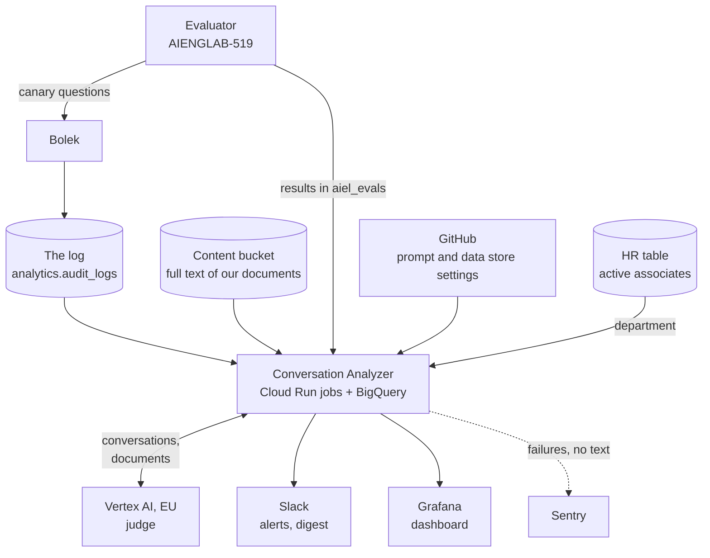

**The assessment path**

Only the assessor handles text. Our indexers keep writing the full text of our documents to the content bucket, as they do today; this system only reads it, and the indexers are not changed.

Every 10 minutes, the assessor assesses the turns in the window. It reads the full text of the documents an answer cites or links from the content bucket, and the department of each user from HR's table of active associates.

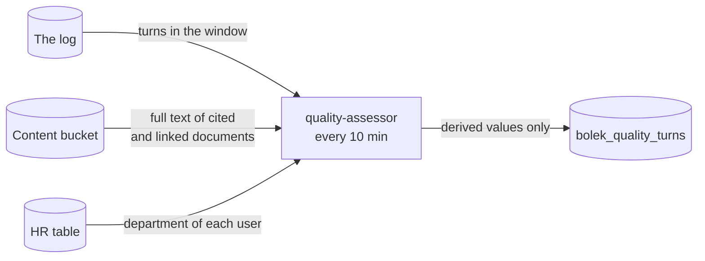

**The reporting path**

Three jobs share one service account and never handle text.

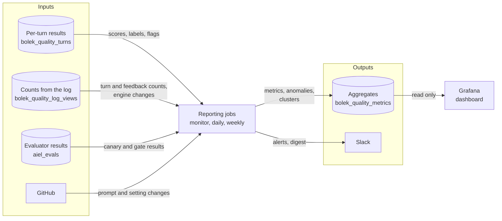

Two more jobs don't belong to either path. `quality-judge-suite` runs the judge test suite on synthetic cases, and `quality-record` lets us record a change by hand (§12.3).

In short, **only the assessor ever reads what users asked and what Bolek answered**. It keeps that text in memory, and only while a run lasts. The indexers handle document text, as they already do, and are not part of this system. All other parts work only with derived values or aggregates.

### 12.2 Building blocks

| Service | What we use it for | Already used in this project? |
|---|---|---|
| **Cloud Run jobs** | All processing | Yes, by the indexers and by the jobs that replace the old Composer DAGs |
| **BigQuery** | Reading the log, the HR table of active associates and the evaluator's results, and storing every result | Yes, the log is there |
| Cloud Scheduler | Starting jobs on schedule, in UTC | Yes, by the indexers |
| Secret Manager | The hashing key for session and turn keys, the secrets that decrypt the content bucket, the Slack and GitHub tokens, the Sentry DSN | Yes, by the indexers and the MCP server |
| Artifact Registry | Storing the container image | Yes, by the indexers |
| Vertex AI, EU | The judge models, `gemini-3.8-flash` and `gemini-4-argon`, on the `eu` multi-region | Yes |
| Content bucket (GCS) | The full text of our documents. Our indexers write it, encrypted. | Yes, the MCP server reads it |
| Our indexers | Unchanged: they write the full text of our documents to the content bucket, which the assessor reads (§12.7) | Yes, they are Cloud Run jobs in this project |
| HR table of active associates | The user's department (§8.4) | Yes, the people directory's indexer reads it |
| Sentry | Reporting job failures, with no text in them | Yes, by the indexers |
| Slack app | Posting alerts and the digest, and reading ✅ reactions on alerts | New app, in our existing Slack workspace |
| Central Grafana | The dashboard (§8.8), defined in the `infra-grafana-dashboards` repository | Yes, the company's shared Grafana |
| GitHub Actions | Testing every change, building the image and pushing it to Artifact Registry | Yes, by the indexers |
| Terraform in the `infrastructure` repo | Defining all of the above | Yes, for the indexers |
| Evaluator (AIENGLAB-519) | Asking canary questions on the production engine, and running the release gate. It writes its results to the BigQuery dataset `aiel_evals`. | Being rebuilt in AIENGLAB-519 |

We don't add anything else. Two things are left out on purpose:

- There is no Cloud Run service. The only reason to have one would be to receive Slack's callback when someone clicks a button. Instead, people acknowledge an alert by reacting with ✅, and a job reads the reactions. That way the project that holds the log has no public endpoint (§12.8).
- There is no message queue or workflow engine. The jobs depend on each other only through timing. The daily job runs after the previous day's answers have been erased, and the monitor runs 5 minutes after each assessment run. Fixed schedules are enough for that.

### 12.3 Jobs

| Job | When it runs | What it does | Time limit | Service account |
|---|---|---|---|---|
| `quality-assessor` | Every 10 minutes | All the work that needs the text of turns. It reads the window, groups turns into sessions, and runs stage 1, the evidence check, stage 2 and session grades. It also handles feedback, late triggers, the canary, the second-model check, the pace check and retrieval counts. | 9 minutes | `quality-assessor` |
| `quality-monitor` | Every 10 minutes, 5 minutes after the assessor | Checks the health of the last assessment run, and once an hour checks the log for gaps. Sends `HIGH` cluster alerts. Reads ✅ reactions on alerts. | 5 minutes | `quality-reporter` |
| `quality-daily` | Every day at 05:00 UTC | Collects change events, computes the daily metrics, runs the anomaly check and release impact, and sends anomaly alerts (§12.9) | 30 minutes | `quality-reporter` |
| `quality-weekly` | Mondays at 06:00 UTC | Builds and ranks problem clusters, closes clusters that were fixed, computes document stats, picks documents for the anchor and focus sets, and sends the digest | 30 minutes | `quality-reporter` |
| `quality-judge-suite` | By hand, for every change to the judge | Runs the judge test suite (§11.1-11.3) | 60 minutes | `quality-judge-suite` |
| `quality-record` | By hand, with arguments | Records a change event that no source collects on its own, such as a document fix or a rebase of the AQR weights | 5 minutes | `quality-reporter` |
| `quality-db-init` | By hand, after a deploy that changes the schema | Creates missing tables and views and adds new columns, from the schema in the code; with `--check`, only compares | 10 minutes | `quality-schema` |

- All jobs use the same container image, built from one repository. Each job runs a different command.
- Tables are never dropped or recreated by a job; schema changes only add.
- As with the indexers, the schedules use UTC and Cloud Scheduler never retries a start. A retry would start a second run in parallel with the first.
- A day in this system is a UTC day. A day's numbers can still change until its last answers are erased, which happens by about 04:22 UTC the next day (§8.1). That is why the daily job runs at 05:00 UTC, which is still before the team starts work.

### 12.4 Who can see what

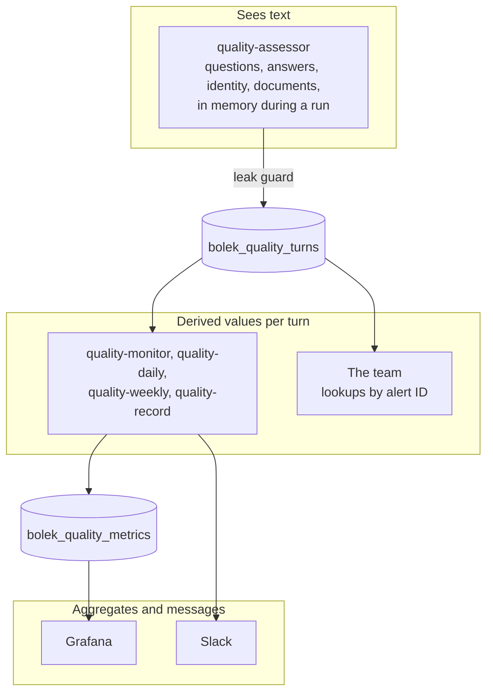

Each job has its own service account, with only the access it needs:

| Service account | Can read | Can write | Can call |
|---|---|---|---|
| `quality-assessor` | Only the `audit_logs` table in `analytics`; `bolek_quality_turns`; the content bucket; `aiel_evals`; `Email` and `base_function` of the HR table of active associates | `bolek_quality_turns` | Vertex AI. In Secret Manager: the hashing key and the content secrets. |
| `quality-reporter` | `bolek_quality_turns`; `bolek_quality_log_views`; `analytics.ge_metrics`; `aiel_evals`; the run history of the indexer jobs | `bolek_quality_metrics` and the alert tables | Slack. GitHub, read only. |
| `quality-judge-suite` | Nothing outside its image, which contains the suite | `bolek_quality_metrics.quality_judge_suite_runs` | Vertex AI |
| `quality-schema` | | The tables and views of the three datasets | |
| Grafana's account | `bolek_quality_metrics` | | |
| The team | `bolek_quality_turns`, `bolek_quality_metrics` | | |

- The assessor gets access to the `audit_logs` table only, not to the whole `analytics` dataset. That dataset also has tables with e-mail addresses, such as hourly activity per user.
- The reporting jobs never read the log directly. They need three things from it: turn counts per hour, feedback counts and engine changes. They get them through **authorized views** in `bolek_quality_log_views`. The views return only counts and change records, and whoever reads them doesn't need access to the log table itself.
- Only the assessor has the hashing key used for session and turn keys (§12.5).
- In stage, every account exists again with a `stage-` prefix and the same access, on the `stage_` datasets. The stage assessor reads the same prod log table, content bucket and HR table as the prod one (§12.14).

### 12.5 Turn and session keys

The assessor has to recognise the same turn in later runs, and it has to attach feedback to the right turn. It must do this without storing anything that would link the log's records to sessions (§3.1). So we build our own keys from values that the anonymizer erases:

| Key | Built from | Why |
|---|---|---|
| **Session key** | A keyed hash of the engine and the session ID | The session ID is erased after 4 hours. After that, nobody can compute the key again from the log. |
| **Turn key** | A keyed hash of the answer's resource name, which contains the session ID and the answer ID | The resource name is erased together with the answer, so the same applies. |

- We never store the log's own IDs for a turn, not even as a hash. Those IDs stay in the log for 30 days. Anyone with the key could hash them again and use the result to link a turn's question to its session.
- Feedback is matched to its turn by turn ID while the turn is in the window. The feedback record and the turn's record in the log carry the same turn ID, so the assessor matches them in memory. The ID is never stored.
- After the window, our stored turn has nothing that ID could match, so the assessor falls back to session key and position. A feedback record keeps the session ID and the question's position in the session for 30 days. The assessor computes the session key from it and takes the turn at that position. This fallback is switched on only after a test on synthetic chats shows that the feedback's numbering matches our positions (§12.17). Until then, feedback that arrives after the window is only counted.
- If the turn is less than 3h30 old, a dislike also counts as a late trigger.
- For each turn we store its segment number, its position in the segment and its position in the session.

### 12.6 One assessment run

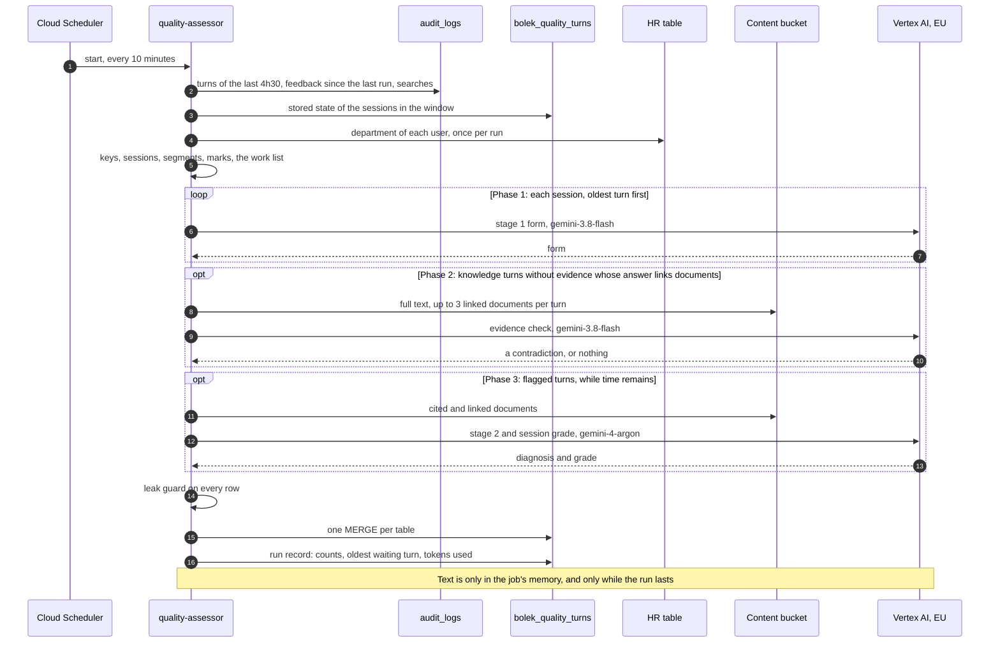

| Step | What happens |
|---|---|
| Read the window | One query reads the production engine's turns from the last 4h30 on all channels, the feedback records that arrived since the last run, and the search records still in the window. |
| Work out the sessions | In memory, the assessor computes session and turn keys and groups the turns into sessions and segments. It marks canary turns (by the evaluator's prompt prefix and accounts), turns from users who are too fast to be human (more than 10 turns in 10 minutes), and turns that are too large. It maps each user to a department family, in memory. |
| Load what was stored | For the sessions in the window, it loads what earlier runs stored: each turn's fingerprint, its flags and whether stage 2 is pending, and the segment numbers, segment states and session grades. Segment numbers must come from storage, because the first segments of a long session may already be erased. |
| Build the work list | The list holds new turns, turns whose fingerprint changed, turns flagged by a late trigger, closed segments that need their final grade, and the 5% sample for the second-model check. During a parallel run, every turn is on the list twice. Turns that reached 3h30 without an assessment are recorded as missed. |
| Phase 1 | Stage 1 for every turn on the list, oldest first. Different sessions are processed in parallel, but the turns of one session go in order, because each turn's form depends on the turns before it. |
| Phase 2 | The evidence check (§6.9) for knowledge turns without evidence whose answer links documents we can read: one judge call per turn. |
| Phase 3 | Stage 2 and session grades for flagged turns, oldest first, for as long as the run has time. |
| Write | The leak guard checks every row (§6.10). Then one `MERGE` per table writes the results. Rows are keyed by turn key, stage and judge version, so writing the same result twice replaces the row instead of adding a second one. |

- Stage 1 always goes first. After 7 minutes, the run stops starting new judge calls. A flagged turn that didn't get to stage 2 is marked as pending and goes first in the next run. If it is still pending when the turn is 3h30 old, we give up on its stage 2 and count it, because the turn's text is about to be erased.
- The assessor also counts retrievals. The anchor set gives more weight to documents that traffic often cites or retrieves (§10.1). The documents returned by Bolek's searches are erased together with the answers, so the assessor counts them per document and day while they still exist. Searches made by canary accounts are not counted. A search record names only document IDs, so each ID takes its data store from the references seen in the window; an ID that no reference names is not counted.

### 12.7 Reading our documents

The evidence check and stage 2 read the full text of our documents. They can't use Bolek's search for that: our data stores only return documents the caller is allowed to see, and a service account has no Google Workspace identity, so it gets nothing back. They read from the content bucket instead.

- **Which documents.** Only those a turn points at: its cited documents (stage 2) and the documents linked in its answer text (evidence check and stage 2). This system has no search of its own (§6.9).
- **Where from.** Our Cloud Run indexers already write the full text of every document they index to the content bucket, encrypted, for the MCP server. The assessor reads it with the content secrets, at a path derived from the document's link. Which bucket holds a data store's text is a setting, based on the data stores the production engine uses.
- **What it covers.** Every data store filled by our Cloud Run indexers, except the people directory, which is never read. Google Drive documents have no text in the bucket (about 6% of citations). A data store still filled by an older indexer has no text until it moves to the Cloud Run indexers.
- **What is kept.** Only the IDs of the documents read, through the leak guard. A linked document takes the log's ID when a reference in the window has the same link, otherwise `url-` and a hash of its link. The text exists only in memory during the run.
- **Nothing changes for the indexers.** An earlier version of this design added a step to the indexers that wrote vectors of every document to a document index in BigQuery. It was dropped together with the search (§6.9).

### 12.8 Alerts, digest and acknowledgement

| Message | Sent by | When | Slack channel |
|---|---|---|---|
| `HIGH` cluster alert | `quality-monitor` | 5 minutes after an assessment run that found new `HIGH` failures above the alert bar (§9.4) | The quality channel |
| Pipeline health alert | `quality-monitor` | When coverage drops below 98%, a turn waits more than 3 hours, there has been no assessment run for 25 minutes, a run failed, the log has a gap, the window is shorter than 3h45, or the daily token limit was passed | The team's existing alerts channel |
| Anomaly alert | `quality-daily` | After the daily anomaly check | The quality channel |
| Digest | `quality-weekly` | Every Monday | The quality channel |

All messages are built from templates and contain only derived values, with no time finer than the hour. Each alert has an ID, and the session grades shown in it can be looked up later by that ID.

This is how an anomaly gets acknowledged:

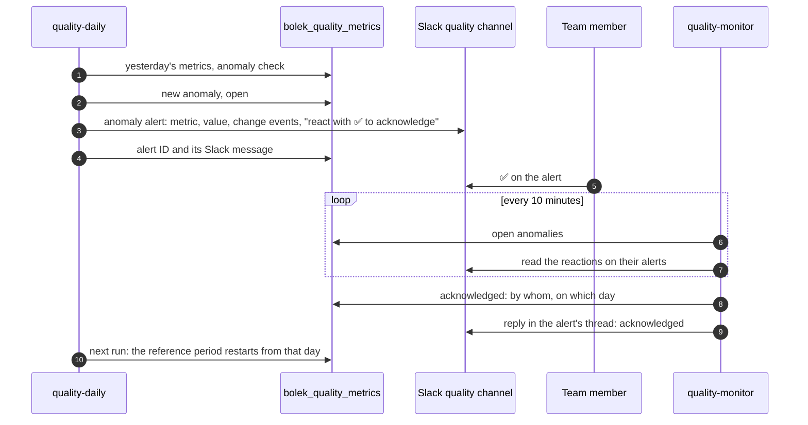

### 12.9 Daily and weekly jobs

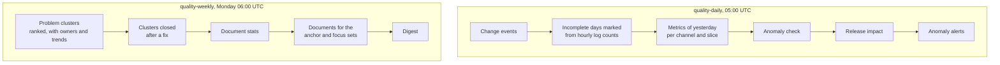

- All numbers are computed from scratch from the stored per-turn rows (§8.1), so re-running a day or a week gives the same result.
- Coverage is measured against the log. The number of eligible turns is taken from the log's own counts, through the authorized views. That way, if the assessor is down for hours, the turns it never saw still count as missed.
- Change events come from five sources:

| Source | How we collect it |
|---|---|
| Engine, agent and connector changes | From the log, through an authorized view |
| Changes to Bolek's prompts and data store settings | From commits to the repositories that hold them, through the GitHub API. A commit message can name the problem clusters the commit fixes. |
| Indexer runs | From the run history of the indexer jobs in this project |
| Judge changes and parallel runs | The assessor records a judge version the first time it uses it |
| Everything else, such as a document fix or a rebase of the AQR weights | Someone runs `quality-record` by hand |

### 12.10 Data model

All datasets are in the EU, the same location as `analytics`. Their tables and views are created by `quality-db-init` from the schema in the code. Per-turn tables are partitioned by day and kept for 1 year. Aggregates are kept without a limit.

| Dataset | Table | One row per | Written by |
|---|---|---|---|
| `bolek_quality_turns` | `quality_turns` | Turn: channel, day, keys, positions, gap bucket, status (assessed, too large, missed or failed), canary and pace marks, department family, evidence kind, cited and found document IDs, flag reasons, stage 2 state, feedback | Assessor |
| | `quality_stage1_results` | Turn and judge version: the form (§6.4), fingerprint, versions (§6.11) | Assessor |
| | `quality_stage2_results` | Flagged turn and judge version: the stage 2 form (§7.4), with up to 3 problem claims | Assessor |
| | `quality_segments` | Session segment: its session facts, and whether it is open or closed | Assessor |
| | `quality_session_grades` | Graded segment (§7.7) | Assessor |
| | `quality_canary_results` | Canary turn, as answered or with a planted error: its forms, a hash of the question, the planted error, whether it was caught | Assessor |
| | `quality_judge_checks` | Day and field: second-model disagreements (§11.5) | Assessor |
| | `quality_retrieval_counts` | Day and document: how often Bolek's searches returned it | Assessor |
| | `quality_judge_versions` | Judge version: what it consists of, when it started, its parallel run | Assessor |
| | `quality_runs` | Assessment run: turns read, assessed, too large, missed, and failed by error class; oldest waiting turn; window margin; throttled calls; tokens used | Assessor |
| | `quality_alerts`, `quality_alert_sessions` | `HIGH` cluster or pipeline health alert; alert and session segment, for lookups by alert ID. Anomaly alerts are stored with their anomaly. | `quality-monitor` |
| `bolek_quality_metrics` | `quality_metrics_daily` | Day, channel, metric and slice | Daily |
| | `quality_anomalies`, `quality_acknowledgements` | Anomaly; acknowledgement | Daily; monitor |
| | `quality_pipeline_health` | Assessment run, and hour of the log | Monitor |
| | `quality_problem_clusters`, `quality_document_stats` | Week and cluster; week and document | Weekly |
| | `quality_release_impact` | Change and metric (§10.3) | Daily |
| | `quality_change_events` | Change event | Daily, `quality-record` |
| | `quality_judge_quality`, `quality_judge_suite_runs` | Day and measure (canary agreement, planted errors caught, second-model disagreement); suite run | Daily; judge suite |
| | `quality_eval_documents` | Set and document: documents to generate anchor and focus questions from | Weekly |
| `bolek_quality_log_views` | `quality_turn_counts_hourly`, `quality_feedback_counts_daily`, `quality_engine_changes` | Authorized views over the log that return only counts and change records | (views) |

**How the per-turn tables connect.** The diagram shows only the main columns. `PK` marks the columns that identify a row, and `FK` marks columns that point to another table.

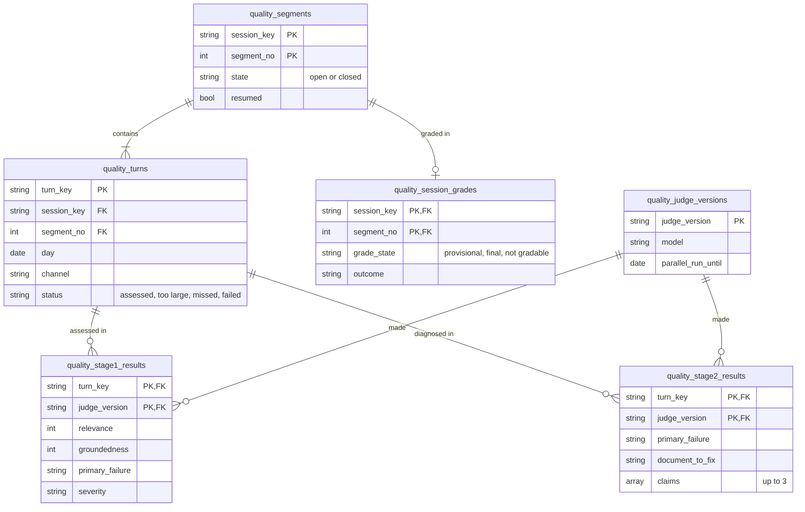

- A turn that is too large or missed has no stage 1 result. A turn has a stage 2 result only if it was flagged. During a parallel run, a turn has one result per judge version for each stage.
- A segment has at most one session grade. A newer grade replaces the older one.

**Looking up session grades from an alert** (§7.7). A `HIGH` cluster alert stores the segments of the turns it reports, so the grades it showed can be found later by the alert's ID.

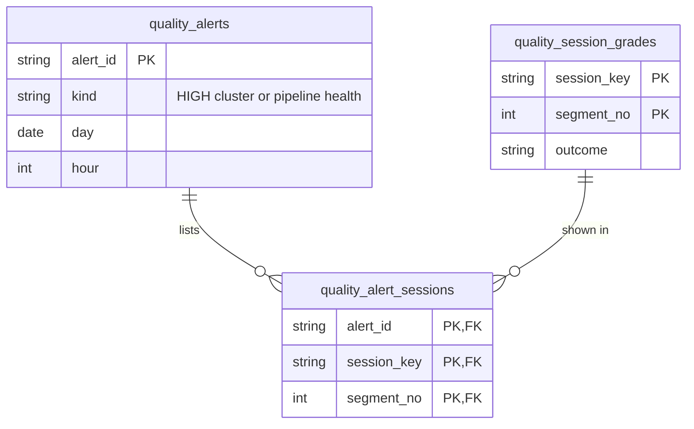

In stage, the same three datasets exist in `rtb-aiel-core-stage`, named with a `stage_` prefix (§12.14).

Each table is written by exactly one job. Two jobs never change the same table at the same time, so BigQuery's limits on concurrent changes to a table don't apply. And when a table looks wrong, there is only one job to check.

### 12.11 Canary, judge test suite and the evaluator

The evaluator is being rebuilt in AIENGLAB-519. The new version uses promptfoo, runs as a Cloud Run job, and writes one row per run, question and metric to the BigQuery dataset `aiel_evals`. The two systems exchange data only through BigQuery.

| Part | Who runs it | How it works |
|---|---|---|
| **Canary** (§11.4) | The evaluator, once a day, on the production engine | Its questions land in the log like real ones. The assessor recognises them by the evaluator's prompt prefix and accounts, assesses them like real turns, and writes the results to `quality_canary_results`. They never count in the metrics. |
| Planted errors | The assessor | It makes changed copies of canary answers, for example with a number swapped, a step removed or a name changed, and assesses those too. This is allowed because canary turns are synthetic. |
| Agreement with the evaluator | `quality-daily` | It matches canary results to the evaluator's scores in `aiel_evals` by a hash of the question text. |
| **Judge test suite** (§11.1) | `quality-judge-suite`, for every change to the judge | The test cases are files in the repository. The job runs the suite 3 times and stores the distances in `quality_judge_suite_runs`. The rule in §11.3 decides whether the change is kept. |
| **Release gate** (§10.2) | The evaluator, for every change | `quality-daily` and `quality-weekly` read its verdicts from `aiel_evals` and show them on the dashboard and in the digest. |
| Anchor and focus sets (§10.1) | `quality-weekly` picks the documents, and the evaluator writes the questions | The list of documents is passed through the `quality_eval_documents` table. |

We need three things from the evaluator, and we agree them with its owner in milestone 0:

- a daily run on the production engine, for the canary;
- gate results that name the change they test;
- generating questions from `quality_eval_documents`.

The last one isn't planned in 519's current phase. Milestone 7 waits for 519's next phase.

### 12.12 Reliability

- Runs never overlap. The assessor's 9-minute time limit is shorter than the 10 minutes between runs. A failed run is not retried, because the next one starts 10 minutes later anyway. Writes are keyed, so even if a run were repeated, it would replace rows rather than duplicate them.
- Missing a run doesn't lose anything. Each turn gets about 20 chances to be assessed before it is 3h30 old. A turn is lost only if the assessor is down for 3h30 or longer, and even then it is counted as missed (§12.9).
- We measure the window instead of assuming it. Each run records the age of the oldest answer still in the log. If that drops below 3h45, for example after the anonymizer moves to Cloud Run, the monitor sends a pipeline health alert.
- Vertex AI serves these models from shared capacity, so it sometimes refuses a call with `429`. We retry with increasing waits and count the refused calls in each run.
- Token use is recorded per run and per model. A daily limit, which is a setting, protects against a bug that loops, and the monitor alerts when the limit is passed.
- On a weekday, about 20 turns arrive every 10 minutes. We haven't measured the peak yet. One job making about 8 judge calls at a time should be enough. If it isn't, the assessor can be split into several Cloud Run tasks by session key, so that each session is still handled by a single task.
- The assessor gets 4 GB and 2 CPUs. With no PII scrubber and its language models in the image, this can be lowered once the stage runs show what it uses.
- If Cloud Scheduler itself stops, nothing alerts, because the monitor is started by the same scheduler as the assessor. We accept this. The dashboard shows pipeline health per run (§8.8), so missing runs show up in the morning check. A stop overnight can lose turns.

### 12.13 Keeping text out

The leak guard (§6.10) protects what we store. Logs, error reports and outside services need their own rules:

- **Logs.** Cloud Run sends everything a job prints to Cloud Logging, and this project copies all its logs to a GCS bucket that keeps them for 7 years. So our jobs log only through one wrapper, which accepts run IDs, counts, codes and error classes and nothing else. A test plants text in a run and fails if any of it shows up in the logs.
- **Sentry.** Errors are reported only as error classes, with no messages, local variables or request bodies.
- **Vertex AI.** Request logging stays switched off. Before launch, we run each job once on synthetic data and check whether the cloud audit logs of its calls to Vertex AI, Secret Manager and GCS contain any content. If some do, those entries of our service accounts are excluded from the 7-year log copy, as agreed with SECOPS.
- **Slack.** Messages are built from templates filled with derived values (§12.8).

### 12.14 Deployment and versions

- One repository, `RTBHouse-OEET/aiel-conversation-analyzer`, holds the code, the rubrics, the prompts, the closed lists, the judge test suite, the table schema and the settings. The settings include the 30-minute segment close, the size cap, the minimum slice size, the alert bar and the ranking weights. GitHub Actions tests every change, builds the image on every merge and stores it in the Artifact Registry of both projects.
- Terraform in `infrastructure/terraform/rtbhouse-agentspace` (prod) and `infrastructure/terraform/rtb-aiel-core-stage` (stage) defines the datasets, service accounts, permissions, secrets, jobs and schedules. The tables and views are created by `quality-db-init` from the schema in the code, so the two can't drift apart. Jobs name their image by digest, so a deploy and a rollback are each a one-line change.
- **Two environments.** Prod runs in `rtbhouse-agentspace` and writes `bolek_quality_*`. Stage runs in `rtb-aiel-core-stage` with its own service accounts, its own hashing key (so stage and prod rows can never be joined), its own Slack channel and the test instance of Grafana, and writes `stage_bolek_quality_*` there. It reads the prod log, content bucket and HR table, so every change is tried on real traffic before prod. A change goes to stage first, then the same image to prod; the steps are in `deployment-plan.md`.
- **Stage runs only when switched on.** Stage assesses full traffic, which costs as much as prod. Every scheduled stage job first reads a control object in a stage bucket that holds an end time; after that time, the job records a paused run and exits at once, with no judge call and no message. Opening stage for some hours sets the end time, so stage closes by itself. Paused periods raise no pipeline health alerts and are marked on the stage dashboard. Prod has no such switch.
- A judge version is identified by a hash of its rubric, prompt, model and form. The settings name the current version. During the 5 weekdays of a parallel run, they also name the previous one, and the assessor assesses every new turn with both (§6.11). The parallel run ends with a change to the settings.

### 12.15 Cost

These are estimates, based on the input sizes we measured in the window and on today's list prices. We will compare them with the real token counts in `quality_runs` during the first weeks.

| Item | Per month |
|---|---|
| Stage 1 on all channels, with earlier turns as context | About 200 USD, and about 400 USD from 2027, when `gemini-3.8-flash` prices double |
| Evidence check | At most about as much as stage 1 (§6.9). How many turns need it is measured in the first week (§6.12). |
| Stage 2 and session grades on `gemini-4-argon` | Up to about 10M input tokens per weekday. The price isn't known yet. |
| Second-model check on 5% of turns | Small |
| BigQuery: reading the window every 10 minutes, computing the daily metrics | About 10 to 20 USD |
| Cloud Run, Cloud Scheduler, Secret Manager, Artifact Registry | About 20 to 40 USD |
| Stage | As much as prod for every hour it is switched on, nothing while it is paused (§12.14) |

### 12.16 Build plan

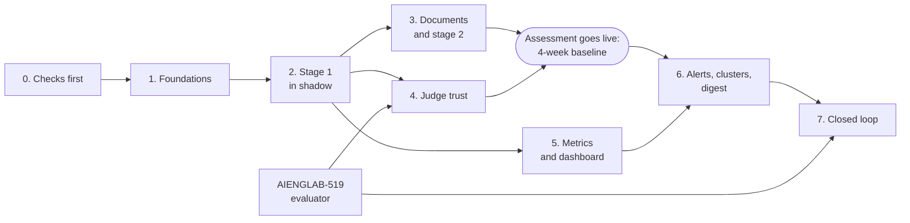

| # | Milestone | What it includes | Done when | Engineer-weeks |
|---|---|---|---|---|
| 0 | Checks first | The feedback numbering check (§12.17), the audit log check (§12.13), approval of the Slack app, and the agreement with AIENGLAB-519 (§12.11) | Each check is answered, or the design is changed | 1 |
| 1 | Foundations | The repository and image; Terraform for all datasets, views, service accounts, secrets, jobs and schedules; the logging wrapper, Sentry, the leak guard and its tests | An empty assessor run writes its run record | 1 |
| 2 | Stage 1 in shadow | Reading the window; keys, sessions and segments; stage 1; too-large and missed turns; feedback; the pace check; the monitor with pipeline health alerts | Coverage stays at 98% or more for 5 weekdays | 3 |
| 3 | Documents and stage 2 | Reading the content bucket; the evidence check, stage 2, session grades and late triggers | The share of flagged turns and the evidence check's reach are measured | 2 to 3 |
| 4 | Judge trust | The judge test suite and its job, rubric tuning, the canary, planted errors and the second-model check | The tuned judge passes §11.3, and the canary runs every day | 2 to 3, mostly spent writing expected forms |
| 5 | Metrics and dashboard | `quality-daily` (log completeness, change events, metrics) and the Grafana page | The team reads the dashboard every morning | 2 |
| 6 | Alerts, clusters, digest | `quality-weekly`, `HIGH` alerts, anomaly alerts with ✅ acknowledgement, and release impact | The first digest goes out. Anomaly checks start when the baseline ends (§8.6). | 2 |
| 7 | Closed loop | Picking documents for the anchor and focus sets, and showing gate results in the digest | Every production change has a gate result and a release impact | 1, plus the evaluator's part |

The build is done in a private repository (`plan.md`). It moves to the official repository and to GCP step by step, stage before prod, as described in `deployment-plan.md`.

In total, this is about 14 to 16 engineer-weeks. Assessment goes live, and the 4-week baseline starts, once stage 1, the evidence check and stage 2 run with the tuned judge. Milestones 5 and 6 can be built during the baseline. Metrics are computed from stored rows, so starting them later doesn't lose any days.

### 12.17 Open problems

| Problem | Why it matters | Next step |
|---|---|---|
| **Does the question index in a feedback record match the turn's position in the session?** | Feedback that arrives after the window is matched to its turn by that position (§12.5). | Check it on synthetic chats in milestone 0. Until it is confirmed, feedback that arrives after the window is only counted. |
