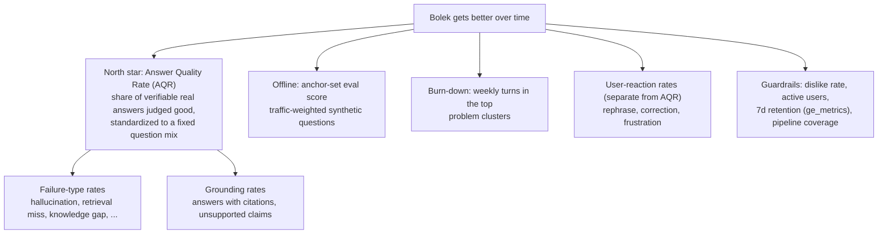
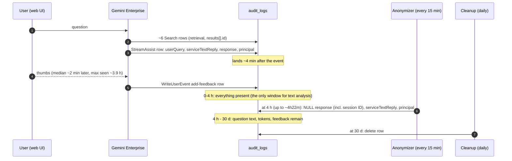
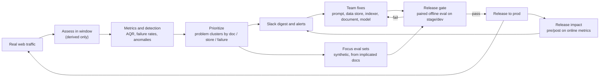
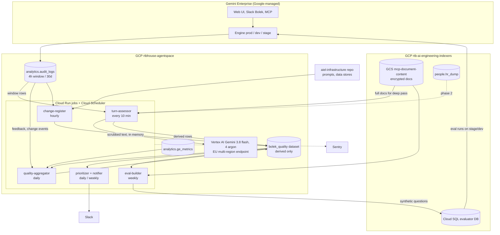
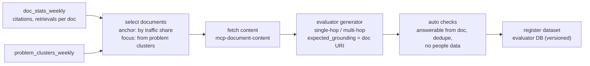
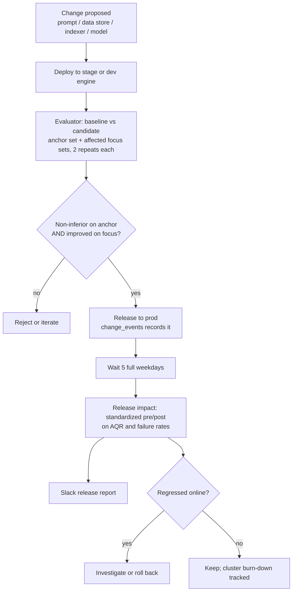
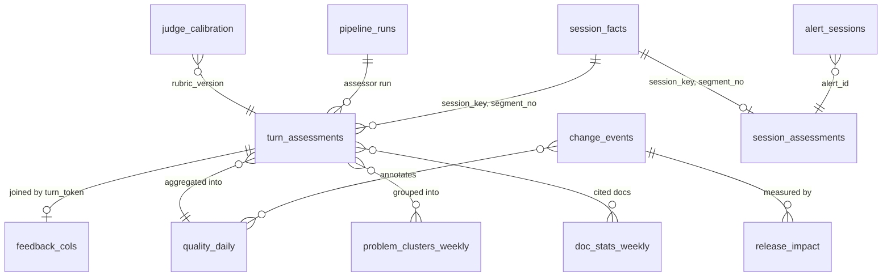

# Bolek Quality Loop: design doc

| | |
|---|---|
| Epic | AIENGLAB-543 (Bolek RAG - Conversation Analyzer), task AIENGLAB-782 |
| Status | Draft v5, 2026-10-21 |
| Owner | Paweł Borkowski |
| Scope | All Bolek channels from the start: Gemini Enterprise **web UI**, **Slack Bolek** and **MCP** (D5). |
| Supersedes | "Design doc - Feedback Analysis Agent" (AIENGLAB-235/236, epic closed as Duplicate). Absorbs `monitoring.md` v2, the adopted parts of `session-analysis.md` (D17-D22) and the findings of AIENGLAB-787, 795-803 (`consistency-review.md`, v5). |

## 1. Summary

Bolek answers ~900-1,450 web questions per weekday (plus ~115 per day over Slack and MCP) and nobody knows which answers were good. Answers and identities exist for only ~4 hours before the anonymizer erases them, question text for 30 days, and explicit feedback covers ~0.1-0.15% of answers.

This design closes the loop with four parts:

1. **Assess every answer (web, Slack, MCP) while it still exists.** A Cloud Run job reads each new turn inside the 4h window, scrubs PII, asks an EU-hosted Gemini model to grade it against a closed rubric, and stores only derived values (scores, closed-list labels, cited document IDs). Text is discarded.
2. **Turn assessments into numbers and priorities.** Daily metrics (Answer Quality Rate, failure rates), anomaly detection, and a weekly ranking of problem clusters keyed by document, data store and failure type.
3. **Turn priorities into synthetic evals.** Documents that real traffic uses, or that cause failures, become sources for generated eval questions in the existing evaluator. No real question is ever copied or re-asked.
4. **Measure every change twice.** Before release, a paired offline eval on a traffic-weighted synthetic set (release gate). After release, a pre/post comparison of the online metrics. Results go to Slack.

Improvement is measurable as: the online Answer Quality Rate on real traffic (mix-standardized), the offline anchor-set eval score, and the weekly volume of the top problem clusters (burn-down).

## 2. Business goal and value

### 2.1 Goal
**Raise Bolek's Answer Quality Rate (AQR) on real traffic, and prove each improvement with numbers.** Closing the learning loop (assess every answer, find what to fix, verify the fix) is the means. The AQR target and the other numeric targets are set after the 4-week baseline (2026-10-21).

### 2.2 What "improved" means



- **AQR** is the single number that should go up. It is computed on real traffic, so it reflects what people actually ask.
- **Anchor-set eval score** is the controlled, repeatable measurement. It catches regressions before users see them.
- **Burn-down** shows that specific known problems were actually fixed.
- **Guardrails** must not get worse while the others improve.

Targets are set after a 4-week baseline. No baseline exists today.

### 2.3 Value

| Who | Gets | Decision it enables |
|---|---|---|
| AIEL team | First quality number on real traffic; weekly ranked problem list; release gate | What to fix next; whether a change is safe to ship; whether it helped |
| Corpus/document owners (via the team) | "Document X causes N bad answers per week, failure type Y" | Update or restructure a specific document, add a missing source |
| Management | Trend of AQR and burn-down | Is the investment in Bolek paying off |
| Evaluator | Eval sets that follow real usage | Offline scores that predict online quality |

### 2.4 Non-goals
- Storing or showing any conversation text to people.
- Re-asking real user questions (decision D2).
- Per-conversation tickets (decision D4: notifications on Slack only).
- Changing the Gemini Enterprise web UI. It is Google-managed; feedback arrives with `feedbackSource = GOOGLE_WEBAPP`.
- Latency monitoring. There is no latency field in `audit_logs`.

## 3. Decisions and constraints

### 3.1 Decisions

| ID | Decision | Source |
|---|---|---|
| D1 | The system may persist **derived values only**: scores, closed-list labels, cited document IDs/URIs, counts, versions. Never question/answer text, summaries or identity. Nothing else is stored beyond what exists today. | User, 2026-10-19 |
| D2 | **Synthetic evals only.** Real questions are never re-asked or copied. Evals are generated from documents that real traffic retrieves or cites. | User, 2026-10-19 |
| D3 | Conversation data may be sent to **Gemini on Vertex AI, EU endpoints only** (a EU region or the `eu` multi-region, never `global`), after **PII scrubbing**. | User, 2026-10-19; `eu` multi-region accepted 2026-10-20 |
| D4 | **Notifications go to Slack only** (alerts, digest). A quality dashboard, likely Grafana, will probably be needed; to be discussed (Q18). | User, 2026-10-19; narrowed to notifications 2026-10-21 |
| D5 | **All channels from the start**: web UI, Slack Bolek and MCP are assessed from phase 1, with metrics per channel (`client`). Slack emoji reactions are collected as feedback, like web thumbs. Evaluator traffic stays canary only. SECOPS approval is out of scope of this doc; the design assumes the current storage boundary (D1). | User, 2026-10-21 (replaces "web UI first") |
| D6 | Analysis is 100% automated. No person reads conversations. | Earlier requirements |
| D7 | New jobs run as **Cloud Run jobs in `rtbhouse-agentspace`**, not Composer. Composer `rtbh-ai-main-airflow-v3` is being retired and its non-indexer DAGs are planned to move to Cloud Run jobs there (`jira-stage/5-port-remaining-composer-dags.md`). | Verified plan |
| D8 | **Models**: stage 1 (every turn) uses `gemini-3.8-flash`. Stage 2 (flagged turns, only if necessary) uses `gemini-4-argon`. Both on the `eu` multi-region. Gemini 2.5 is not used. | User, 2026-10-20 |
| D9 | **Only identified problems are reported.** A failure code is recorded only when it is deterministic or confirmed against the sources; otherwise the turn gets `NONE`. Stage 1 never guesses retrieval or corpus codes; stage 2 assigns them with evidence (§5.2). Failure rates are therefore lower bounds. | User, 2026-10-21 |
| D10 | **Knowledge answers without evidence in the log are "not verifiable".** Evidence = the turn's own references or those of an earlier turn in the same segment (D23); only turns with neither are not verifiable. `groundedness` is NULL, only deterministic failure codes and `CONTRADICTED_CLAIM` from the evidence check apply, they are reported separately and never counted as good (§5.4). | User, 2026-10-21 |
| D11 | **Fields are gated by intent** (table in §5.3). Non-applicable fields are NULL and are not asked of the judge. | User, 2026-10-21 |
| D12 | **Rubric** = written meaning of each score level plus synthetic few-shot examples from canary and evaluator turns, versioned and tuned on the canary (§8.6). | User, 2026-10-21 |
| D13 | **Oversized turns are skipped**, recorded as `SKIPPED_TOO_LARGE`, never truncated and graded. They count in coverage (§5.4). | User, 2026-10-21 |
| D14 | **Quality verdict and user reaction are separate metrics.** The verdict uses only the judge's findings. The reaction (next turn's `relation_to_previous`) is its own metric, filled in when the next turn arrives; the last turn of a conversation has none. A negative reaction may still trigger a stage-2 pass (§8.2). | User, 2026-10-21 |
| D15 | **`confidence` is informational only**: a hint for the team. No logic, threshold or weight uses it. | User, 2026-10-21 |
| D16 | **Topic comes from citations first.** With citations, `topic` is derived from the cited data stores; the judge picks it only when there are none. `topic_source` records which. | User, 2026-10-21 |
| D17 | **Sessions, inside the 4h window only.** Turns are grouped by `session_key` = HMAC(engine, `session_id`), with `session_id` from `response.answer.name`. Only the 4h window of data exists; nothing longer is expected. A segment closes after 30 min idle (provisional) or is forced when its oldest turn reaches 3h30. A turn in a closed session starts segment n+1 (`resumed`), with the previous segment's derived labels as context (§8.3). | User, 2026-10-21 (from `session-analysis.md`) |
| D18 | **Stage 1 stays per turn.** A turn may be assessed again when its input changes (new context, late trigger); an `input_fingerprint` built from IDs and versions prevents assessing the same state twice (§8.3). A new rubric or judge model does **not** re-assess turns already assessed: it applies to new turns, and during its 5-weekday bridge each turn is assessed under both versions. One stored assessment per turn per (`rubric_version`, `judge_model`); within a version the latest replaces the earlier (revised 2026-10-21). | User, 2026-10-21 |
| D19 | **Session grade, informational only.** Besides the facts in `session_facts`, a session segment gets a judge grade (`session_assessments`, §8.3) wherever its whole text is still in the window; otherwise `NOT_GRADABLE`. It is graded by `gemini-4-argon` when one of its turns is flagged for stage 2 (`provisional` while the segment is open) and again at segment close if still in the window. No metric, AQR or ranking uses it; it is attached to Slack alerts as extra context (§7.4), and every session grade in an alert can be looked up by `alert_id`. | User, 2026-10-21 (replaces "no session verdict") |
| D20 | **Assessor and anonymizer stay separate jobs.** | User, 2026-10-21 |
| D21 | **No persisted session map.** Sessions can't be rebuilt from `audit_logs` after 4h. | User, 2026-10-21 |
| D22 | **The anonymizer's 4h rule is unchanged.** No session-aware delay. | User, 2026-10-21 |
| D23 | **Evidence and `HIGH`.** A claim is wrong only when one of our documents says something different. Evidence, in order: the turn's own references; references of earlier turns in the same segment (answers Q19); documents found by the **evidence check**, a stage-1 step on `gemini-3.8-flash` for knowledge turns with neither: search with the scrubbed question (people directory excluded, top 10), read up to 3 full documents from `mcp-document-content` (capped), look only for a specific contradiction. Found: `CONTRADICTED_CLAIM`, `HIGH`, flagged. Not found: nothing recorded, the turn stays not verifiable (the check can find errors, never prove an answer right). Own read-only search identity, excluded from `Search` linkage and metrics. Answers Q24. Details: `data-access.md`. | User, 2026-10-23 |

### 3.2 Requirements traceability

| Requirement (earlier) | Where it is met |
|---|---|
| Analyze within 4 hours | §8.2 eligibility and SLA: assessed within 3h of the event; coverage monitored |
| 100% AI, no person looks | §8.6 automated assessment; §8.7 leak guard; §10 no text in logs, errors, Slack; §11 canary stream for debugging without real data |
| Team learns immediately on Slack about bad, very good or unusual results | §7.4 alerts every run for severe clusters, daily anomalies, weekly digest with best and worst |
| Results in BigQuery, no fragile data | §9 data model, derived only; §8.7 validator rejects free text |

| Epic scope item | Where |
|---|---|
| Department of the asker | Phase 2, §8.8 (via `people.hr_dump`, k-anonymity suppression) |
| Sources used | `cited_doc_uris`, `cited_data_stores`, retrieval linkage §8.4 |
| Sentiment of answer and follow-ups | Replaced by concrete labels: `relation_to_previous` (rephrase, correction, frustration) §5.3 |
| Topic categorization | Closed topic list §5.3 |
| Conversation length, time gaps | In-window session reconstruction §8.3 (`turn_index`, gap buckets, `session_facts`) |
| Thumbs up/down, Slack emoji reactions | Feedback join §7.2. Consent UI out of scope (Google UI). Slack emoji source to be verified (Q16). |
| Contradictions within a conversation | `contradicts_previous_answer` flag §8.6, previous turn of the same session (§8.3) |

## 4. Verified facts this design relies on

All facts were checked between 2026-10-16 and 2026-10-21, read-only and counts only. Appendix A lists how.

### 4.1 Data sources

| Source | What it holds | Retention / limit |
|---|---|---|
| `rtbhouse-agentspace.analytics.audit_logs` | One row per call: `timestamp`, `methodName`, `userQuery`, `serviceTextReply`, `response` JSON, `request` JSON, `userIamPrincipal`, `serviceAttributionToken`, `assistToken` (added 2026-10-06, AIENGLAB-668), `serviceLabel`, `serviceName`. Ingestion-time partitioned, partition filter required. | `response`, `serviceTextReply`, `userIamPrincipal` NULLed at 4h by `audit_logs_annonymizer` (every 15 min). Rows deleted after 30 days by `audit_logs_cleanup`. Origin: AIENGLAB-53. |
| same, `methodName='WriteUserEvent'`, `eventType='add-feedback'` | Thumbs: `feedbackType`, `reasons`, `comment`, `conversationInfo` (`assistToken`, `session`, `questionIndex`), `userPseudoId` | 30 days. Kept by the anonymizer. |
| same, `methodName='Search'` | Internal retrieval calls fired by the assistant per user turn (~6 per turn per the `user_activity_materialize` DAG). Request: `query`, `userInfo`. Response: `results[].id` (typically 20 per call), `summary`. | Response NULLed at 4h. |
| `analytics.ge_metrics` | Google export: DAU/WAU/MAU, retention, churn, like/dislike counts. `original_search_query` and `document_name` are always NULL. | 2026-02-25 onward, ~3-day lag |
| `analytics.daily_user_activity`, `hourly_user_activity` | Per-user query counts per channel. `user_email` holds **raw emails** (21,500 of 21,554 web rows), although the dashboard design doc says SHA256. | daily: no expiry, since 2026-03-27. hourly: 35-day partition expiry. |
| `rtb-ai-engineering-indexers.people.hr_dump` | `email`, `position`, `base_function`, `main_function`, `profit_center` (1,413 rows) | Department source for phase 2 |
| GCS `mcp-document-content` (indexers project) | Full document content written by the indexers' Vertex AI sink: `<data_store_id>/<sha256(uri)>.enc`, Fernet over JSON `{title, url, content, chunk_count}`, key from PBKDF2 over two Secret Manager secrets (no KMS). Read today by the MCP server (`aiel-interfaces/mcp_server/document_content.py`). | Present for 100% of distinct cited documents of the indexer data stores (2026-10-21). None for Google Drive (native connector, ~6% of citations), `rtb-bq-documentation-v2` and the people directory. Objects of removed documents are deleted on the next indexer run. |
| Evaluator: Cloud SQL `agentspace-evaluator-db` (Postgres 15, indexers project, private IP) | Datasets, versioned questions, runs, per-question results. Metrics: LLM judge, BERTScore, grounding F1. Targets `ge_dev`, `ge_stage`, `ge_prod`. | Existing |

### 4.2 Lifecycle of one web answer



### 4.3 What a web-UI turn contains (inside the window)

- **Web UI is structurally distinguishable**: its `StreamAssist` request carries `agentsSpec`. API clients (Bolek Slack, MCP, the evaluator) send `query.text`. Over 7 days: 5,822 web-UI rows on the prod engine; 12,151 evaluator rows (all `query.text` with the evaluator prefix "Provide concise, focused answers that:"); 810 other API rows; 4 with neither. Over 30 days (to 2026-10-21): 20,706 web UI, 8,813 evaluator, 2,852 other API and 12 "neither" rows on prod; evaluator traffic is ~41% of all `StreamAssist` rows (both engines). **The evaluator prompt starts with a newline**, so the prefix must be matched after `LTRIM` (`STARTS_WITH("\nProvide ...", "Provide ...")` is false). The `user_activity_materialize` DAG relies on the same split, uses `LTRIM`, and checks the API side on every run.
- `userIamPrincipal` and `response` are 100% filled before 4h. `serviceTextReply` is filled on 100% of web-UI rows (median ~2,100 chars). Question length: median ~45 chars, with outliers up to ~1.3M chars (pasted content).
- **Grounding metadata exists on only ~28% of web-UI answers** (111/402 and 108/390 in two samples). Where present: `answer.replies[].groundedContent.textGroundingMetadata` with `references[]` (snippet `content`, `documentMetadata.uri/title/document/domain/mimeType/pageIdentifier`) and `segments[]` (`text`, `startIndex`, `endIndex`, `referenceIndices`). The other ~72% rarely contain URLs in the text (36 of 268). **Cause (Q1, 2026-10-21): mostly real answer behavior, not a logging artifact.** `answer.replies` only ever holds this grounding metadata, never the reply text, and its absence means the answer came without citations; `answer.state` is `SUCCEEDED` on all turns. Of isolated web turns without metadata, 29% had no `Search` call and 39% exactly one, while 99% of grounded turns had calls (89% five or more). The share falls with the turn's position in the session: 62% on first turns, 38% on second, 11% from the 5th turn on; follow-ups are mostly answered from context. A synthetic UI check (citations shown vs logged) is still to be done.
- Cited hosts (one sample): biztech.rtbhouse.com, knowhow.rtbhouse.com, traffic-wiki.rtbhouse.biz, rtbhouseproduct.atlassian.net, inhouse.rtbhouse.net, sites.google.com, API docs.
- `Search` result IDs carry data-store prefixes: `know_how_<n>`, `docs_<n>`, `posts_<n>`, `pages_<n>`, `confluence_SSP_<hex>_v3`, `associate-<hex>` (people directory), and others. A `Search` result has only `id`. It is the same ID as `references[].documentMetadata.document` ends with (100% of cited IDs appear in the same user's preceding `Search` results). Prefixes are **ambiguous** across data stores: `pages_*` and `posts_*` (traffic wiki, InHouse), `sites_google_*` (helpdesk QA, HR House).
- **Session ID is in the response**: `response.answer.name` = `.../engines/<engine>/sessions/<session_id>/assistAnswers/<answer_id>`, filled on 100% of `StreamAssist` rows in the window and erased at 4h with `response` (`session-analysis.md`, 2026-10-20). `request` has no session ID. `assistToken` is per turn, not per session. Feedback carries `conversationInfo.session` (kept 30 days) and joins to the answer by `serviceAttributionToken` (26 of 33 events) or `assistToken` (12 of 12 since 2026-10-06).
- In one evening sample (29 web-UI sessions), the old principal + 30-min idle rule split 1 real session and merged 2 different ones, out of 56 transitions. 51 of 52 same-session gaps were under 30 min. Parallel sessions per user were rare (1 pair).
- Weekday daytime samples (2026-10-21, ~180 web-UI sessions each) differ: the old rule was wrong on 46 of 392 transitions (12%); 57% of sessions have more than one turn and hold 85% of turns; 6-9% of same-session gaps are 30 min or longer, and 19-29% of multi-turn sessions contain such a gap. Within-session gap p50 2.5 min, p90 28 min, p95 66 min, p98 100 min. Most gaps over 30 min are 30-120 min long, so the earlier turns are usually still inside the window when the user comes back.
- **Slack and MCP (Q17)**: all 168 non-evaluator API turns in one window had a `session_id`, but 165 of their 168 sessions had a single turn. A Slack thread is not one Gemini Enterprise session.
- The evaluator sends one question per session, in English (`languageCode=en`), with web grounding off and the concise-answer prompt (answers ~1,100 characters vs ~2,200 on the web UI). It is run by hand: traffic on 11 of 19 weekdays with data (2026-09-22 to 10-21), at varying hours.
- Custom agents (`agentsSpec.agentSpecs`) are ~1-4% of web-UI turns.

### 4.4 Volumes
- Web-UI turns (prod): 914-1,454 per weekday, 22-143 per weekend day (2026-10-06 to 2026-10-19).
- Feedback: 33 events in the retained 30 days (24 dislike, 9 like). 26 of 33 have reason `REASON_UNSPECIFIED`, 2 have a comment.
- Data gap: no `StreamAssist` rows from 2026-09-29 22:01 to 2026-10-05 15:10 UTC; `Search` and `WriteUserEvent` were unaffected. Most likely cause: the export started sending the new top-level `assistToken` before the column existed (the first row after the gap already has it; AIENGLAB-668). `audit_logs` is written by the Gemini Enterprise export itself, so any new field can silently drop a method again. No other weekday working hour in 30 days has fewer than 5 rows of any method (Q10).
- Change events in `audit_logs` (09-17 to 10-16): `UpdateEngine` 32, `UpdateAgent` 14, `CreateAgent` 13, `UpdateDataConnector` 2.

### 4.5 Platform facts
- EU regions (`europe-west4`, `europe-west1`, `europe-central2`) serve Gemini 2.5 only (`2.5-flash`, `2.5-flash-lite`, `2.5-pro`); `3.8-flash` and `3.7-flash` return 404 there (2026-10-20). The evaluator's judge uses `global` for that reason (evaluator `constants.py`).
- The **`eu` multi-region** (`aiplatform.eu.rep.googleapis.com`, via `google-genai` with `location="eu"`) answered a synthetic call on `gemini-3.8-flash`, `gemini-3.7-flash` and `gemini-4-argon`; `gemini-2.5-flash` returns 404 there (2026-10-20). The indexers' `vision_llm` already runs `gemini-3.8-flash` on `eu` (`src/common/utils/vision_llm.py`, AIENGLAB-692). The `vertexai` SDK rejects `eu`, so the assessor must use `google-genai`.
- The project has no per-project `eu` quota entries for `gemini-3.8-flash` or `gemini-4-argon` (Service Usage, 2026-10-21): they run on shared capacity, so the risk is occasional `429`s, not a cap (Q3). `gemini-3.8-flash` costs $0.75 / $3.75 per 1M input / output tokens until 2026-12-31, then $1.50 / $7.50 (Vertex AI pricing page, 2026-10-21).
- `gemini-4-argon`: price and terms accepted (user, 2026-10-23).
- Improvement levers live in `aiel-infrastructure/modules/agentspace-engines`: the system instruction (base text plus rule files in `prompts/`), `data_store_ids` (with `ignore_changes` on at least one engine, so also edited in the console), search tier, feature flags (model selector on). Indexers own content and chunking.
- `slack_failure_callback` builds its Slack message from the first line of the exception (up to 300 chars). An exception that quotes conversation text would leak it.
- Related backlog: AIENGLAB-522 (auto-run evals on prompt change), AIENGLAB-524 (daily scheduled eval per model), AIENGLAB-523 (eval results dashboard).

## 5. Concepts

### 5.1 The improvement loop



### 5.2 Failure taxonomy (closed list)

Each assessed turn gets zero or more failure types, with one primary. The four families come from `funnel.md`. The codes reuse the old Feedback Analysis design where possible.

Only identified problems are recorded (D9). "Assigned by" says which stage may emit a code; stage 1 never emits stage-2-only codes. A turn with no identified problem gets `NONE`, so failure rates are lower bounds. For not-verifiable turns (D10) only the deterministic codes apply.

| Family | Code | Meaning | Assigned by | Typical fix owner |
|---|---|---|---|---|
| Retrieval | `RETRIEVAL_MISS` | The relevant document exists in the index but was not retrieved or cited | Stage 2 only | AIEL: search config, indexer |
| Retrieval | `CHUNKING_ISSUE` | The right document was used but the snippet lost needed context | Stage 2 only | AIEL: indexer chunking |
| Corpus | `KNOWLEDGE_GAP` | The information is not in any source | Stage 2 only | Corpus owner: add source |
| Corpus | `OUTDATED_SOURCE` | Source content is stale | Stage 2 only | Document owner |
| Corpus | `CONFLICTING_SOURCES` | Cited sources contradict each other | Stage 2 only | Document owners |
| Generation | `CONTRADICTED_CLAIM` | A claim contradicts one of our documents that the assessment read (a different number, name, date, rule or step) | Stage 1 (form or evidence check, D23), stage 2 | AIEL: prompt, model, search configuration |
| Generation | `UNSUPPORTED_CLAIM` | A claim is not supported by the cited snippets (hallucination), and no document read contradicts it | Stage 1 (per segment vs its snippets, grounded turns only), stage 2 | AIEL: prompt, model |
| Generation | `REASONING_ERROR` | Sources fine, combined or interpreted wrongly | Stage 2 only | AIEL: prompt, model |
| Generation | `INCOMPLETE_ANSWER` | Misses parts of the question | Stage 1 | AIEL: prompt |
| Generation | `MISUNDERSTOOD_QUERY` | Answered a different question | Stage 1 | AIEL: prompt |
| Generation | `PRESENTATION_ISSUE` | Wrong language, broken formatting | Stage 1 | AIEL: prompt |
| Generation | `UNGROUNDED_INTERNAL_ANSWER` | Internal-knowledge question answered with no citation at all | Stage 1, deterministic | AIEL: prompt, grounding config |
| Question | `AMBIGUOUS_QUESTION` | Too vague to answer well; a clarifying question was needed | Stage 1 | AIEL: prompt (ask back) |
| Question | `OUT_OF_SCOPE` | Not something Bolek should or can answer | Stage 1 | Communication |
| System | `AGENT_OR_TOOL_ERROR` | Tool or agent failure, empty answer | Stage 1, deterministic | AIEL |
| | `NONE` | No identified failure | | |

Deterministic codes: `UNGROUNDED_INTERNAL_ANSWER`, `AGENT_OR_TOOL_ERROR`. The exact bar for "identified" on the non-deterministic stage-1 codes is open (Q12).

### 5.3 Other closed lists

- **Intent**: `FACT_LOOKUP`, `HOW_TO`, `TROUBLESHOOTING`, `PEOPLE_LOOKUP`, `DATA_QUESTION`, `GENERAL_TASK` (writing, translation, summarizing pasted text; not a knowledge question), `CHITCHAT`, `OTHER`. Knowledge intents: `FACT_LOOKUP`, `HOW_TO`, `TROUBLESHOOTING`, `DATA_QUESTION`.
- **Topic**: initially one per knowledge area of the 13 data stores attached to the engines (about Bolek, API docs, app hints, biztech, BQ documentation, Confluence, helpdesk Q&A, HR House, InHouse, know-how, traffic wiki, Google Drive, people directory), plus `OTHER`. Changes to the list are versioned (`taxonomy_version`). Assigned from the cited data stores when the answer has citations, by the judge otherwise (D16); `topic_source` = `CITATION` or `JUDGE`. The rule for answers citing several stores is open (Q13).
- **Relation of this question to the previous turn**: `FIRST`, `FOLLOW_UP`, `REPHRASE` (same need, asked again), `CORRECTION` ("that is wrong"), `FRUSTRATION`, `NEW_TOPIC`. The previous turn is the previous turn of the same session (§8.3). Turn N's user reaction is turn N+1's relation label. It is a separate metric, never part of turn N's quality verdict (D14). This replaces the time-gap "re-ask" proxy from `monitoring.md`, which the gap distribution showed to be mostly normal follow-ups.

**Field applicability by intent (D11).** Fields marked "no" are NULL and not asked of the judge. Initial table, finalized with the rubric.

| Intent | `relevance` | `completeness`, `clarity` | `groundedness`, segment counts | `needs_internal_knowledge` | Failure codes |
|---|---|---|---|---|---|
| Knowledge (`FACT_LOOKUP`, `HOW_TO`, `TROUBLESHOOTING`, `DATA_QUESTION`) | yes | yes | yes, if citations exist; otherwise NULL and the turn is not verifiable (D10) | yes | all; not verifiable → deterministic only |
| `PEOPLE_LOOKUP` | yes | no | no | no | `AGENT_OR_TOOL_ERROR` only (relevance-only assessment, §8.5) |
| `GENERAL_TASK`, `CHITCHAT` | yes | yes | no | no | generation codes except `CONTRADICTED_CLAIM`, `UNSUPPORTED_CLAIM`, `REASONING_ERROR`, `UNGROUNDED_INTERNAL_ANSWER`; question and system codes |
| `OTHER` | yes | yes | no | no | question and system codes |
- **Severity**: `LOW`, `MEDIUM`, `HIGH`. `HIGH` only together with `CONTRADICTED_CLAIM` on a knowledge intent (D23); unsupported or not found is at most `MEDIUM`. A `HIGH` always flags the turn.

### 5.4 Metric definitions

| Metric | Definition (per day and channel, prod engine; also all channels combined) |
|---|---|
| Assessed coverage | (`ASSESSED` + `SKIPPED_TOO_LARGE` turns) / eligible turns. Target ≥ 98%. A pipeline health metric, not quality. |
| Too-large share | `SKIPPED_TOO_LARGE` turns / eligible turns (D13) |
| Verifiable turn | Non-knowledge intent, or knowledge intent with ≥ 1 reference. Knowledge turns without references are not verifiable (D10). |
| Good answer | verifiable AND `relevance ≥ 4` AND (`groundedness ≥ 4` OR intent not knowledge) AND no identified `HIGH` severity failure. Does not use the next turn (D14). |
| **AQR** | good answers / assessed verifiable turns, mix-standardized (§8.8) |
| Failure rate (per code) | turns with that identified primary failure / assessed turns. A lower bound (D9). |
| Grounded share | knowledge-intent turns with ≥ 1 reference / knowledge-intent turns. The rest are the not-verifiable share. |
| Unsupported-claim rate | grounded turns with ≥ 1 unsupported segment / grounded turns |
| Negative reaction rate | turns whose next turn is `REPHRASE`, `CORRECTION` or `FRUSTRATION` / turns with a next turn. Separate from AQR (D14). |
| Dislike rate | dislikes / turns (informational, ~0.1%) |
| Anchor eval score | evaluator LLM-judge mean and grounding F1 on the anchor set (§8.12) |
| Cluster burn-down | weekly turns in the top-N clusters from the baseline period |

## 6. Architecture

### 6.1 Overview



### 6.2 Components

| Component | Responsibility | Runs | Reads | Writes |
|---|---|---|---|---|
| `turn-assessor` | Selects eligible turns of all channels, groups them into sessions, skips inputs already assessed (fingerprint), links retrieval, scrubs PII, two-stage LLM assessment, validates and writes derived rows. Also processes a canary sample of evaluator turns. | Every 10 min | `audit_logs` (incl. fragile fields), `mcp-document-content`, Vertex AI EU | `turn_assessments`, `session_facts`, `pipeline_runs` |
| `quality-aggregator` | Joins feedback, computes daily metrics, standardization, anomaly detection, release impact | Daily 06:00 UTC | `turn_assessments`, `audit_logs` (feedback only), `ge_metrics`, `change_events` | `quality_daily`, `release_impact`, feedback columns |
| `prioritizer + notifier` | Problem clusters, doc stats, Slack messages from templates | Alerts each assessor run; digest weekly | `bolek_quality` | `problem_clusters_weekly`, `doc_stats_weekly`, Slack |
| `eval-builder` | Picks documents for anchor and focus sets, generates questions with the evaluator's generator, registers datasets | Weekly; anchor quarterly | `doc_stats_weekly`, `problem_clusters_weekly`, `mcp-document-content` | Evaluator DB |
| Release gate | Paired evaluator runs, candidate vs baseline | On every change (AIENGLAB-522) and daily (AIENGLAB-524) | Evaluator DB, stage/dev engine | Evaluator DB, Slack |
| `change-register` | Collects change events: engine/agent/connector updates from `audit_logs`, commits touching prompts and data stores, model switches, indexer runs | Hourly | `audit_logs`, infrastructure repo | `change_events` |

## 7. Flows

### 7.1 In-window assessment

```mermaid
sequenceDiagram
    autonumber
    participant SCH as Cloud Scheduler
    participant TA as turn-assessor
    participant BQ as audit_logs
    participant PII as PII scrubber (in process)
    participant LLM as Gemini (EU multi-region)
    participant GCS as mcp-document-content
    participant Q as bolek_quality
    SCH->>TA: run (every 10 min)
    TA->>BQ: eligible turns (web, Slack, MCP): age 5 min - 3h30, not yet assessed
    TA->>Q: turns over the size cap: SKIPPED_TOO_LARGE, no LLM call
    TA->>BQ: same sessions: prior turns (window); same principals: Search rows after the previous turn, -120 s..+30 s
    TA->>TA: group by session_key, skip inputs whose fingerprint is already assessed
    TA->>TA: link retrieval, extract references
    TA->>PII: question, answer, snippets, prior turns
    PII-->>TA: scrubbed text with consistent placeholders
    TA->>LLM: stage 1 rubric (3.8 flash), structured output
    LLM-->>TA: labels and scores
    alt flagged (low score, HIGH severity, dislike, late trigger)
        TA->>GCS: full text of cited documents
        TA->>PII: scrub document text
        TA->>LLM: stage 2 deep diagnosis (4 argon)
        LLM-->>TA: root cause, segment support
    end
    TA->>TA: leak guard: schema, enums, URI allowlist
    TA->>Q: MERGE derived row by assessment_id; update session_facts
    TA->>TA: drop all text from memory
    TA->>Q: pipeline_runs: counts only
```

### 7.2 Feedback join
Feedback is joined in derived space, so it does not race the window. The aggregator matches `add-feedback` events to `turn_assessments.turn_token` on `serviceAttributionToken` and writes `feedback_type` and the reason code onto the turn. Slack emoji reactions are mapped to the same `feedback_type` (like/dislike) once their source and join key are known (Q16). A dislike that arrives while the turn is still under ~3h30 is also a late trigger for a stage-2 pass (§8.6). Tokens are NULLed on derived rows after 30 days, when `audit_logs` drops the row anyway.

### 7.3 Daily aggregation and detection
1. Completeness check: hourly row counts per method and per client vs the same hour and weekday baseline. A method with 0 rows for 2 consecutive weekday hours (07-17 UTC) while others have rows alerts immediately (an export schema change, §4.4). Incomplete days are flagged and excluded from baselines (the 09-29 22:01 to 10-05 15:10 gap is the known positive test).
2. Feedback join (§7.2), reaction join (turn N gets turn N+1's `relation_to_previous` as its reaction; separate metric, D14).
3. Metrics per stratum (§8.8), mix-standardized AQR.
4. Anomaly detection (§8.9), change annotation from `change_events`.
5. Release impact for changes whose post-window just completed (§8.10).

### 7.4 Slack outputs (D4)

| Message | When | Content (derived values only) |
|---|---|---|
| Pipeline health | Immediately, to `#ai-engineering-lab-alerts-prod` | Coverage below 98%, oldest unassessed turn age above 3h, job failure class. Never a payload. |
| Severe cluster alert | After an assessor run, batched | Example: "3 HIGH-severity CONTRADICTED_CLAIM answers citing doc `<uri>` (biztech) in the last hour". No times finer than the hour, no tokens, no people-directory docs. Adds the session grades of the cluster's turns (D19): outcome distribution, `NOT_GRADABLE` count and the worst few, e.g. "5 turns, UNRESOLVED (provisional), went wrong at turn 2, 2+ rephrases". Carries an `alert_id`; `alert_sessions` lists every session grade in the alert. |
| Daily anomaly | Daily | Metric, value vs baseline, z / CUSUM, nearby changes |
| Weekly digest | Monday | AQR trend (standardized); top 10 problem clusters with volume, trend and fix owner; top 5 best-performing docs and topics (the "very good"); unusual items: new topic share spikes, `OTHER` growth, newly hot docs; release impact results; burn-down |
| Release report | When a post-window completes | Pre/post difference with CI per metric, offline gate result |

Channel for quality messages: to be decided (Q9).

### 7.5 Traffic-weighted synthetic evals



### 7.6 Release gate and impact



## 8. Algorithms

### 8.1 Turn selection

```sql
-- eligible turns of all channels on the prod engine, inside the window
SELECT serviceAttributionToken, assistToken, timestamp, userIamPrincipal,
       userQuery, serviceTextReply, response,
       IF(JSON_QUERY(request, '$.agentsSpec') IS NOT NULL, 'web_ui', 'api') AS client
FROM `rtbhouse-agentspace.analytics.audit_logs`
WHERE _PARTITIONTIME >= TIMESTAMP_SUB(CURRENT_TIMESTAMP(), INTERVAL 1 DAY)
  AND methodName = 'StreamAssist'
  AND (JSON_QUERY(request, '$.agentsSpec') IS NOT NULL         -- web UI
       OR (JSON_VALUE(request, '$.query.text') IS NOT NULL     -- Slack Bolek, MCP
           AND NOT STARTS_WITH(LTRIM(JSON_VALUE(request, '$.query.text')),
                               'Provide concise, focused answers')))  -- not evaluator (prompt starts with a newline)
  AND JSON_VALUE(request, '$.name') LIKE '%/engines/gemini-enterprise-rtbh-pro%'
  AND timestamp BETWEEN TIMESTAMP_SUB(CURRENT_TIMESTAMP(), INTERVAL 210 MINUTE)
                    AND TIMESTAMP_SUB(CURRENT_TIMESTAMP(), INTERVAL 5 MINUTE)
  AND serviceTextReply IS NOT NULL
```

`api` rows are split into `slack` and `mcp` by a rule still to be found (Q15); until then they are reported as `api`. Rows already in `turn_assessments` (by `assessment_id = hash(serviceAttributionToken, assistToken, rubric_version, judge_model)`) are skipped unless they have a pending late trigger. The canary stream uses the same query with `STARTS_WITH(LTRIM(query.text), 'Provide concise, focused answers')` and is written to a separate table. Rows with neither `agentsSpec` nor `query.text` (12 in 30 days, `query.parts` only) are counted as `unknown` and not assessed.

### 8.2 Window budget and scheduling
- Anonymizer cutoff: 4h, effectively up to ~4h22m with its 15-min schedule (measured gap between runs: median 15 min, p95 19.5 min, max 22 min; `session-analysis.md` §5.1). The design treats **3h30 as the hard limit** and **3h as the SLA**.
- The assessor and the anonymizer are separate jobs (D20); the anonymizer's 4h rule stays as is (D22).
- Assessor runs every 10 min. A turn is normally assessed 5-15 min after the event, so it gets about 20 attempts before the hard limit.
- Late triggers (a dislike, or the next turn labeled `REPHRASE`/`CORRECTION`) start a stage-2 pass if the turn is still under 3h30.
- Each run first processes turns oldest-first, so a backlog never drops the turns closest to the cutoff.
- A turn not assessed by 3h30 is recorded as `missed` in `pipeline_runs`. It cannot be recovered.
- Dependency: if the anonymizer's delay or cadence changes (it is being ported to Cloud Run), the window shrinks. The assessor reads the anonymizer's configured delay at start and refuses to run with a margin under 30 min, raising a health alert.

### 8.3 Session reconstruction and session grade (D17-D21)
Only the 4h window exists. Within one run, turns are grouped by session (within their channel) and ordered by `timestamp`. Turns already assessed in earlier runs are re-read as context while still in the window.

- **Key**: `session_key` = HMAC(engine, `session_id`), secret in Secret Manager. `session_id` comes from `response.answer.name` (verified for the web UI; Slack and MCP turns have one too, but almost always one turn per session, Q17). The principal is used only for `Search` linkage (§8.4). Feedback joins by applying the same HMAC to `conversationInfo.session`.
- **Segments**: a segment closes after **30 min idle** (provisional; the daytime p98 of within-session gaps is ~100 min, so recalibrate on the share of resumed segments whose earlier text is already gone, Q20) or is **forced** when its oldest turn reaches 3h30. A turn arriving in a closed session starts segment n+1 with `resumed = true`. Its context is the previous segment's **derived** labels, since the earlier text may be past 4h. In daytime samples most resumes come 30-120 min later, while the earlier text still exists; whether to use it then is open (Q20). Closing a segment finalizes its `session_facts` and re-grades the segment if it has a session grade and its text is still in the window (D19).
- **Context for stage 1**: up to 2 prior turns of the same session (scrubbed). If the previous turn is already past 4h, `context_truncated = true`.
- **Re-assessment and fingerprint (D18)**: `input_fingerprint` = hash(`turn_token`, ordered tokens of the context turns, trigger set, `rubric_version`, `judge_model`, stage). It is built from IDs and versions only, never from text. A run assesses a turn only if no row with the same fingerprint exists. A turn is assessed again only when its input changed while still in the window: a late context row or a late trigger (dislike, next turn `REPHRASE`/`CORRECTION`). A new `rubric_version` or `judge_model` is not a re-assessment trigger: it applies to new turns, and during the bridge (§8.13) each turn gets one assessment per version.
- **Session facts (D19)**: per segment, `session_facts` holds facts only: turn count, counts of `REPHRASE`/`CORRECTION`/`FRUSTRATION` turns, duration bucket, `resumed`, `forced_close`. `session_version` = number of turns seen, so a changed session is recomputed and an unchanged one is not.
- **Session grade (D19)**: when a turn is flagged for stage 2, `gemini-4-argon` also grades its segment so far (scrubbed text of all its turns), in the same run. Closed-list form: `outcome` (`RESOLVED`, `PARTIALLY_RESOLVED`, `UNRESOLVED`, `UNCLEAR`), `first_bad_turn_index`, `rephrase_bucket` (user effort), `recovered_after_correction`, `confidence` (informational, D15). `grade_state`: `PROVISIONAL` while the segment is open, `FINAL` after a re-grade at close, `NOT_GRADABLE` when part of the segment's text is gone (forced, resumed, or `context_truncated`). Graded again only when `session_version` changes (same fingerprint rule as D18). Informational only: no metric, AQR, cluster ranking or trigger uses it.
- **No session map (D21)**: nothing links `assistToken` to a session after 4h. Sessions can't be rebuilt from `audit_logs` once the window closes.
- Stored per turn: `session_key`, `segment_no`, `turn_index`, `gap_to_previous_bucket` (`<1m`, `1-5m`, `5-30m`, `30-60m`, `>60m`), `context_truncated`, `resumed`.
- Open: whether a chat reopened from history keeps the same `session_id` (Q14).

### 8.4 Retrieval linkage (heuristic)
`Search` rows carry no engine, session or turn ID (`Search.attributionToken` never equals `serviceAttributionToken`). Retrieval happens before the `StreamAssist` row, whose timestamp is the end of the answer: for isolated turns, `Search` rows fall 0-60 s before it. For each turn T of a principal, with previous turn T' of the same principal:

```text
window(T) = ( max(T - 120 s, T' + 30 s) , T + 30 s ]
```

On a weekday sample this assigns every call to at most one turn (the earlier −30 s..+180 s window assigned 643 calls to two turns) and finds 99.8% of cited documents in the turn's own calls (94.0% before); 73% of web turns get at least one call, the rest mostly did no retrieval. Derive:

- `n_retrieval_calls` (0 is a real signal: no retrieval), `n_retrieved_results`.
- `retrieved_store_mix`: shares by data store. ID prefixes are ambiguous for some stores (§4.3), so exact shares need a document catalog from the indexers (Q22).
- `cited_in_retrieved`: exact match of cited document IDs with retrieved IDs; expected ~1.0, tracked as a linkage health metric.
- `retrieved_not_cited`: retrieved IDs not cited, input for stage-2 retrieval diagnosis.
- `linkage_ambiguous`: the previous turn of the same principal is less than 150 s earlier.

The rule is measured for the web UI only. Evaluator traffic (10 concurrent questions under one developer principal) can't be linked this way; Slack and MCP run under user principals and are to be measured in phase 0.

This is used only for retrieval-family diagnosis and doc stats. It is never used to attribute anything to a person.

### 8.5 PII scrubbing (D3)
- Presidio with English and Polish models (`pl_core_news_lg`, as proposed in the old design), plus custom recognizers for `@rtbhouse.com`/`@rtbhouse.net` emails, employee IDs, phone numbers and names.
- **Consistent placeholders within a turn bundle**: the same entity becomes the same token (`<PERSON_1>`) across question, answer, snippets and documents, so the judge can still compare them. The mapping lives in memory for one turn and is never stored.
- Turns above a size cap (pasted content; question outliers up to ~1.3M chars) are not sent to the LLM. They are recorded with `assessment_status = SKIPPED_TOO_LARGE` and count in coverage (D13). The cap value is open (Q11).
- Stored: only `pii_entity_count_bucket` (for monitoring the scrubber).
- `PEOPLE_LOOKUP` intent: assessed for relevance only. No document URIs from the people directory (`associate-*`, people-connections) are ever stored.

### 8.6 Two-stage assessment (the funnel)

**Stage 1 (every turn), `gemini-3.8-flash`, `eu` multi-region, temperature 0, structured output (JSON schema).** Input: scrubbed question, answer, grounding segments with reference snippets (when present), up to 2 prior turns. Output, all closed or numeric:

```text
intent, topic (judge only when there are no citations; topic_source),
answer_language_matches (bool),
relation_to_previous (FIRST|FOLLOW_UP|REPHRASE|CORRECTION|FRUSTRATION|NEW_TOPIC),
relevance 1-5, completeness 1-5, clarity 1-5,
groundedness 1-5 (only if references exist and intent is knowledge),
unsupported_segment_count, total_segment_count (from segments[]),
is_refusal_or_empty (bool), contradicts_previous_answer (bool),
needs_internal_knowledge (bool), failure_types[] (stage-1 codes only, §5.2),
primary_failure, severity (LOW|MEDIUM|HIGH),
confidence 0-1 (informational only, D15)
```

Fields are gated by intent (§5.3, D11). Groundedness is checked **per segment**: each `segments[].text` against the snippets it references (`referenceIndices`). That is deterministic input, not a guess. `UNGROUNDED_INTERNAL_ANSWER` is set when `needs_internal_knowledge` is true and there are no references. Knowledge turns without references are not verifiable (D10): only deterministic codes apply.

**Rubric (D12).** Written meaning of each score level (at least 1, 3 and 5) in Polish and English, plus synthetic few-shot examples built from canary and evaluator turns, which engineers may read. Tuned against the canary (§8.13) and versioned as `rubric_version`. First draft (`r0-draft`, 2026-10-23): `rubric.md`; examples are placeholders until built from canary turns.

**Stage 2 (flagged turns only, if necessary), `gemini-4-argon`, `eu` multi-region.** Triggered by: `relevance ≤ 2`, `groundedness ≤ 2`, `severity = HIGH`, a dislike, or a late trigger (§8.2). Stage 1 never emits retrieval or corpus codes (D9), so they are not a trigger. It adds the old design's two-level gap analysis:

1. **Snippet vs answer**: did the model use what it was given? → `UNSUPPORTED_CLAIM`, `REASONING_ERROR`.
2. **Full document vs snippet**: fetch the cited documents from `mcp-document-content`, scrub them, and check whether a better passage exists → `CHUNKING_ISSUE`, `RETRIEVAL_MISS`. If no source supports an answer → `KNOWLEDGE_GAP`. If the document is stale or two documents contradict → `OUTDATED_SOURCE`, `CONFLICTING_SOURCES`.

3. **Session grade**: the flagged turn's session segment is graded as a whole (§8.3, D19). Informational, attached to alerts.

Expected stage-2 share: under 20% of turns. To be measured in the shadow phase.

**Both stages are stored** (2026-10-21). Stage 2 does not overwrite the stage-1 result; a turn never flagged has no stage-2 result. Metrics use the stage-2 result where it exists. This measures how often stage 2 changes stage 1. Storage details to be defined with the stage-2 output fields.

**Stage 2 details (2026-10-23, `design-doc.md` §7).** Inputs: everything stage 1 saw, the stage-1 result and flag reasons, full cited documents, and its own search (as the evidence check, D23). Per problem claim: supported by snippets but misread → `REASONING_ERROR`; in the full cited document → `CHUNKING_ISSUE`; in another document found by search → `RETRIEVAL_MISS`; nowhere → `KNOWLEDGE_GAP` (least certain, measured on the canary). Turns without references start at the search. Stage 2 keeps the stage-1 "what" code and adds the cause, which becomes `primary_failure` (it names the fix owner). It may drop stage-1 findings it disproves. A turn is flagged at most once; later signals add reasons only. Output form (§6.4): up to 3 problem claims (span, what, why, documents with roles) plus turn fields (groundedness re-scored; relevance, completeness, clarity kept from stage 1; failure types; primary failure; severity; stage-1 findings confirmed/dropped; `fix_doc` = the document to fix, which keys problem clusters; confidence). Session grade (§6.6): outcome meanings defined; `rephrase_bucket` is counted from stage-1 `relation_to_previous`, not judged; `recovered_after_correction` = `YES`/`NO`/`NO_CORRECTION`; the judge also sees each turn's stage-1/2 results.

Every row stores `rubric_version`, `judge_model`, `prompt_sha`, `taxonomy_version`, `assessor_version`. Results from different rubric versions are never compared directly (§8.13 bridge).

### 8.7 Leak guard on outputs
Before any write, a validator enforces the D1 boundary:

- The output schema has **no free-text fields**. Every string is either an enum value from the versioned lists, or a document URI/ID that matches an allowlist of data-store hosts and ID prefixes.
- People-directory URIs and IDs are dropped.
- LLM responses that fail validation are retried once and then recorded as `assessment_failed` with an error class. The LLM output itself is never logged.
- Exceptions are re-raised as typed errors without message payloads before they reach Sentry or Slack (the current `slack_failure_callback` posts the exception's first line).
- Sentry: PII sending disabled, request bodies and local variables stripped.
- Unit test: a fixture with seeded PII and text must produce a row with no substring of the input longer than 20 characters, except allowlisted URIs.

### 8.8 Metrics and mix standardization
What people ask changes week to week, for example a release-notes week or HR season. A raw AQR change could reflect a different mix of questions rather than a quality change. So AQR is reported both raw and **directly standardized**:

```text
AQR_std(t) = Σ_s w_s · AQR_s(t)
  s   = stratum (intent family × data-store family), ~10-20 strata
  w_s = share of stratum s in the reference period (first 4 baseline weeks),
        frozen until a deliberate rebase (logged in change_events)
  strata with n_s(t) < 30 are pooled into their family
```

Department breakdown (phase 2): the assessor maps the principal to `base_function` via `people.hr_dump` in memory and writes department counters to an hourly counters table with 7-day retention. The daily rollup publishes a department only if it had at least 5 distinct active users that day; otherwise it is merged into `OTHER`. Department is never stored on a per-turn row.

### 8.9 Anomaly detection
As in `monitoring.md` v2, applied to AQR_std, each failure rate, negative-reaction rate and coverage:

- Weekdays and weekends are modeled separately. Days with `n < 100` and incomplete days are skipped.
- Baseline `p0`: last 28 complete same-type days, excluding days in an open alert.
- `sigma_t = max(sqrt(p0(1-p0)/n_t), 1.4826·MAD)`. The empirical floor accounts for clustering within users and sessions.
- Shewhart: flag if `|z| > 3`. CUSUM on standardized values: `k = 0.5`, `h = 4`, two-sided, reset after an alert.
- Acknowledge-and-rebase: an alert stays open until acknowledged. The acknowledgement is recorded as an `ALERT_ACK` row in `change_events`; the mechanism (manual insert or a Slack action) is to be decided.
- Change annotation: events in the previous 48h → "likely caused by" vs "unexplained".

### 8.10 Release impact (online, pre/post)
For a change at time `c`:

- **Pre**: the last 5 complete weekdays before `c`. **Post**: 5 complete weekdays starting the day after `c`. Both exclude incomplete days and days in another change's window. If two changes overlap, both get the verdict `confounded`.
- Difference of standardized rates. 95% CI by **cluster bootstrap over sessions** (resampling `session_key`), because turns in one session are correlated.
- Verdicts: `improved` (CI > 0), `regressed` (CI < 0), `no detectable change`. The minimum detectable effect is reported with each verdict.
- Precondition: the same `rubric_version` and `judge_model` on both sides. Otherwise wait for a bridge (§8.13).

Sensitivity, at ~5,500 web turns per 5-weekday window and an illustrative AQR of 0.70 (real value unknown until the baseline): SE of the difference ≈ `sqrt(2·0.21/5500)` ≈ 0.87 pp, so MDE (α = 0.05, power 0.8) ≈ 2.8 × 0.87 ≈ **2.4 pp**, about 3 pp with a design effect of 1.5. For a data store with a 15% share, MDE ≈ 6 pp. Small, store-specific changes need the offline gate rather than online pre/post.

### 8.11 Prioritization (what to fix)
A cluster key is `(primary_failure, data_store, doc_uri)`, or `(primary_failure, topic)` when there is no document (for example `KNOWLEDGE_GAP`). Weekly:

```text
impact_k = turns_k(week) × severity_weight(primary_failure)
  (confidence is not used, D15)
  severity_weight: HIGH-capable failures (CONTRADICTED_CLAIM, UNSUPPORTED_CLAIM, OUTDATED_SOURCE,
                   CONFLICTING_SOURCES, REASONING_ERROR) = 3, retrieval/corpus = 2,
                   presentation/question = 1   (proposal, tune after baseline)
trend_k  = turns_k(week) vs mean of previous 4 weeks
owner_k  = from the taxonomy table (§5.2)
```

- The top 10 by `impact_k` go into the digest, each with owner and trend.
- A cluster linked to a change (via `change_events` referencing the cluster ID) is marked **resolved** when its weekly volume stays below 25% of its pre-fix level for 2 consecutive weeks.
- The burn-down metric is the sum of `turns_k` over the baseline top-N clusters.

### 8.12 Synthetic eval sets (D2)
- **Anchor set**: about 300-500 questions, fixed per quarter. The per-data-store quota is proportional to that store's share of citations and retrievals over the last 8 weeks, with a floor of 20 per store. Documents within a store are sampled proportional to traffic. Generated with the evaluator's existing generators (single-hop and multi-hop synthesizers, `expected_grounding` = source doc), which produced today's `hrhouse.csv`, `knowhow.csv` and others.
- **Focus sets**: per active problem cluster with a document, 10-20 questions answerable from that document, to verify a fix (for example, that `RETRIEVAL_MISS` on doc X is gone). `KNOWLEDGE_GAP` clusters have no document. They get a focus set once the missing source is indexed.
- **Quarterly anchor refresh** with a bridge: old and new anchor sets run together for 2 weeks to link the series.
- **Auto-checks before registering**: the answer is verifiable from the document (LLM check), deduplicated against existing sets (embedding similarity), and contains no people-directory content.
- **Noise floor**: every gate run is repeated twice. Run-to-run spread on the anchor set is measured, and a difference counts only if it exceeds both the CI and this spread.
- **Gate rule (proposal)**: candidate is non-inferior on the anchor set (paired bootstrap 95% CI of the mean per-question LLM-judge difference above −0.02 on the 0-1 scale, grounding F1 likewise) AND improves on the targeted focus set.

### 8.13 Judge calibration without humans
Nobody may read real conversations, so the judge is validated on material that is not fragile:

1. **Canary stream.** Evaluator turns pass through the same `audit_logs` window (`query.text` with the evaluator prefix after `LTRIM`; responses, session ID and grounding present before 4h, grounded on ~67%). The assessor grades a sample whenever evaluator traffic is in the window. Today the evaluator is run by hand (11 of 19 weekdays), so a daily canary needs the scheduled run of AIENGLAB-524. The evaluator stores no session, answer or `assistToken` per result, so until it does, audit rows are joined to results by question text (after the prefix and `\n\nQuestion: `), engine and the run's time range; retries can produce several audit rows. The canary is single-turn only: `relation_to_previous`, contradictions and session grades can't be calibrated on it without a multi-turn synthetic set (Q23). Because these are synthetic, engineers may inspect inputs and outputs, and the evaluator already holds golden answers. **Agreement** between the reference-free online rubric and the evaluator's reference-based judge is tracked (Cohen's kappa per label, correlation per score).
2. **Mutation tests.** On evaluator answers, inject known faults: swapped numbers, a dropped procedure step, a citation pointing to the wrong snippet, wrong language. Measure **detection recall** per failure type.
3. **Cross-model check.** Re-grade 5% of real turns with `gemini-4-argon` in the same run. Disagreement rate is tracked as a stability metric. Only the agreement value is stored.
4. **Thumbs sanity.** Disliked turns should have a much lower AQR than the rest. Too few for statistics (~33 per month), so a direction check only.
5. **Bridge on change.** A new `rubric_version` or `judge_model` runs in parallel with the old one for 5 weekdays: every new turn is assessed under both, stored as two rows. The offset is stored, and series are compared only through the bridge. Turns assessed before the change are not re-assessed.

Trust thresholds (proposal): a label is used in Slack prioritization only with kappa ≥ 0.6 on the canary and recall ≥ 0.7 on mutations. Below that it is shown as "experimental".

## 9. Data model
New dataset `rtbhouse-agentspace.bolek_quality` (EU), access-restricted. Every field is derived (D1).



**`turn_assessments`** (one row per turn of any channel and per `rubric_version` + `judge_model`, so two rows during a bridge; partitioned by `day`; retention 90 days proposed, Q7)

| Field | Type | Note |
|---|---|---|
| `assessment_id` | STRING | hash of token pair + `rubric_version` + `judge_model`, idempotency key |
| `turn_token` | STRING | `serviceAttributionToken`, NULLed after 30 days |
| `day` | DATE | no finer timestamp is stored |
| `engine`, `client` | STRING | `prod`; `web_ui`, `slack`, `mcp` (`api` until Q15) |
| `session_key`, `segment_no`, `resumed` | STRING / INT64 / BOOL | HMAC of engine + session ID (§8.3) |
| `input_fingerprint` | STRING | hash of IDs and versions, no text (D18) |
| `assessment_status` | STRING (enum) | `ASSESSED`, `SKIPPED_TOO_LARGE` (D13). Skipped rows carry only ids, `day`, versions. |
| `turn_index`, `gap_to_previous_bucket`, `context_truncated` | INT / STRING / BOOL | |
| `intent`, `topic`, `topic_source`, `relation_to_previous`, `severity`, `primary_failure` | STRING (enum) | `topic_source`: `CITATION` or `JUDGE` (D16) |
| `failure_types` | ARRAY<STRING> (enum) | identified only (D9) |
| `relevance`, `completeness`, `clarity`, `groundedness` | INT64 1-5 | NULL where not applicable to the intent (D11); groundedness NULL if no references |
| `unsupported_segment_count`, `total_segment_count`, `n_references` | INT64 | |
| `cited_doc_uris`, `cited_data_stores` | ARRAY<STRING> | allowlisted, people directory excluded |
| `n_retrieval_calls`, `n_retrieved_results`, `retrieved_store_mix` | INT64 / JSON of numbers | heuristic §8.4 |
| `is_refusal_or_empty`, `contradicts_previous_answer`, `needs_internal_knowledge`, `answer_language_matches` | BOOL | |
| `stage2_done`, `confidence` | BOOL / FLOAT64 | `confidence` informational only (D15) |
| `feedback_type`, `feedback_reason` | STRING (enum) | joined later |
| `pii_entity_count_bucket` | STRING | scrubber monitoring |
| `rubric_version`, `taxonomy_version`, `judge_model`, `prompt_sha`, `assessor_version` | STRING | |

**`session_facts`** (one row per session segment; partitioned by `day`, clustered by `session_key`; same retention as `turn_assessments`): `session_key, segment_no, day, session_version, n_turns, n_rephrase, n_correction, n_frustration, duration_bucket, resumed, forced_close, state (OPEN|CLOSED|FORCED)`. Facts only; the grade is in `session_assessments` (D19). There is no session map table (D21).

**`session_assessments`** (one row per graded session segment; same partitioning and retention as `session_facts`): `session_key, segment_no, day, session_version, grade_state (PROVISIONAL|FINAL|NOT_GRADABLE), outcome (RESOLVED|PARTIALLY_RESOLVED|UNRESOLVED|UNCLEAR), first_bad_turn_index, rephrase_bucket, recovered_after_correction, confidence, judge_model, rubric_version`. Informational only (D19).

**`alert_sessions`**: `alert_id, session_key, segment_no, session_version`. Links each Slack alert to the session grades it summarized, so each can be looked up (§7.4).

**`quality_daily`**: `day, metric, stratum, n, successes, rate, rate_std, p0, z, cusum_pos, cusum_neg, status (ok|flag|incomplete), alert_id, nearby_change_ids, rubric_version`.

**`problem_clusters_weekly`**: `week, cluster_id, primary_failure, data_store, doc_uri, topic, turns, impact, trend, owner, resolved_by_change_id, status`.

**`doc_stats_weekly`**: `week, doc_uri, data_store, citations, retrieval_hits, turns, mean_groundedness, unsupported_rate, failure_counts (JSON of numbers)`.

**`change_events`**: `change_id, ts, source (audit_log|terraform|indexer|evaluator|manual_ack), type (PROMPT|MODEL|DATASTORE|INDEXER|ENGINE|AGENT|RUBRIC|REBASE|ALERT_ACK), ref (commit SHA or ticket), linked_cluster_ids`.

**`release_impact`**: `change_id, metric, pre_n, pre_rate, post_n, post_rate, diff, ci_low, ci_high, mde, verdict`.

**`judge_calibration`**: `day, rubric_version, judge_model, label, kappa, mutation_recall, cross_model_disagreement, n`.

**`pipeline_runs`**: `run_id, started_at, finished_at, eligible, assessed, skipped_too_large, stage2, missed, failed_by_class, oldest_unassessed_age_min, window_margin_min`.

Aggregate tables have no expiry. Synthetic datasets and runs live in the evaluator DB.

## 10. Privacy and security

### 10.1 Data classes

| Data | Class | Where it may exist | How long |
|---|---|---|---|
| Question, answer, snippets, documents (raw) | Fragile | `audit_logs` (as today), assessor memory | As today; in memory for seconds |
| Scrubbed text | Fragile | Assessor memory, Vertex AI EU request | Request lifetime |
| Identity (principal) | Fragile | `audit_logs` (as today), assessor memory | As today |
| Derived labels, scores, URIs, counts | Derived | `bolek_quality` | Per-turn 90 days (proposed), aggregates indefinite |
| Synthetic questions and answers | Not fragile | Evaluator DB | Indefinite |

### 10.2 Controls
- **Least privilege**: a dedicated assessor service account reads `audit_logs`, reads `mcp-document-content` and the two Secret Manager secrets its Fernet key is derived from, calls Vertex AI in one EU region, and writes `bolek_quality`. People get read access to aggregates. Per-turn rows are restricted to the AIEL team.
- **No text at rest or in transit to people**: §8.7 leak guard. No debug logging of payloads. Typed errors only. Slack messages are rendered from templates over derived fields.
- **No interactive debugging on real data**: debugging uses the canary stream (§8.13), which is synthetic.
- **EU only** (D3): Vertex AI `eu` multi-region endpoint (`google-genai` client). Never `global`. Models are limited to what `eu` serves (`gemini-3.8-flash`, `gemini-4-argon` as of 2026-10-20).
- **Re-identification**: per-turn rows carry only `day`, never time of day. Department never appears per turn and has k ≥ 5 suppression. People-directory documents are excluded: data store `rtb-associates` or `people-connections_*`, document ID prefix `associate-`, or a `mailto:` URI. `session_key` is an HMAC, not the Google session ID, and no session map is stored (D21), so derived rows can't be linked back to `audit_logs` sessions after 4h.
  - Residual risk: `hourly_user_activity` holds raw emails per hour. That is why per-turn rows must not get an hour field, and why access is restricted.

### 10.3 Findings outside this design, to raise with SECOPS
- `agent_usage_analytics_*` (Bolek Slack logs, sink `agent-usage-sink`) keeps `user_email`, `user_query` and on some rows `agent_response` since 2026-03-25 with **no expiry**. If Slack emoji reactions (Q16) or the Slack/MCP split (Q15) are read from there, the analyzer builds on data outside the 4h rule.
- GCS `audit-logs-rtbhouse-agentspace` (sink `audit-logs-sink`, empty filter) keeps all project logs, including daily Cloud Audit `data_access` objects, with a 7-year (220,903,200 s), unlocked retention policy, while BigQuery drops identity after 4h.
- `daily_user_activity` stores raw emails with no expiry, although the dashboard design doc promises SHA256. Written by `user_activity_materialize` (`REGEXP_REPLACE(LOWER(userIamPrincipal), r'^user:', '')`, line 117) (Q8).
- `hourly_user_activity` (raw emails per hour, 35 days), `mcp_usage_analytics_*` (emails, no expiry) and `web_channel_backfill_audit` (emails, no expiry).
- Vertex AI data-use terms for conversation content need confirmation by SECOPS (not verified here).

## 11. Reliability and operations
- **SLA**: 98% of eligible turns assessed within 3h. A missed turn is lost; coverage is reported daily and alerts immediately below the threshold.
- **Idempotency**: MERGE on `assessment_id`. A turn is sent to the LLM again only when its `input_fingerprint` is new (D18). Re-runs overwrite the row of the same rubric and judge version, with the same or a newer `assessor_version`. `session_facts` is recomputed when `session_version` changes. Aggregations are recomputed from `turn_assessments`, never accumulated.
- **Backlog handling**: oldest-first ordering. When a run exceeds its time budget, stage 2 is deferred before stage 1 (stage 1 coverage first).
- **Canary as health check**: if canary turns stop flowing (no evaluator run that day), health falls back to stage-1 success rate and coverage.
- **Data completeness**: hour-level row count checks per method and per client (§7.3), including the method-silence alert. Incomplete days are excluded from baselines and alerted.
- **Population checks** (daily): `unknown` request shape above 20 rows per day; a web UI principal with more than 10 turns in 10 minutes (excluded for the day, counted only); any row with both `agentsSpec` and `query.text`. Measured web UI pace so far is human: at most 2 turns per user per minute, no gaps under 10 s.
- **Linkage health**: share of grounded turns with `cited_in_retrieved < 1` (§8.4).
- **Throttling**: `429` rate per run in `pipeline_runs`; retry with exponential backoff (shared capacity, §4.5).
- **Dependencies to watch**:
  - The anonymizer's delay and cadence (§8.2).
  - The channel signature (`agentsSpec` vs `query.text`, the evaluator prefix after `LTRIM`). This is not a Google contract; the residuum check in `user_activity_materialize` guards the API side, the population checks above guard the web UI side.
  - The export schema: a new field from Google can silently drop a method (§4.4).
  - The lifecycle of `gemini-3.8-flash` and `gemini-4-argon` on the `eu` multi-region.
  - The Composer-to-Cloud-Run migration.
- **Alerts**: job failures to Sentry and `#ai-engineering-lab-alerts-prod`, as planned for the ported DAGs.
- **Findings for other owners** (`session-analysis.md`):
  - The anonymizer's UPDATE has no `IS NOT NULL` filter and rewrites ~47k rows per run for ~100 real changes (29.5M row updates, 38.7 GB scanned per week). Raise with the port owner (Q5).
  - Views `user_prompts_analytics`, `user_feedback_analytics`, `user_prompts_with_feedback` call `serviceAttributionToken` `sessionId`; it is per call, not per session.
  - Clustering `audit_logs` on `methodName` would cut window-read cost; needs a check that the Gemini Enterprise export accepts it.

## 12. Cost and capacity (estimates)
- **Measured input size** (web UI, 526 turns, 2026-10-21): question + answer + snippets p50 2.9k, p90 5.4k, p99 21k, max 51k characters; snippets are short (p50 0, p90 1.2k). Per session: p50 5.3k, p90 21k, max 209k characters.
- **Stage 1**: about 900-1,450 web turns plus ~115 Slack/MCP turns per day. With up to 2 prior turns as context (§8.3) ~4.3k input tokens per turn including a ~2k rubric (at ~3.5 characters per token, not measured), ≈ **~6.7M input tokens per weekday**; with the whole session as context (capped at 60k characters, Q21) ≈ ~9.5M. At current `gemini-3.8-flash` prices (§4.5) that is **~$7-10 per weekday** (about double from 2027-01-01), ~$150-200 per month. Context caching of the shared rubric could save up to ~30%.
- **Stage 2**: at most 20% of turns × at most ~30k tokens (capped full documents) ≈ **up to ~9M tokens per weekday** on `gemini-4-argon` (price and terms accepted, user 2026-10-23; tokenizer not checked). The session grade (D19) adds one more `gemini-4-argon` call per flagged turn, over the segment's turns; not yet estimated.
- **Calibration**: canary plus 5% cross-model, small.
- **Throughput**: ~110-130 web turns per hour in weekday windows, ≈ 20 per 10-min run; the true peak is not measured. Well within one job instance. No fixed `eu` quota applies (§4.5); throttling is handled by backoff (§11).
- **Budget alert**: a Cloud Billing budget on the assessor's label, e.g. $50 per week.
- **BigQuery**: negligible, a few thousand derived rows per day.

## 13. Rollout

| Phase | Content | Exit criterion |
|---|---|---|
| 0. Spikes | Resolve Q1 (missing grounding metadata), Q2 (URI/ID → document mapping), Q11 (size cap), Q12 ("identified" bar), Q15-Q17 (Slack/MCP split, Slack emoji source, API session ID), Presidio PL recall on canary text, rubric v1 with few-shot examples (D12), `gemini-3.8-flash` judge vs evaluator reference judge on canary; `gemini-4-argon` stage 2 vs stage 1 on flagged canary turns | Each open question answered or design adjusted |
| 1. Shadow | `turn-assessor` + `quality-aggregator` on all channels (web, Slack, MCP; D5), canary calibration, no Slack messages except health | 4-week baseline; coverage ≥ 98%; kappa and recall thresholds met |
| 2. Visibility | Slack digest, anomalies, severe-cluster alerts, prioritization | Team uses the digest for 4 weeks; first clusters resolved |
| 3. Closed loop | eval-builder (anchor + focus), release gate (AIENGLAB-522/524), release impact | Every prod change has a gate result and an impact report |
| Later | Department breakdown (phase-2 design §8.8) | SECOPS sign-off on k-anonymity |

## 14. Alternatives considered

| Alternative | Why not |
|---|---|
| Analyze only disliked answers, one Jira ticket each (AIENGLAB-235 design) | ~33 feedback events per month covers ~0.1% of answers, so it can't measure improvement. Tickets contradict D4. Its two-level gap analysis is reused as stage 2. |
| Metadata-only monitoring (`monitoring.md` v2) | Verified as insufficient: no error field, missing grounding is a logging property, and re-ask by time gap is mostly normal follow-ups. Kept as the health layer. |
| Store summaries of questions and answers | Excluded by D1; summaries can quote content. |
| Re-ask real questions in evals | Excluded by D2. Traffic-weighted synthetic sets approximate the real distribution through documents instead. |
| Global endpoint | Excluded by D3. Not needed: `gemini-3.8-flash` (the evaluator's judge) is available on the `eu` multi-region. |
| Gemini 2.5 (Flash for stage 1, Pro for stage 2) | Superseded by D8. Only needed if `eu` multi-region were not accepted. |
| Per-turn timestamps | Re-identification via `hourly_user_activity`. `day` is enough for every metric here. |
| Grouping by principal + 30-min idle | Replaced by `session_key` (D17): it split or merged sessions in 3 of 56 transitions in a sample. |
| Stage 1 per closed session segment | Rejected (D18): grading 30-45 min after the event instead of 5-15 min; per-turn grading keeps late triggers simple. |
| Session verdict used as a metric (`session_outcome` in AQR or rankings) | Rejected (D19): inferred, conflicts with D9 and D14. Adopted instead as an informational session grade attached to alerts. |
| One job for session map, analysis and anonymizer (`session-analysis.md` §5.3 A) | Rejected (D20): if the job is down nothing is anonymized; couples our job to the anonymizer port. |
| Persisted session map (`assistToken` → session, 30 days) | Rejected (D21): links 30-day question text into sessions; needs SECOPS and a D1 change. |
| Session-aware anonymizer delay (`session-analysis.md` §5.3 B) and longer fixed delay (§5.3 C) | Rejected (D22): changes the retention boundary. |

## 15. Risks

| Risk | Effect | Mitigation |
|---|---|---|
| Grounding metadata missing on ~64-72% of web answers (Q1: mostly answers without citations, especially follow-ups) | Groundedness and retrieval diagnosis cover only about a third of turns | Knowledge turns without citations are "not verifiable" (D10), reported separately and excluded from AQR; `UNGROUNDED_INTERNAL_ANSWER` still applies; judging follow-ups against the session's earlier references is open (Q19) |
| Only identified problems are recorded (D9) | Failure rates and cluster volumes under-count real problems | Report them as lower bounds; report the not-verifiable share next to AQR |
| Judge quality on real traffic differs from its quality on evaluator turns (same `gemini-3.8-flash` as the evaluator judge, but a different input distribution) | Noisy labels, wrong priorities | Canary kappa, mutation recall, trust thresholds, cross-model check |
| Presidio misses names or IDs in Polish text | PII reaches the LLM (still EU, nothing stored) | Recall test on canary text with seeded PII; conservative custom recognizers |
| Window shrinks (anonymizer change) or the job is down | Turns lost forever | Margin check at start, coverage alerts, oldest-first, 20 attempts per turn |
| Online pre/post can't see small effects (MDE ~2.4-3 pp) | "No detectable change" for real small gains | Offline paired gate for small changes; report MDE with every verdict |
| Mix shifts mistaken for quality changes | Wrong conclusions | Direct standardization, strata reported |
| Synthetic evals drift from real usage | Gate passes but users see no gain | Traffic-weighted quotas, quarterly refresh with bridge, online impact as the final check |
| Web-UI signature changes (Google) | Wrong population | Residuum check on every run, as in `user_activity_materialize`, plus the population checks (§11) |
| Export schema change (Google adds a field) | A method's rows silently stop arriving (happened 09-29 to 10-05) | Method-silence alert (§7.3); fix by adding the nullable column |
| Evaluator filter without `LTRIM` | Evaluator traffic (~41% of `StreamAssist`) assessed as Slack/MCP | `LTRIM` in every filter (§8.1); population checks |
| Leak via errors or Slack | Fragile data exposed | Typed errors, template-only Slack, leak-guard test |

## 16. Open questions

| # | Question | Who / how |
|---|---|---|
| Q1 | Why do ~72% of web-UI answers have no `answer.replies` grounding metadata? **Answered 2026-10-21** (§4.3): mostly answers without citations, often with no retrieval, increasingly on follow-ups. Remaining: synthetic UI check of citations shown vs logged | Engineer, 15 min, synthetic conversations |
| Q2 | How do cited URIs and `Search` result IDs map to `mcp-document-content` paths? **Answered 2026-10-21** (§4.1): `<data_store_id>/<sha256(uri)>.enc` for cited documents. Retrieved-only IDs have no URI or data store, see Q22 | done |
| Q3 | `eu` multi-region quota for `gemini-3.8-flash` and `gemini-4-argon` in `rtbhouse-agentspace`. **Answered 2026-10-21** (§4.5): no fixed per-project quota, shared capacity; backoff and 429 tracking (§11) | done |
| Q4 | Vertex AI data-use terms for conversation content; whether the `eu` multi-region counts as an EU endpoint for SECOPS. (`gemini-4-argon` price and terms: accepted, user 2026-10-23.) | SECOPS |
| Q5 | Will the anonymizer keep its 4h delay and 15-min cadence after the Cloud Run port? Cadence measured: every 15 min, max gap 22 min. Also raise the missing `IS NOT NULL` filter (§11). | Owner of the port ticket |
| Q6 | Is Presidio's Polish NER recall acceptable? | Phase-0 test |
| Q7 | Retention and access for per-turn derived rows (90 days proposed) | SECOPS |
| Q8 | `daily_user_activity` raw emails vs the SHA256 promise | Dashboard owners, SECOPS |
| Q9 | Slack channel and owner for quality messages | Team |
| Q10 | Cause of the data gap; can it recur? **Answered 2026-10-21** (§4.4): `StreamAssist` only, most likely the `assistToken` schema change; can recur on any export schema change, now detected by the method-silence alert | Ask Google whether the export can tolerate or announce new fields |
| Q11 | Size cap above which a turn is `SKIPPED_TOO_LARGE` (D13). Measured: no turn over 100k characters in 526 web turns, max session 209k (§12). Proposal: 30k input tokens per turn bundle, 120k per session grade | Team |
| Q12 | Exact bar for "identified" on non-deterministic stage-1 codes (D9): judge evidence check, stage-2 confirmation, or a calibrated threshold | Team; phase-0 canary results |
| Q13 | Topic rule when an answer cites several data stores (D16) | Team |
| Q14 | Session end and sessions longer than 4h: answered by D17 (segments). Still open: does a chat reopened from history keep the same `session_id`, and what is the right idle threshold (30 min is provisional)? | Observe live in the window; recalibrate after 2 weeks of `session_facts` |
| Q15 | How to tell Slack Bolek from MCP among `query.text` rows (both are API clients; both run under user principals) | Phase 0: inspect request fields of the API rows; avoid relying on `agent_usage_analytics_*` (§10.3) |
| Q16 | Where Slack emoji reactions are stored and how they join to a turn. `bolek_slack` (in `agent_usage_analytics_*`) has query, email and session, no answer text; reactions not verified | Phase 0: Slack Bolek owner |
| Q17 | Do Slack and MCP turns carry a usable `session_id`? **Answered 2026-10-21** (§4.3): yes, but nearly every API turn is its own session, so a Slack thread is not one session. Open: which key groups Slack turns (the bot's own session ID?) | Slack Bolek owner |
| Q18 | Quality dashboard (likely Grafana) next to Slack notifications (D4): scope, audience, which derived tables it reads | Team, later |
| Q19 | Add a "context-grounded" class to D10: a knowledge turn without references whose earlier turn in the same session has references, judged against those references (24% of web turns in one sample; not verifiable would drop from ~64% to ~39%)? **Answered 2026-10-23** (D23): yes, as evidence from earlier turns of the same segment | done |
| Q20 | Resumed segments: use the earlier segment's text while it is still in the window (the usual case), and derived labels only when it is gone? Then `NOT_GRADABLE` (D19) applies only when text is really gone. Recalibrate the idle threshold on that share | Team |
| Q21 | Stage-1 context: up to 2 prior turns (§8.3) or the whole session capped at 60k characters (~$2 more per weekday, better `relation_to_previous` and contradiction checks on long sessions)? | Team |
| Q22 | A `doc_catalog` table written by the indexers' sink (`data_store_id, doc_id, uri_sha256, host, has_content, is_people_directory`; no titles or URIs) to map retrieved-only IDs to data stores and content | Indexers owner |
| Q23 | Canary for multi-turn behavior: 20-50 synthetic conversations of 3-5 turns sent in one session; store `answer.name` and `assistToken` per evaluator result | Evaluator owner |
| Q24 | How stage 1 can set `HIGH` without knowing the truth. **Answered 2026-10-23** (D23): a contradiction by a document read, with the evidence check for turns without evidence. Still open: (a) do the evidence check's `Search` calls reach `audit_logs` with their query (only then may queries use answer phrases); (b) precision of the rule, measured on the canary with planted errors; (c) share of knowledge intents among turns without evidence (cost); (d) SECOPS approval of the search identity reading `mcp-document-content` | Team, SECOPS |

## Appendix A. Evidence

| Fact | How it was checked (date) |
|---|---|
| Anonymizer fields, 4h delay, 15-min schedule; cleanup 30 days | DAG source in the Composer bucket (10-16) |
| Window fill 100%, cutoff at 4h, ~4 min landing | Row counts by age bucket (10-16) |
| Web-UI vs API signature, eval traffic share | `agentsSpec` / `query.text` / prefix counts over 7 days (10-19); `user_activity_materialize` comments |
| Web-UI daily volume | Daily counts 10-05 to 10-19 (10-19) |
| Grounding metadata ~28%, reference/segment structure | JSON key paths and counts in window, two samples (10-19) |
| `serviceTextReply` 100%, lengths | Counts and length quantiles in window (10-19) |
| Search linkage ~75%, results per call ~20, ID prefixes | Window joins and pattern counts (10-19) |
| Feedback 33 events, reasons, latency | Counts and quantiles (10-19) |
| Session ID in `response.answer.name` (not in `request`), fill by age, `assistToken` per turn, session gaps | `session-analysis.md` appendix (10-20); the 10-16 request-only key listing missed it |
| Anonymizer cadence | `INFORMATION_SCHEMA.JOBS_BY_PROJECT` in the indexers project, 7 days (`session-analysis.md`, 10-20) |
| Grounding cause, position effect, retrieval per turn | Key paths, counts and `Search` timing around isolated turns in the window (`grounding-metadata.md`, 10-21) |
| Content path in `mcp-document-content` | Indexer sink and MCP reader code; `sha256(uri)` of cited URIs vs bucket object names (`document-mapping.md`, 10-21) |
| `Search` linkage rule and citation recall | Window joins, two rules compared (`retrieval-linkage.md`, 10-21) |
| Data gap boundaries and cause | Daily and hourly counts per method, terraform history, log sinks, GCS object counts (`data-completeness.md`, 10-21) |
| Quota, price, input size | Service Usage consumer quotas, Vertex AI pricing page, character counts in the window (`cost-quota.md`, 10-21) |
| Evaluator prefix, schedule, storage | 30-day counts; evaluator code (`canary-feasibility.md`, 10-21) |
| Population classes, per-user pace, Slack/MCP sessions | 30-day classification; window counts (`population-filter.md`, 10-21) |
| Identity data outside 4h | Table schemas, expiry and fill counts; bucket metadata (`secops-identity-data.md`, 10-21) |
| Daytime session distributions | Window counts (`conversation-heuristics.md`, 10-21) |
| `daily_user_activity` raw emails | Pattern counts on `user_email` (10-19) |
| `people.hr_dump` fields | Schema (10-19) |
| Gemini models in EU | 2.5 listed in 3 EU regions via publisher-model API (10-19). `gemini-3.8-flash`, `3.7-flash`, `gemini-4-argon` answered a synthetic call on the `eu` multi-region via `google-genai`; 2.5-flash returns 404 there; 3.x return 404 in the 3 regions (10-20). Indexers `vision_llm.py` and commit `6352175` (10-12) |
| Evaluator DB, metrics, judge model, test sets | Repo files and `gcloud sql instances list` (10-19) |
| Composer retirement plan | `aiel-content-indexers/jira-stage/5-port-remaining-composer-dags.md` (10-19) |
| Prior design and its status | Confluence copy in `aiel-content-indexers`; AIENGLAB-235 resolution Duplicate (10-19) |
| Slack callback behavior | `plugins/common/callbacks.py` in the Composer bucket (10-19) |
