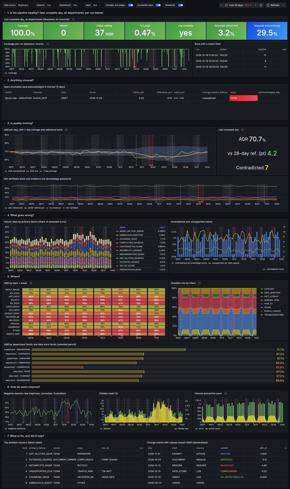
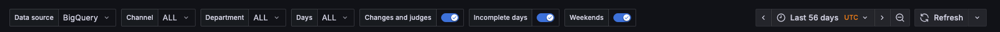
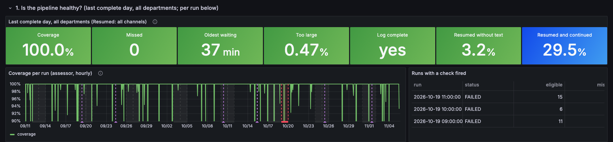
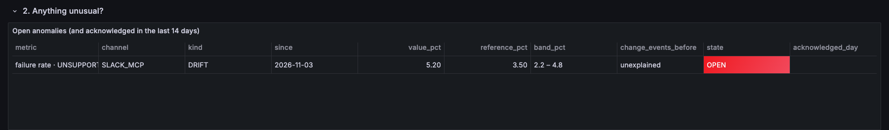
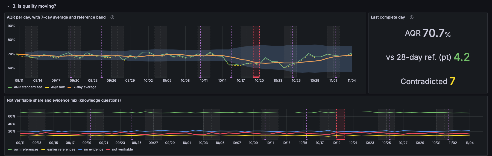
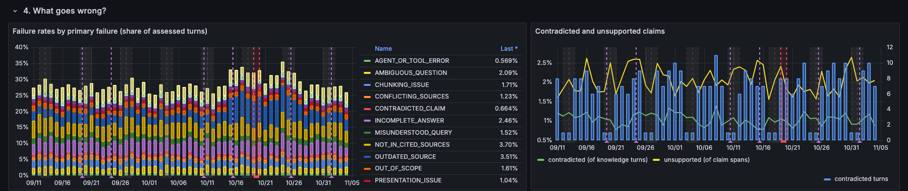
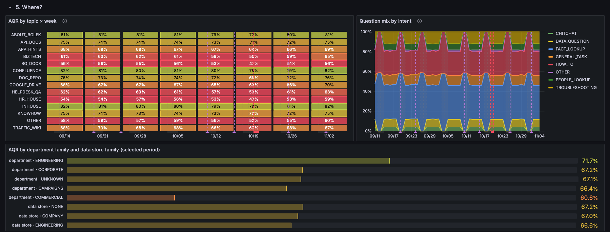
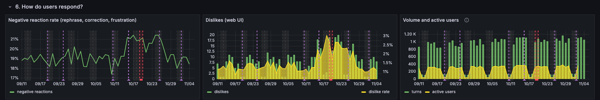
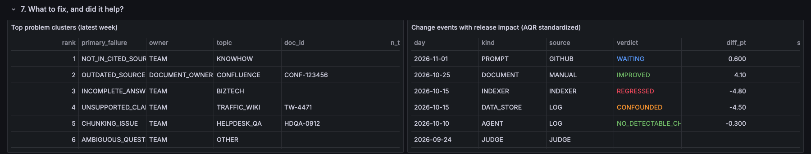

# Bolek quality dashboard

The page the team opens every morning to see how well Bolek answers, and whether the numbers behind that can be
trusted. It is the dashboard of §8.8 of the [design doc](../../../design-doc.md): one page, read from top to bottom.
The first rows answer *"can I trust yesterday's numbers?"*, the last ones *"what should we work on?"*.

> **Status: proposal.** The screenshots below come from the local Grafana with **mocked data** (`make grafana`).
> The numbers are made up, but they have the same shape as the rows `quality-daily` and `quality-weekly` write.
> They tell one story so that every panel has something to show: an indexer change on 15 Oct breaks a Confluence
> document, AQR drops, the document is fixed on 25 Oct, and quality recovers.



## What it is, and what it is not

- **Aggregates only.** Every panel reads daily or weekly numbers from `bolek_quality_metrics` (pipeline health per
  assessment run). Grafana's account cannot read the per-turn tables, so there is no drill-down to a single turn,
  question or answer.
- **Days, not hours.** Quality is computed once a day, for the day before. Only pipeline health is per run.
- **Small slices are merged.** No panel shows a number based on fewer than 20 turns: smaller slices are merged by the
  daily job or hidden by the panel.
- **No session grades.** They are context for alerts only (§7.7).
- **Slack tells you what needs attention now; this page is for looking.** Alerts and the weekly digest go to Slack
  (§9). The dashboard is where you check the trend and the context behind an alert.

## Reading it each morning (about 5 minutes)

1. **Row 1:** is everything green? If not, yesterday's numbers may not be reliable. Fix the pipeline first.
2. **Row 2:** any open anomaly? Read the change events before it, then acknowledge it in Slack or start work on it.
3. **Row 3:** is AQR inside its reference band, and going the right way since the last change?
4. **Rows 4 and 5,** only when something moved: which failure type, which topic, which department.
5. **Row 6:** do users see the same as the judge?
6. **Once a week, with the digest:** row 7.

## Filters and markers



| Control | What it does |
|---|---|
| **Channel** | `ALL`, `WEB_UI` or `SLACK_MCP` (Slack Bolek and MCP, which the log cannot tell apart yet, §8.9). Slack and MCP have about 115 turns a day, so their daily lines are rough: read them per week. |
| **Department** | A department family (`ENGINEERING`, `CAMPAIGNS`, `COMMERCIAL`, `CORPORATE`, `UNKNOWN`, `MERGED_OTHER`). Applies to the quality panels of rows 3, 4 and 6. Pipeline health and usage are shown for all departments. |
| **Days** | Weekdays, weekends or both. Weekend traffic is about a tenth of weekday traffic, and different, so compare each kind with its own. |
| **Time range** | Defaults to the last 56 days (two baselines' worth). |
| **Changes and judges** | Purple marks: every change event (prompt, model, data store, document, indexer, agent). Judge changes are tagged `judge`: a new judge version can move the numbers without Bolek changing. |
| **Incomplete days** | Red shading: a day with a gap in the log. Its numbers are shown but should not be trusted, and the anomaly check skips it. |
| **Weekends** | Grey shading, so a quiet Sunday does not look like a drop. |

## 1. Is the pipeline healthy?



**The question it answers:** *Can I trust yesterday's numbers?* Every other row is computed from what the assessor
managed to assess. If it missed turns, fell behind or read an incomplete log, the quality numbers are wrong in ways
no chart below would show.

| Tile | Meaning | Healthy |
|---|---|---|
| **Coverage** | Assessed or too-large turns over the eligible turns in the log. | ≥ 98 % (alert below) |
| **Missed** | Turns neither assessed nor recorded as too large by 3h30. They can never be assessed. | 0 |
| **Oldest waiting** | Age of the oldest turn not yet assessed. | under 1 hour (alert over 3 hours) |
| **Too large** | Turns skipped because they did not fit the judge. | under 1 % |
| **Log complete** | No hour of the day had a gap in the log. | yes |
| **Resumed without text** | Resumed conversations whose earlier text was already erased, so the judge saw only earlier labels (§5.3). | low |
| **Resumed and continued** | Conversations resumed after a 30-minute pause whose first turn continues the topic. Informational: if it is high, conversations should stay open longer (§5.2). | — |

Below the tiles, **coverage per run** shows every hourly assessment run, and **runs with a check fired** lists the
runs that raised a pipeline alert. In the example, three runs on 19 Oct failed during a log gap: that day is marked
incomplete everywhere on the page.

**If this row is red:** don't read the rest yet. Check the runs table, then the Cloud Run job's logs.

## 2. Anything unusual?



**The question it answers:** *Did something change that I did not expect?* The daily anomaly check (§8.7) compares
each day with the 28 days of the same kind before it. It watches standardized AQR, each failure rate, the negative
reaction rate and coverage, per channel. It finds two kinds of change:

- **Jump:** one day far outside the usual range. Typically a release or a data store that broke something overnight.
- **Drift:** small daily moves in the same direction that add up. Typically documents slowly going stale.

Each row shows the value against its reference value and band. It also lists the change events of the 48 hours before
the anomaly, or *unexplained* if there were none. An anomaly stays **open** until someone reacts with ✅ to its Slack
alert; acknowledged ones stay listed for 14 days.

In the example, unsupported claims on Slack/MCP have been drifting up since 3 Nov with no change event before them.

## 3. Is quality moving?



**The question it answers:** *Are Bolek's answers getting better or worse?* This is the main row of the page.

- **AQR (Answer Quality Rate)** is good answers divided by assessed verifiable turns: answers the judge could check
  against sources and found correct, complete and clear.
- **Standardized AQR** (green, the main number) weighs each kind of question by its share in the baseline. If people
  simply ask more easy questions one week, standardized AQR does not move. **Raw AQR** (dashed) is the same without
  that weighting. **When the two lines move apart, the question mix changed, not quality** (§8.4).
- The **orange line** is the 7-day average. It smooths out day-to-day noise.
- The **blue band** is the range of the 28 days before ± 3 standard deviations. A day outside it is unusual.
- The tile on the right shows the last complete day: AQR, its difference from the 28-day reference in points, and
  the number of turns with a **contradicted claim**, the most serious error (Bolek said something its own documents
  contradict).

The second panel shows **how much of the traffic AQR can see**. For knowledge questions, an answer is checked against
its own references, the references of earlier turns, or nothing. The **not verifiable** share (red) is what the judge
could not check. If it grows, AQR covers less of the traffic and means less.

In the example, AQR drops by about 6 points on 15 Oct and recovers after the fix on 25 Oct.

## 4. What goes wrong?



**The question it answers:** *Which kind of problem moved?* AQR says that something got worse. This row says what.

- **Failure rates by primary failure:** every assessed turn with a problem gets one primary failure from a closed list
  (§6.7). For example, `OUTDATED_SOURCE` means a document is out of date, `NOT_IN_CITED_SOURCES` means the answer
  isn't in the documents Bolek cited, and `INCOMPLETE_ANSWER` means part of the question was left unanswered. Each bar
  is the share of the day's assessed turns. The legend shows the last value. These rates are a lower bound: only
  problems the judge identified count.
- **Contradicted and unsupported claims:** the two errors that matter most for trust. *Contradicted* turns are shown
  as a count (bars) and as a share of knowledge turns. *Unsupported* claims are statements in an answer that its
  evidence does not back up.

In the example, the `OUTDATED_SOURCE` band grows from 15 Oct and shrinks after the fix.

## 5. Where?



**The question it answers:** *Where did it move: which topic, which kind of question, which department?*

- **AQR by topic × week:** one row per data store (topic), one column per week, coloured from red to green. A topic
  that turns red in one week points at its data store or its indexer. In the example, the weeks of 12 and 19 Oct are
  lower across the board. The mock spreads the regression over every topic; in real data it would show in the rows
  of the affected data stores.
- **Question mix by intent:** what people ask, as shares of the day: fact lookups, how-tos, troubleshooting and so
  on. A shift here explains raw and standardized AQR moving apart (row 3).
- **AQR by department family and data store family:** for the selected period. A department far below the others
  asks things Bolek answers badly, or uses data stores that are weak. That tells you whose questions to look at in the
  weekly fix list.

## 6. How do users respond?



**The question it answers:** *Do users see the same as the judge, and do they keep using Bolek?* None of these numbers
is part of AQR. They are an independent check on it.

- **Negative reaction rate:** turns whose next turn is a rephrase, a correction or frustration, over turns that got a
  reaction. If it rises while AQR stays flat, the judge may be missing something.
- **Dislikes (web UI):** thumbs-down in the web UI, as a count and a rate. About 1 in 1,000 turns, so read it as a
  signal, not a measurement. Slack and MCP have no dislikes yet.
- **Volume and active users:** turns per day and the engine's active users, as Google reports them, about 3 days late.
  Quality should never rise while usage drops: that would mean people stopped asking the hard questions.

## 7. What to fix, and did it help?



**The question it answers:** *What should we work on next, and did the last fix work?* Read it once a week, together
with the Monday digest.

- **Top problem clusters (latest week):** failures grouped by primary failure and document (or topic, when there is no
  single document, §9.1). They are ranked by turns × severity (3 for high, 2 for medium, 1 for low). Each cluster
  has an **owner**: the team, a document owner (outdated or conflicting documents), or a corpus owner (missing
  knowledge). `trend_pct` compares with the 4 weeks before. A cluster is closed when its weekly turns stay below a
  quarter of their level before the fix for 2 weeks.
- **Change events with release impact:** every recorded change, with the difference in standardized AQR between the 5
  complete weekdays before and after it (§10.3):
  - **IMPROVED** or **REGRESSED:** the difference is larger than chance explains.
  - **NO_DETECTABLE_CHANGE:** the difference is within chance.
  - **CONFOUNDED:** another change fell in the same days.
  - **WAITING:** fewer than 5 weekdays have passed since the change.

  `gate_verdict` is the result of the release gate on synthetic questions before the release (§10.2).

In the example, the indexer change of 15 Oct is `REGRESSED` (−4.8 points), the document fix of 25 Oct is `IMPROVED`
(+4.1), and the prompt change of 1 Nov is still `WAITING`.

## Open points

Things this proposal does not do yet, or does more simply than the design doc:

- **Reference band and reference value** use the 28 days before, of every kind. The anomaly check (§8.7) compares
  weekdays with weekdays only, and leaves out days of an open anomaly. So after a regression the band widens, as
  in the example from 15 Oct.
- **Row 7** lacks the panel *"weekly turns still in the top clusters of the baseline"*: it waits for ticket 25.
- **Stage only:** shading of the hours when stage was paused (`no_run_expected`) is not drawn yet.
- **Department filter** applies to quality panels only. Pipeline health and usage exist only for all departments.
- **Table columns** are cut short at this width. Codes like `NOT_IN_CITED_SOURCES` need shorter labels or wider
  columns.

## Working on the dashboard

The file [`bolek-quality.json`](bolek-quality.json) is the dashboard in the `dashboard.grafana.app/v1beta1` format of
`infra-grafana-dashboards`, where it will live (`test/AI-Engineering-Lab/Conversation-Analyzer/` for stage, `prod/…`
for prod). Locally:

```bash
make up              # the emulator stack
make grafana         # Grafana on http://localhost:3000 (no login), 8 weeks of mocked metrics, dashboard loaded
                     # edit panels in the UI, then:
make grafana-save    # write the UI's version back into bolek-quality.json
make grafana-load    # or push the file into Grafana (also warms the query cache)
make dashboard-check # every panel's SQL on the emulator, without Grafana: fails on an error or an empty panel
```

`make dashboard-check` takes `DASHBOARD=<file>` (any v1beta1 or classic dashboard JSON), `VARS="channel=WEB_UI
department=ENGINEERING"` and `ALLOW_EMPTY=1`. It fills in the variables (their saved values by default) and the time
macros (`$__timeFilter`, `$__timeFrom`, `$__timeTo`, `$__timeGroup`) the way the plugin does, then runs each query.
Every panel must return rows, unless its description says **"May be empty"** (for example the open anomalies table).
After `make demo` there are too few turns to fill the panels, so run it there with `ALLOW_EMPTY=1`: only query errors
fail. The tests run it on the mocked data, so a panel that breaks fails `make test`.

Grafana runs the real BigQuery plugin, so the panels run the same SQL they will run on Central Grafana. A small local
proxy (`docker/grafana/proxy/`) answers as Google's BigQuery and OAuth endpoints and forwards to the emulator. Grafana
trusts only that proxy, so nothing reaches real GCP. The emulator runs one query at a time, so the proxy caches
repeated queries for 10 minutes. A panel you just edited still takes about a second to load.
