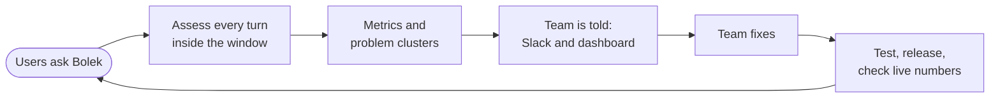
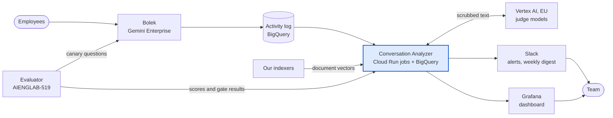
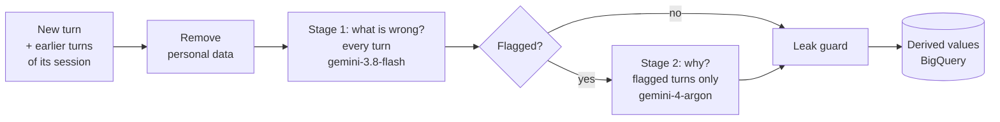
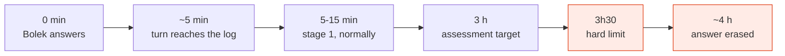
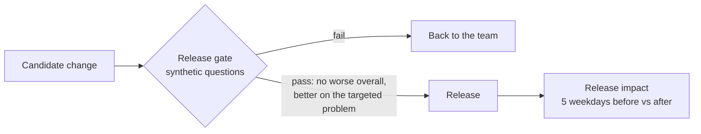
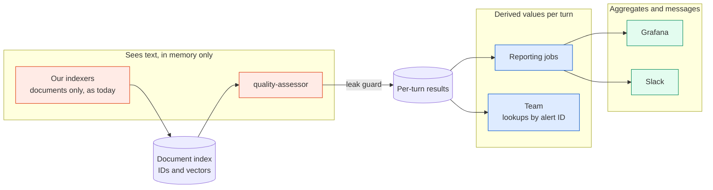
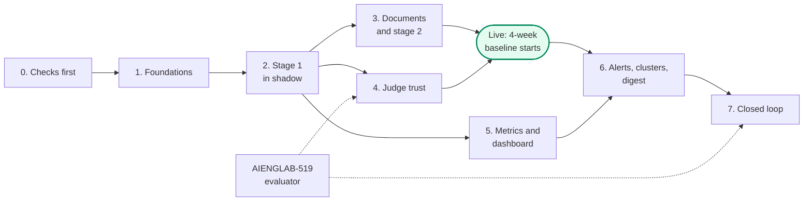

# AIENGLAB-543 Conversation Analyzer

**JIRA:** [AIENGLAB-543](https://rtbhouseproduct.atlassian.net/browse/AIENGLAB-543) (Bolek RAG - Conversation Analyzer)

**Detailed design (LLD):** [AIENGLAB-782 Conversation Analyzer](https://rtbhouseproduct.atlassian.net/wiki/spaces/AIENGLAB/pages/1769963596/AIENGLAB-782+Conversation+Analyzer). This page is the high-level view; "LLD §N" points to the section with the details.

**Owner:** Paweł Borkowski · **Status:** Draft, 2026-10-27

**Approvers**:

Every design document should be approved by the Team Lead of the team affected by the change. This list can also include other engineers with domain knowledge about a particular topic.

| **Name** | **Yes \| Not yet** | **Date** |
| --- | --- | --- |
| Maciej Winnicki | | |
| Adam Naworski | | |
| Michał Oracki | | |
| Paweł Borkowski | | |
| Dariusz Grzywacz | | |

# Context

Bolek, our company assistant built on Google Gemini Enterprise, answers employees' questions from our documents. It answers about 900 to 1,450 questions per weekday in the web UI, and about 115 per day through Slack Bolek and MCP. **Nobody knows which of these answers were good.**

- **Feedback is too rare to steer by.** Users rate about 1 answer in 1,000.
- **The answers disappear quickly.** Google's activity log of Bolek is the only record of what users asked and what Bolek answered. After about 4 hours, our existing anonymizer job erases the answer text, the session ID and the user's identity from it. Nobody can review an answer after that.
- **Tests don't cover real traffic.** The evaluator ([AIENGLAB-519](https://rtbhouseproduct.atlassian.net/browse/AIENGLAB-519)) scores Bolek on a fixed set of synthetic questions. It can't say how Bolek does on what people really ask.
- **Real conversations must stay private.** Questions and answers can contain personal and confidential data. Nobody may read them, store them or send them outside the EU.

In this doc we propose the Conversation Analyzer. It is an automated judge that assesses every real answer while it still exists and keeps only scores and labels. From these it builds a quality metric, a weekly list of what to fix, and the checks that prove a fix worked.

**Terms used in this doc**

| Term | Meaning |
| --- | --- |
| Turn | One user question and Bolek's answer to it. The unit we assess. |
| Window | The roughly 4 hours after a turn during which its answer text exists in the log. |
| Judge | A Gemini model on an EU endpoint that fills in a fixed assessment form for a turn. |
| Derived values | The only things the system stores: scores, labels from closed lists, counts, document IDs and hashes. Never text. |
| Evidence | The documents an answer is compared with. A claim is wrong only when one of our documents says something different. |
| AQR | Answer Quality Rate: the share of checkable turns with a good answer, weighted to a fixed mix of question types so that a change in what people ask doesn't look like a change in quality (LLD §8.4). |
| Problem cluster | Failures with the same cause and the same document, ranked weekly. One entry on the fix list. |
| Canary | Synthetic evaluator questions sent through the production Bolek, so they pass through the same log as real turns. Used to test the judge on the real path. |

# Goals and Non-Goals

### Goals

1. **Measure answer quality on all real traffic.** Assess every turn on every channel before its answer is erased, with at least 98% coverage.
2. **Track one headline number.** Report AQR daily, per channel and for all channels together, and raise it over time. The target increase is set after a 4-week baseline.
3. **Tell the team what to fix and who owns it.** Send a weekly ranked list of problem clusters, each with an owner. Alert on the same day about contradicted answers, regressions and pipeline problems.
4. **Prove every fix.** Test each change on synthetic questions before release, then compare live numbers before and after it.
5. **Keep real conversations private.** Store derived values only, send text only to EU endpoints, and keep every step automatic so that no person reads a real question or answer.

### Non-Goals

1. **Reading, copying or re-asking real questions.** Tests use synthetic questions generated from our documents.
2. **Changing how long the log keeps data.** The anonymizer and its 4-hour rule stay as they are.
3. **Measuring response time.** The log records no latency.
4. **Fixing the problems found.** The system shows where to look. The team, document owners and corpus owners make the fixes.
5. **Reporting on single users, sessions or departments.** The dashboard shows aggregates only, and there are no per-session tickets.
6. **Rebuilding the evaluator.** That is AIENGLAB-519. This project uses it and agrees on a few additions (see "What needs to be done").

# Proposed Solution

**Description**

The Conversation Analyzer closes Bolek's learning loop: assess every turn, find what to fix, and verify that the fix worked.

It is a set of scheduled **Cloud Run jobs** in the GCP project `rtbhouse-agentspace`, where the log and Bolek's data stores already are. All results go to **BigQuery**. There are no long-running services and no public endpoints.

The system has two paths. Only the first one ever handles text.

| Component | Path | What it does |
| --- | --- | --- |
| `quality-assessor` | Assessment | Every 10 minutes, reads the new turns from the log, removes personal data from them, and has the judge fill in a form for each turn. Keeps text in memory only while a run lasts, and writes derived values only. |
| Document index | Assessment | Vectors of our documents in BigQuery, with no text. Our indexers write it whenever they index a document. The judge uses it to find documents to check an answer against. |
| `quality-monitor` | Reporting | Every 10 minutes, checks pipeline health and sends urgent alerts. |
| `quality-daily` | Reporting | Every morning, computes the daily metrics, detects anomalies and measures release impact. |
| `quality-weekly` | Reporting | Every Monday, ranks problem clusters and sends the digest. |
| `quality-judge-suite` | Neither | By hand, for every change to the judge: runs a fixed set of synthetic test cases and tells whether the change made the judge better. |

**How a turn is assessed**

- **Stage 1** runs on every turn, with the turn's session as context. The judge fills in a fixed form: question type, relevance, groundedness, failure types, severity, and how the user reacted to the previous answer. When an answer that needs company knowledge has no references, the judge searches our documents itself for one that contradicts it (the *evidence check*, LLD §6.9).
- A turn is **flagged** when the answer missed the question, a document contradicts it, the user disliked it, or the user had to rephrase or correct it. Expected share: under 20% of turns.
- **Stage 2** finds out *why* a flagged turn failed. Was the right document not found, out of date, cut badly, or missing altogether? The cause names the owner of the fix (LLD §7).
- **The leak guard** checks every row before it is stored. Only numbers, closed-list values, hashes and allowlisted document IDs pass.

**Every turn must be assessed before its answer is erased.**

**Data flow**

1. A user asks Bolek on the web UI, in Slack or through MCP. About 5 minutes later, the turn is in the log.
2. Every 10 minutes, `quality-assessor` reads the turns still in the window. It groups them into sessions using a keyed hash of the session ID, so the ID itself is never kept.
3. It removes personal data from the conversation text (names, e-mails, IDs).
4. The judge on Vertex AI (EU) fills in the stage 1 form for each turn. When needed, it also runs the evidence check against the document index and the full text of up to 3 documents.
5. Flagged turns go to stage 2, which diagnoses the cause.
6. The leak guard checks every result, and the derived values are written to BigQuery. The text is dropped when the run ends.
7. The reporting jobs turn these values into daily metrics, anomaly alerts, weekly problem clusters, a Slack digest and a Grafana dashboard.
8. The team fixes the top problems. Each fix must pass the release gate on synthetic questions, and after release the live numbers are compared before and after.

**Pros**

- **Covers all traffic.** Every turn on every channel is assessed, compared with 1 in 1,000 that gets feedback.
- **Says what to fix, not just a score.** Stage 2 names the cause and the document, so each problem has an owner.
- **Private by construction.** No text is stored, no person reads real conversations, and text reaches a model only in the EU.
- **Built from what we already run.** Cloud Run jobs, BigQuery, our indexers, Terraform, Grafana and Slack. It adds no service, no queue and no public endpoint.
- **Every change is proven twice:** before release on synthetic questions, and after release on live numbers.
- **Cheap.** Stage 1 and the infrastructure cost about 230 to 260 USD a month at today's prices. The evidence check adds at most as much again, and the price of the stage 2 model isn't known yet (see Cost).

**Cons**

- **Many answers can't be fully checked.** Only about a third of web UI answers carry references in the log. Knowledge answers without any evidence are reported as *not verifiable*, outside AQR.
- **Failure counts are lower bounds.** Only problems the judge can point to are recorded.
- **The judge can't be checked on real traffic directly.** Its quality rests on a synthetic test suite, the canary and a second-model check.
- **It has a hard deadline.** Turns that aren't assessed within 3h30 are lost. An outage of 3h30 or more loses turns for good.
- **No targets yet.** Every target except coverage is set after the 4-week baseline.
- **It depends on the evaluator (AIENGLAB-519)** for the canary and the release gate.

**What needs to be done**

| Component | Change |
| --- | --- |
| **New:** Conversation Analyzer repository | Code for all jobs, the judge's rubrics and prompts, the closed lists, the judge test suite and the settings. One container image. |
| **New:** Cloud Run jobs and schedules | `quality-assessor`, `quality-monitor`, `quality-daily`, `quality-weekly`, `quality-judge-suite`, and `quality-record` for recording a change by hand (LLD §12.3) |
| **New:** BigQuery datasets | Per-turn results, aggregates, authorized views over the log (counts only), and the document index (LLD §12.10) |
| **New:** service accounts and permissions | One per job, each with the least access it needs. Only the assessor can read the log (LLD §12.4). |
| **New:** judge test suite | A few hundred synthetic cases, each with the form a perfect judge would fill in (LLD §11) |
| **New:** Slack app and quality channel | Alerts and the weekly digest. People acknowledge an anomaly by reacting with ✅. |
| **New:** Grafana dashboard | One page with pipeline health, anomalies, AQR and other metrics, and problem clusters (LLD §8.8) |
| **Changed:** `infrastructure` repo (Terraform) | Datasets, views, service accounts, secrets, jobs and schedules |
| **Changed:** our indexers' shared code | Also cut each changed document into chunks and write their vectors to the document index. The people directory is skipped. (LLD §12.7) |
| **Changed:** evaluator (AIENGLAB-519) | A daily canary run on the production engine; the expected document of each question; gate results that name the change they test; questions generated from a document list we provide (LLD §12.11) |
| **Unchanged** | Bolek, the log, the anonymizer |

# Alternatives Considered

### A. Analyse only disliked answers, one Jira ticket each

**Description:** When a user dislikes an answer, diagnose that turn and open a Jira ticket for it.

**Data flow:** dislike in the log → read the turn while it is in the window → diagnose the cause → Jira ticket → team fixes.

**Pros:** small volume and low cost. The signal comes from real users. Simple to build.

**Cons:**
- About 1 answer in 1,000 gets feedback, so this can't measure quality or prove that it improved.
- Only users who bother to click are heard, and feedback exists in the web UI only.
- A ticket per turn would carry conversation content into Jira.

**What needs to be done:** a job that reads feedback, a diagnosis prompt, and Jira integration.

*Kept:* its two-level diagnosis became stage 2.

### B. Monitor log metadata only, without a judge

**Description:** No model reads anything. Count signals in the log's metadata, such as volume, answers with or without references, quick re-asks and feedback, and alert when the counts change.

**Data flow:** log → counters every 30 minutes → daily anomaly detection → Slack alerts.

**Pros:** no model cost, no text leaves the log, simple.

**Cons:** checked against live data, and it is not enough:
- The log has no error field and no latency.
- Answers without references are how Bolek normally answers, not failures.
- Quick re-asks are mostly normal follow-ups.

It can say that something changed, but not whether answers are right or what to fix.

**What needs to be done:** a counter job, a daily detection job, alerts.

*Kept:* as the pipeline health layer (coverage, gaps in the log).

### C. Keep the text longer and assess later

**Description:** Make the answers last beyond 4 hours, and assess in a daily batch with no deadline. The text could be kept longer in three ways:
- delay the anonymizer for open sessions, or for all records;
- store summaries of questions and answers;
- store a map from log records to sessions.

**Data flow:** log keeps answers for days → daily batch assessment → the same reporting as the proposed solution.

**Pros:**
- No 3h30 deadline, so an outage doesn't lose turns.
- Whole sessions can be graded at once.
- Simpler scheduling.

**Cons:**
- It changes a retention rule that needs a security decision.
- Summaries can quote content.
- A session map would let the questions of a session, which stay in the log for 30 days, be put back together.
- All three widen exposure of personal data.

**What needs to be done:** an anonymizer change or new text storage, SECOPS approval, and access controls for the new data.

### Smaller choices

| Alternative | Why not |
| --- | --- |
| Use Bolek's own search to find evidence | Our data stores return only documents the caller may see, and a service account has no Workspace identity, so it gets nothing back. We build our own document index instead. |
| A Cloud Run service to receive Slack button clicks | It would add a public endpoint to the project that holds the log. A job reads ✅ reactions instead. |
| A message queue or workflow engine | The jobs depend on each other only through timing. Fixed schedules are enough. |
| Assess whole session segments when they close, instead of each turn | Results would come 30 to 45 minutes later, and late signals such as a dislike would be harder to handle. |
| Use the session grade as a metric | It is inferred and often provisional, because part of the session is already erased. It is shown in alerts as context only. |
| One job that assesses and also anonymizes | If that job were down, nothing would be anonymized. |
| Vertex AI `global` endpoint | Text must not leave the EU. The models we need are available on the `eu` multi-region. |
| Cloud DLP instead of Presidio for removing personal data | Presidio runs inside the job, so text with personal data never goes to another service. Cloud DLP stays as the fallback if Presidio's recall on Polish text is too low. |
| Exact time of each turn | It could match a turn to a person through other usage records. The day is enough for every metric. |

# Risks

| Risk | Type | Impact | Mitigation |
| --- | --- | --- | --- |
| **Personal data reaches the judge.** Presidio misses a name or ID in Polish text, for example an inflected name. | Security | Personal data reaches the model. It stays in the EU and is never stored, but it shouldn't happen. | Test recall on synthetic Polish and English text with planted personal data before launch. Add our own recognisers. Cloud DLP as the fallback. |
| **Text leaks through logs, Sentry or cloud audit logs**, which this project copies to a bucket kept for 7 years | Security | Conversation text is kept for 7 years. | Logging goes through one wrapper that accepts counts and codes only, and a test plants text and checks the logs. Sentry gets error classes only. The audit log check is done in milestone 0 (LLD §12.13). |
| **The security team doesn't accept the `eu` multi-region** | Compliance | The judge models must move to a single EU region. | Raise it with SECOPS early. Fall back to models that a single EU region offers. |
| **The judge is wrong on real traffic.** Nobody can read real answers to check it. | Quality | Noisy labels and wrong priorities | Judge test suite with a held-out part; canary with planted errors; second-model check on 5% of turns. A label drives alerts only when the suite shows the judge finds it reliably. |
| **False alarms** from wrong contradiction findings or noisy anomaly checks | Quality, trust | The team stops reading alerts. | A false contradiction costs the most in the judge's tuning. The alert bar and anomaly limits are set from baseline data. |
| **The document index misses documents** | Quality | Missed contradictions, and too many "knowledge gap" findings | Measure the hit rate on the canary, whose questions come with their source document. If it is too low, add a keyword search. |
| **Many answers are not verifiable** | Quality | AQR covers only part of the traffic. | Use the references of earlier turns in the session and the evidence check. Report the not-verifiable share next to AQR. |
| **Turns are lost.** The window gets shorter, for example after an anonymizer change, or the assessor is down for 3h30 or more. | Reliability | Turns can never be assessed. | About 20 attempts per turn; oldest turns first; alerts on coverage, waiting time and window length. Missed turns are counted. |
| **Cloud Scheduler stops**, and with it the monitor | Reliability | No alert fires, and an overnight stop loses turns. | Accepted. The dashboard shows pipeline health per run, so the morning check catches it. |
| **Cost** | Cost | Stage 2's price is unknown, and `gemini-3.8-flash` prices double in 2027. | Token use is recorded per run, and a daily limit triggers an alert. Real costs are checked in the first weeks. |
| **The evaluator (AIENGLAB-519) slips or doesn't add what we need** | Dependency | No canary and no release gate, so judge trust and the closed loop are delayed. | Agree on the four additions in milestone 0. The closed loop waits for 519's next phase. |
| **Slack Bolek and MCP can't be told apart in the log** | Data | They are reported together as one channel. | Inspect their request fields to find a rule. |
| **Writing the expected forms takes time.** A few hundred cases, each checked by an engineer, before launch. | Effort | Launch slips. | A model drafts the cases, engineers check them in batches, stage 1 cases first. |

# Other Important Aspects

### Privacy and security

Only one job ever sees what users asked and what Bolek answered. Everything after it works with derived values or aggregates.

| Guarantee | How |
| --- | --- |
| No text is stored | The leak guard checks every write, and no stored field holds free text. |
| Text goes only to EU endpoints, without personal data | Presidio removes personal data inside the job, and the judge runs on the `eu` multi-region. |
| No person reads real questions or answers | Every step is automatic. The judge is tuned only on synthetic cases and the canary. |
| Sessions can't be rebuilt later | Sessions are stored only as a keyed hash of an ID that the anonymizer erases. Nothing links the log's records to sessions. |
| No path to a single person | Each turn keeps only its day, alerts give no time finer than the hour, and the dashboard shows aggregates only. |

### Success criteria

| Criterion | Target |
| --- | --- |
| AQR goes up | Set after the 4-week baseline |
| Every eligible turn is assessed before its answer is erased | 98% coverage |
| No text is stored, and no person reads it | Always |
| The team knows what to fix | A weekly ranked list of problem clusters |
| Regressions are noticed quickly | Daily anomaly alerts, limits set after the baseline |
| A fix can be proven | A release gate result and a release impact for every production change |

### Cost

Monthly estimates from the measured input sizes and today's list prices (LLD §12.15):

| Item | Per month |
| --- | --- |
| Stage 1 on all channels | About 200 USD, about 400 USD from 2027 |
| Evidence check | At most about as much as stage 1 |
| Stage 2 and session grades (`gemini-4-argon`) | Up to about 10M input tokens per weekday; price not known yet |
| BigQuery, Cloud Run and the rest | About 30 to 60 USD |

### Build plan

| # | Milestone | Done when | Engineer-weeks |
| --- | --- | --- | --- |
| 0 | Checks first: feedback numbering, audit logs, Polish PII test, first index hit rate, Slack app approval, agreement with 519 | Each check is answered, or the design is changed | 1 |
| 1 | Foundations: repository, Terraform, logging wrapper, leak guard | An empty assessor run writes its run record | 1 |
| 2 | Stage 1 in shadow, with pipeline health alerts | Coverage stays at 98% or more for 5 weekdays | 3 |
| 3 | Document index, evidence check, stage 2 | Index hit rate and share of flagged turns are measured | 2 to 3 |
| 4 | Judge trust: test suite, rubric tuning, canary | The tuned judge passes the suite, and the canary runs daily | 2 to 3 |
| 5 | Daily metrics and the Grafana dashboard | The team reads the dashboard every morning | 2 |
| 6 | Weekly clusters, alerts, digest, release impact | The first digest goes out | 2 |
| 7 | Closed loop with the evaluator | Every production change has a gate result and a release impact | 1, plus the evaluator's part |

The total is about **14 to 16 engineer-weeks**. Assessment goes live, and the baseline starts, once stage 1, the evidence check and stage 2 run with the tuned judge. Milestones 5 and 6 can be built during the baseline without losing data, because metrics are computed from the stored rows.

### Open questions

| Question | Next step |
| --- | --- |
| Does the evidence check catch enough errors without false contradictions? | Measure on the canary with planted errors |
| What hit rate must the document index keep? | Measure on the canary in the first weeks, then set it |
| Does the question number in a late feedback record match the turn's position in its session? | Test on synthetic chats in milestone 0. Until then, late feedback is only counted. |
| How many contradicted answers make an alert? | Set from the first weeks of data |
| Which strata does AQR's weighting use? | Define 10 to 20 from the first days of data, freeze them with the baseline |

The full list is in LLD §6.12, §7.8, §8.9, §9.4, §11.6 and §12.17.
