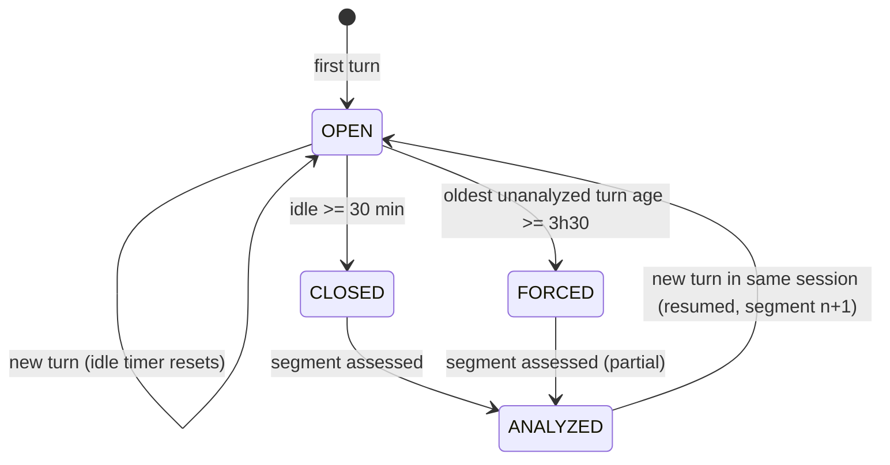
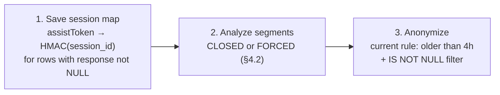

# Session analysis: data, session linkage, session end, anonymizer cadence

| | |
|---|---|
| Context | `design.md` v2 (per-turn assessment). This note moves the unit of analysis to the **session**. Answers the TODO in `categorizarion.md`. |
| Status | Proposal, 2026-10-20. Reviewed 2026-10-21: partly adopted into `design.md` (D17-D22). Where they differ, `design.md` is current. |
| Data checked | `rtbhouse-agentspace.analytics.audit_logs`, read-only, counts and key paths only. No question or answer text was read. |

## Review outcome (2026-10-21)

| Proposal here | Decision | `design.md` |
|---|---|---|
| Session ID from `response.answer.name`; group by `session_key` (HMAC); idle close 30 min, forced at 3h30, segments for resumed sessions | Adopted. Only the 4h window of data exists; nothing longer is expected. | D17, §8.3 |
| Session-level assessment at segment close | Rejected. Stage 1 stays per turn; a turn is reassessed only when its input fingerprint changes. | D18 |
| `session_outcome` and other session verdicts (§4.3) | Adopted in an informational form (revised 2026-10-21): a session grade by `gemini-4-argon` on flagged turns, attached to Slack alerts, used by no metric. Outcome list changed to `RESOLVED`, `PARTIALLY_RESOLVED`, `UNRESOLVED`, `UNCLEAR`. | D19 |
| One job: map, analyze, anonymize (§5.3 A) | Rejected. Assessor and anonymizer stay separate. | D20 |
| Persisted `session_turn_map` (§5.3 A step 1, §6.1) | Rejected. | D21 |
| Session-aware delay (§5.3 B), longer fixed delay (§5.3 C) | Rejected. The anonymizer's 4h rule is unchanged. | D22 |
| Anonymizer `IS NOT NULL` filter, `sessionId` view alias, clustering on `methodName` | Recorded as findings for other owners. | §11 |

Open questions from §8: S1 (meaning of `questionIndex`) stays open; S2 and S4 move to `design.md` Q14; S3 is moot (no map); S5 is in `design.md` §11; S6 moves to `design.md` Q17 (all channels in scope from the start, D5).

## 1. Summary

1. **A session ID exists.** `response.answer.name` has the form `.../engines/<engine>/sessions/<session_id>/assistAnswers/<answer_id>`. It is filled on 100% of `StreamAssist` rows in the window, web UI and API alike. This corrects `design.md` §4.3 ("No session ID on `StreamAssist`"), which checked only `request`.
2. **The session ID is erased at 4h** together with `response`. The only places it survives are feedback events (`conversationInfo.session`, 30 days). After 4h a turn can't be assigned to its session.
3. **`assistToken` is per turn, not per session** (distinct per row). It survives anonymization and joins feedback to its turn (12 of 12 feedback events since the column exists).
4. **Grouping by principal plus a 30-min idle gap (`design.md` §8.3) is wrong.** In the sample, the same session continued after gaps over 30 min, and a principal opened a new session within 5-30 min. Group by `session_id`.
5. **The anonymizer's cadence is not the problem; its 4h delay is.** It runs every 15 min (measured: median 15 min, p95 19.5 min, max 22 min). Running it less often would only make the window longer by a random amount. Sessions last up to ~2.8h in a 4h evening sample, and feedback shows sessions with 22+ questions, so long sessions can't be analyzed whole inside 4h.
6. **Proposal:**
   - one Cloud Run job every 15 min that, in order, (a) saves the `assistToken → session` mapping, (b) analyzes closed sessions, (c) anonymizes;
   - a session is closed after 30 min idle, or forced at a 3h30 hard limit;
   - sessions longer than that are analyzed in segments.
   - Optional, with SECOPS: a longer delay for rows of sessions that are still open.

## 2. Structure of `audit_logs` (what matters for sessions)

Table: EU, day partitions by ingestion time, partition filter required, **no clustering**, ~346k rows / ~0.5 GB (30 days). Written by the Gemini Enterprise export (schema in `aiel-infrastructure/modules/agentspace-bigquery/main.tf`); we don't control which fields it writes.

| Method | Key paths (JSON) | Session-relevant |
|---|---|---|
| `StreamAssist` | req: `name` (engine/assistant), `query.text` (API) or `query.parts` + `agentsSpec` (web UI), `agentsSpec.agentSpecs` (custom agent). resp: `assistToken`, `answer.name`, `answer.state`, `answer.replies` | **`answer.name` → `session_id`** (resp, gone at 4h). `assistToken` column (persists 30 days) = `response.assistToken` on 100% in window. |
| `WriteUserEvent` / `add-feedback` | `userEvent.feedback.conversationInfo.{session, assistToken, questionIndex}`, `feedbackType`, `reasons`, `comment`, `llmModelVersion`, `userPseudoId` | Session and turn, kept 30 days. `questionIndex` is omitted for the first question (proto default 0); observed values are all even (2, 4, 6, 28, 30, 38, 44), so probably 2 × (question number − 1). To confirm. |
| `WriteUserEvent` / `search`, `view-item`, `view-category-page` | `userPseudoId`, `attributionToken`, `documents`, `agentspacePageType` (`home`, `agent`, `agent_gallery`, `notebook-lm`, `deep-research`) | No session, no principal. Can't be linked to a session. `view-item` (document opened) could be a positive signal, but there is no join key. |
| `Search` | req: `query`, `userInfo`; resp: `results`, `summary`, `attributionToken` | No session or turn ID. Linking stays the heuristic in `design.md` §8.4 (principal ± time), now constrained to the session's time range. |

Fill rates by age (2026-10-20, `StreamAssist`):

| Age | Rows | `response` | `session_id` | principal | `assistToken` column |
|---|---|---|---|---|---|
| < 4h | 99 | 100% | 100% | 100% | 100% |
| 4-5h | 26 | 12% (being anonymized) | 12% | 12% | 100% |
| > 5h | 5,192 | 0% | 0% | 0% | 100% |

Existing views `user_prompts_analytics` and `user_feedback_analytics` call `serviceAttributionToken` `sessionId`. That is wrong: it is unique per call. Anyone reusing those views gets one "session" per turn.

## 3. Linking messages into a session

### 3.1 Keys

| Key | Granularity | Lifetime | Use |
|---|---|---|---|
| `session_id` from `response.answer.name` | session | 4h | **Grouping key** |
| `assistToken` (column) | turn | 30 days | Turn ID; joins feedback; joins the saved mapping after 4h |
| `serviceAttributionToken` | turn (call) | 30 days | Idempotency (`design.md` §8.1); joins feedback for older rows |
| `timestamp` | turn | 30 days | Ordering inside the session, gaps |
| `userIamPrincipal` | user | 4h | Only for `Search` linkage and "new session by same user" |
| `conversationInfo.session` (feedback) | session | 30 days | Joins feedback to the session directly |

Within a session, turns are ordered by `timestamp` (`answer_id` is random). `questionIndex` from feedback can verify the order once its meaning is confirmed.

### 3.2 Observed sessions (window 17:39-21:26 UTC, Tue 2026-10-20; small evening sample)

| | Web UI | API (Slack/MCP) |
|---|---|---|
| Sessions / turns | 29 / 82 | 13 / 20 |
| Turns per session, p50 / p90 / max | 1 / 5 / 19 | 1 / 2 / 7 |
| Duration p80 / p90 / max | 11 min / 37 min / 2.8h | 0 / 2 min / 2.2h |
| Principals per session | always 1 | always 1 |

Gap to the user's previous turn (web UI):

| Gap | Same session | New session |
|---|---|---|
| < 1 min | 10 | 0 |
| 1-5 min | 26 | 0 |
| 5-30 min | 15 | 2 |
| 30-60 min | 1 | 1 |
| > 60 min | 0 | 1 |

- The 30-min heuristic would have split 1 real session and merged 2 different ones, out of 56 transitions. Small, but avoidable now.
- Parallel sessions per user are rare: 1 overlapping pair among 42 sessions of 34 users.
- Feedback history (30 days, 19 sessions) shows `questionIndex` up to 44, so sessions with ~20+ questions exist. Those are probably longer than one window.

**The sample is too small for thresholds.** Section 6, step 1, collects session statistics continuously.

### 3.3 Grouping rule

```text
session_key = (engine, session_id)          -- session_id from response.answer.name
turn order  = timestamp
client      = web_ui (agentsSpec) | api (query.text) | evaluator (prefix)  -- per turn, as in design.md §8.1
```

The `conversation_id` random UUID from `design.md` §8.3 is replaced by `session_key`. Stored in derived tables as a keyed hash (HMAC with a secret in Secret Manager), so that:
- derived tables don't carry the raw Google ID;
- feedback joins still work, because the same HMAC is applied to `conversationInfo.session`.

## 4. When is a session finished

A user can always come back to an old chat from the history. So "finished" is a policy, not a fact. The rule has to give an answer quickly for the common short session, and must never lose data at the 4h cutoff.

### 4.1 States



### 4.2 Rules

| Rule | Value | Reason |
|---|---|---|
| **Idle close** | last turn ≥ **30 min** ago | 51 of 52 same-session gaps were < 30 min (98%). Recalibrate after 2 weeks to the p98 of within-session gaps. Lower means faster analysis but more segments; higher means more forced closes. |
| **Hard limit (forced close)** | oldest unanalyzed turn in the session ≥ **3h30** old | With a 4h anonymizer delay. Keeps ~30 min for the analyzer to run and retry. The anonymizer never NULLs earlier than 4h; its 15-min cadence only makes data last longer. |
| **Early close (optional)** | same principal started another session, and last turn ≥ 5 min ago | "New chat" click. Parallel sessions are rare (1/42). Speeds up analysis. Has no effect on correctness. |
| **Resume** | turn in an already analyzed session | Starts segment `n+1`, assessed with the previous segment's **derived** labels as context (no text after 4h). Marked `resumed = true`. |
| **Truncation flag** | segment was forced, or its first turn's predecessor is already past 4h | `context_truncated = true`; excluded from session-level metrics that need the whole session (e.g. "resolved in session"). |

Unit of analysis: **segment** = `(session_key, segment_no)`. For most sessions, segment = session. Session-level metrics combine segments using derived values only.

### 4.3 What the session-level assessment sees

All turns of the segment (scrubbed), in order, with their grounding. That allows labels the per-turn design can't give reliably:
- `session_outcome`: `RESOLVED`, `ABANDONED_AFTER_FAILURE`, `UNRESOLVED`, `SINGLE_TURN`;
- number of rephrases or corrections in the session;
- contradiction between answers;
- the turn where things went wrong.

`relation_to_previous` from `design.md` §5.3 stays per turn but now uses the true previous turn of the same session.

Size: p90 is 5 turns, so one call per segment is cheap. Long segments (e.g. > 10 turns or > ~30k tokens) are assessed as a sliding window over turns, with the derived labels carried forward.

## 5. Anonymizer and cleanup: what runs and how often

### 5.1 Facts (repo `airflow-dags`, Composer `rtbh-ai-main-airflow-v3`, `europe-west4`; BQ job history of the last 7 days)

| Job | Code | Schedule | Measured | What it does |
|---|---|---|---|---|
| `audit_logs_annonymizer` | `dags/audit_logs_annonymizer.py` | every 15 min (since 2026-08-27, #67; was every minute) | 629 runs / 7 days; gap median 15.0 min, p95 19.5 min, max 22 min; ~2.2 s per run | `UPDATE ... SET response, serviceTextReply, userIamPrincipal = NULL` for `timestamp` older than 4h, within the last 3 days |
| `audit_logs_cleanup` | `dags/audit_logs_cleanup.py` | daily 00:00 UTC | 7 runs, 41.6k rows deleted | `DELETE` partitions older than 30 days |
| `user_activity_materialize` | `dags/user_activity_materialize.py` | hourly (MERGE) | 168 runs | Not an anonymizer; reads the window hourly |

No Cloud Run jobs or Cloud Scheduler jobs exist yet in `rtbhouse-agentspace` or `rtb-ai-engineering-indexers`. The jobs run as `audit-logs-maintainer@rtb-ai-engineering-indexers`, so their BQ history is in the indexers project, not in agentspace.

Side finding: the UPDATE has no `IS NOT NULL` condition. Every run rewrites all ~47k rows of the last 3 days, including rows already NULLed: 29.5M row updates and 38.7 GB scanned per week, while real work is ~100 rows per run. Adding `AND (response IS NOT NULL OR serviceTextReply IS NOT NULL OR userIamPrincipal IS NOT NULL)` makes each run touch only new rows. Same behavior, less cost and partition churn.

### 5.2 Is the cadence a problem for session analysis?

No. The anonymizer NULLs a row no earlier than 4h after the event. Its cadence only adds 0-22 min on top of that. Changing the cadence would not help:
- **Less often** (e.g. hourly): the window becomes 4-5h at random. That is not a guarantee we can plan around, and identity lives longer for no designed reason.
- **More often**: no gain; it was moved off 1-min runs because of Composer load (see the DAG comment).

**Recommendation: keep 15 min.** What blocks session analysis is:
1. the session ID disappears with `response`;
2. the analyzer and the anonymizer are not coordinated;
3. the 4h delay against sessions that last hours.

### 5.3 Proposal

**A. One job, three steps, every 15 min (recommended, no policy change).** When the anonymizer is ported to Cloud Run (D7), make it one Cloud Run job `audit-window-processor`. The steps run in order in each run:



- Step 1 is a MERGE into `bolek_quality.session_turn_map(assist_token, session_key, engine, client)`. Rows are deleted after 30 days, like `audit_logs`. The map gives session grouping after 4h:
  - feedback per session;
  - session length;
  - question history per session. Questions are kept 30 days today, and this links them into sessions. This needs a SECOPS note.
- Step 3 runs only after steps 1-2 finish, or fails open. If step 1 or 2 fails, step 3 still runs: privacy wins over analysis. The run is logged as `missed`.
- Each run handles all sessions whose hard limit falls before the next run plus a margin. Oldest first.
- Analysis latency: idle 30 min + up to 15 min. Forced closes only for sessions active > 3h30.

**B. Session-aware delay (needs SECOPS).** Step 3 NULLs a row when its session is analyzed **or** the row is older than a hard cap (e.g. 8h or 24h, to be decided). Effects:
- short sessions get anonymized **earlier** than today, right after analysis (often under 1h);
- long sessions keep their text until they close.

This lowers average exposure and removes most forced closes. Decide based on the session duration distribution collected in step 1 (how many sessions last > 3h30).

**C. Longer fixed delay.** The simplest change (one constant), but the most exposure and the worst trade-off. Not recommended.

## 6. Speed and usability for further analysis

1. **Persist the session map first (§5.3 A, step 1)**, even before the analyzer exists. Every day without it is lost session history. It can also replace the counts-only collection: duration, turns per session and gaps come from `audit_logs.timestamp` joined through the map, for 30 days back from when it starts.
2. **Cluster `audit_logs` on `methodName`** (terraform `clustering`). It applies to new data. Every query here filters on `methodName`, and `StreamAssist` is ~2% of rows (`Search` and `WriteUserEvent` dominate). Needs a check that the Gemini Enterprise export accepts it; it should, since clustering doesn't change the schema.
3. **Window reads use one query per run**: `_PARTITIONTIME >= TIMESTAMP_TRUNC(now − 1 day, DAY)`, `methodName IN ('StreamAssist','Search')`, `timestamp >= now − 4h`. Group in memory by `session_key`; the volume is ~100-450 turns per 4h.
4. **Derived tables keyed by session.** Add `session_assessments(session_key, segment_no, day, ...)` next to `turn_assessments`, which gets `session_key`, `segment_no`, `turn_index`. Partition by `day`, cluster by `session_key`.
5. **Fix or drop the `sessionId` alias** in `user_prompts_analytics` / `user_feedback_analytics` / `user_prompts_with_feedback`, so nobody builds on per-turn "sessions".

## 7. Changes to `design.md` this implies (not applied)

- §4.3: session ID exists in `response.answer.name` inside the window; `assistToken` is per turn.
- §8.3: replace principal + 30-min grouping with `session_key`; `conversation_id` = HMAC of `session_id`.
- §8.2 / §11: the analyzer and the anonymizer become steps of one job; session close rules from §4.2 here.
- §9: `session_turn_map`, `session_assessments`; `turn_assessments` gets `session_key`, `segment_no`.
- §16 Q5: answered in part. Cadence 15 min measured; the port should keep it and add the step order.

## 8. Open questions

| # | Question | How |
|---|---|---|
| S1 | Meaning of `questionIndex` (2 × question number?) | Compare with turn order via `assistToken` on the next feedback events |
| S2 | Session duration distribution on weekdays, share of sessions > 3h30 | Session map (§6.1), 2 weeks |
| S3 | Is storing the session map (links 30-day questions into sessions) acceptable? Is option B acceptable? | SECOPS |
| S4 | Does a resumed chat from history keep the same `session_id`? | Check in the session map: sessions with turns on different days |
| S5 | Does the Gemini Enterprise export accept table clustering? | Try on dev |
| S6 | Do API sessions (Slack, MCP) map 1:1 to Slack threads? | Moved to `design.md` Q17 (phase 0) |

## Appendix: how it was checked (2026-10-20)

- Key paths: `JSON_KEYS(request|response, 3..6)` per `methodName`, 2 and 31 days.
- `answer.name` and feedback session format: patterns with IDs masked.
- Fill rates by age, distinct counts of `assistToken`, `serviceAttributionToken`, `session_id`.
- Session stats and gaps: window rows grouped by `session_id`, `LAG` per principal. Only bucketed counts were output.
- Feedback: joined by `assistToken` (12/12 since 10-06); 19 sessions; `questionIndex` values.
- Anonymizer cadence: `rtb-ai-engineering-indexers.region-eu.INFORMATION_SCHEMA.JOBS_BY_PROJECT`, `UPDATE`/`DELETE`/`MERGE` on `audit_logs`, 7 days.
- Code: `airflow-dags/dags/audit_logs_annonymizer.py`, `audit_logs_cleanup.py`, `user_activity_materialize.py`; `aiel-infrastructure/modules/agentspace-bigquery/main.tf`.
- Not used: the GCS sink `audit-logs-rtbhouse-agentspace` (raw logs with identity). It would give a longer history, but reading it means pulling raw content out of BigQuery.
